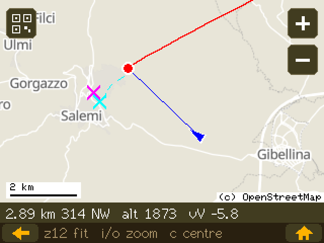
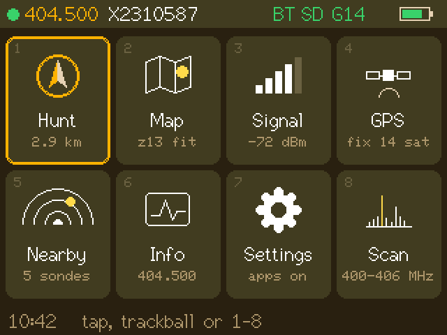

<div align="center">

<a href="README.md"></a>&nbsp;&nbsp;<a href="README.it.md"></a>

[](#)
[](https://github.com/N1k0droid/t-deck-sonde-tracker/releases)
[](LICENSE)
[](https://github.com/Xinyuan-LilyGO/T-Deck)
[](#)
[](https://platformio.org)

<br>


### Caccia alle radiosonde (Vaisala RS41, Graw DFM, Meteomodem M10/M20, InterMet iMet-54) con il solo LilyGO T-Deck Plus (433 MHz)

<table>
  <tr>
    <td align="center"><br><sub>Caccia: distanza e bussola</sub></td>
    <td align="center"><br><sub>Mappa offline e previsione di caduta</sub></td>
    <td align="center"><br><sub>Avvicinamento: signal meter</sub></td>
  </tr>
</table>

</div>

> [!WARNING]
> **Firmware in fase di test.** Funziona, ma alcune parti non sono ancora state provate sul campo: vedi [Cosa resta da provare](#cosa-resta-da-provare).

## Indice
- [Cos'è](#cosè)
- [Stato del progetto](#stato-del-progetto)
- [Cosa serve](#cosa-serve)
- [Installazione](#installazione)
- [Primo avvio](#primo-avvio)
- [Wi-Fi e pagina web, passo per passo](#wi-fi-e-pagina-web-passo-per-passo)
- [Comandi](#comandi)
- [Le pagine](#le-pagine)
- [Impostazioni](#impostazioni)
- [Mappa offline](#mappa-offline)
- [App di caccia sul telefono](#app-di-caccia-sul-telefono)
- [Internet tramite l'hotspot del telefono](#internet-tramite-lhotspot-del-telefono)
- [Interfaccia web](#interfaccia-web)
- [Server di debug](#server-di-debug)
- [Frame completi e sensore d'ozono](#frame-completi-e-sensore-dozono)
- [Tipi di sonda e preset](#tipi-di-sonda-e-preset)
- [Invio dei dati: SondeHub, radiosondy.info, aprs.fi](#invio-dei-dati-sondehub-radiosondyinfo-aprsfi)
- [SondeHub: serve aiuto](#sondehub-serve-aiuto)
- [File sulla scheda SD](#file-sulla-scheda-sd)
- [Come è stato provato](#come-è-stato-provato)
- [Cosa resta da provare](#cosa-resta-da-provare)
- [Limiti noti](#limiti-noti)
- [Glossario](#glossario)
- [Compilare dai sorgenti](#compilare-dai-sorgenti)
- [Crediti e licenza](#crediti-e-licenza)

## Cos'è
Le radiosonde sono piccoli strumenti meteo appesi a un pallone. Salgono fino a 30-35 km, poi il pallone scoppia e la sonda ricade con un paracadute. Durante tutto il volo trasmette la sua posizione nella banda 400-406 MHz, e molti radioamatori vanno a cercarla e a recuperarla: è la "caccia alla sonda".

Di solito per la caccia servono tre cose: un ricevitore, per esempio una scheda TTGO, un telefono con un'app e una mappa. **T-Deck SondeTracker fa tutto con il solo T-Deck Plus**, anche senza telefono e senza internet. Ecco cosa fa:

- con la radio interna del T-Deck riceve e decodifica le sonde **Vaisala RS41**, **Graw DFM-06/09/17**, **Meteomodem M10/M20** e **InterMet iMet-54**. Le RS41 le riceve anche **a frame interi**, e così le sente meglio quando il segnale è debole;
- legge il **sensore d'ozono** OIF411 delle sonde che lo portano;
- mostra **distanza, direzione, quota e velocità** della sonda, con una bussola che indica dove andare;
- calcola **dove atterrerà** la sonda, usando il vento misurato dalla sonda stessa;
- ha una **mappa offline** sulla scheda SD, con te, la sonda, il suo percorso e il punto di caduta;
- per gli ultimi metri ha una **pagina di avvicinamento** con un signal meter sonoro;
- se non conosci la frequenza, la **scansione continua** cerca la sonda: prima sulle frequenze dei preset, poi su tutta la banda;
- salva sulla SD il **percorso di ogni sonda** in CSV, e lo esporta in KML per Google Earth;
- se vuoi, fa da **ricevitore per le app di caccia** (MySondyGO, Hunter Tracker, TrovaLaSonda) e **legge SondeHub** tramite l'hotspot del telefono;
- se lo accendi, **invia le sonde** a radiosondy.info e **la posizione della tua stazione** a radiosondy.info e aprs.fi;
- tiene sulla SD ogni frame nel formato di SondeHub: servono a far approvare il firmware da SondeHub ([serve aiuto](docs/SONDEHUB.md)).

<p align="center">
    
</p>

## Stato del progetto
Il firmware è in **fase di test**. Sul T-Deck Plus ho provato la ricezione delle RS41, anche su voli reali, la schermata di caccia, la mappa, i temi, la lettura di SondeHub e gli invii a radiosondy.info e aprs.fi, e funzionano. La scansione e gli altri tipi di sonda li ho provati al banco. Come ho fatto le prove lo spiego in [Come è stato provato](#come-è-stato-provato). Altre funzioni sono complete ma devono ancora passare la prova sul campo: l'elenco è in [Cosa resta da provare](#cosa-resta-da-provare).

Le schermate di questa pagina riproducono quelle del T-Deck con dati di esempio, presi da una caccia simulata in Sicilia.

Segnalazioni, prove e suggerimenti sono benvenuti nella sezione **Issues** di GitHub.

## Cosa serve
- Un **LilyGO T-Deck Plus nella versione a 433 MHz**, con radio LoRa SX1262 e GPS integrato. Il T-Deck Plus si vende a 433, 868 e 915 MHz, ma solo la versione a **433 MHz** ha il circuito radio accordato vicino alla banda delle sonde, 400-406 MHz. Le versioni a 868 e 915 MHz ricevono le sonde molto peggio, o per niente.
- Il T-Deck senza "Plus" non ha il GPS: il firmware funziona lo stesso, ma senza la tua posizione.
- Una **scheda microSD** in FAT32. È consigliata, perché ci vanno i registri, i percorsi e la mappa.
- Un'**antenna** adatta ai 400-406 MHz. Per iniziare va bene quella a 433 MHz fornita con il T-Deck.
- Facoltativo: un telefono con hotspot, per internet e per le app di caccia.

## Installazione
Il file da installare si scarica dalla pagina **[Releases](https://github.com/N1k0droid/t-deck-sonde-tracker/releases)** e si chiama `t-deck-sonde-tracker-v-<versione>-beta<n>.bin`, per esempio `t-deck-sonde-tracker-v-0.95-beta4.bin`. Le versioni 0.x sono beta; dalla 1.0.0 il nome diventa `t-deck-sonde-tracker-v-<versione>.bin`. È un'immagine completa, con bootloader, partizioni e programma, e va scritta all'indirizzo 0.

### Metodo 1: con il firmware Launcher (consigliato)
Il [Launcher](https://github.com/bmorcelli/Launcher) è un firmware open source per dispositivi ESP32, T-Deck compreso, che fa da gestore di avvio. Resta sul dispositivo e permette di installare e alternare i firmware tenuti sulla scheda SD, senza PC. La caccia alle radiosonde non è un'attività di tutti i giorni: con il Launcher il T-Deck può usare un altro firmware nella vita quotidiana e passare a T-Deck SondeTracker quando c'è un lancio da seguire.

Se sul T-Deck il Launcher non c'è ancora, si installa una volta sola dalla pagina [Launcher Flasher](https://bmorcelli.github.io/Launcher/), con Chrome o Edge, seguendo le istruzioni che trovi lì.

1. Copia il file `.bin` nella cartella `downloads` della scheda SD, dove il Launcher cerca i firmware; se la cartella non c'è, creala. Quando T-Deck SondeTracker è già installato, le versioni successive puoi copiarle anche dal browser, senza togliere la scheda: vedi la pagina **Files** in [Interfaccia web](#interfaccia-web).
2. Inserisci la SD nel T-Deck e avvia il Launcher.
3. Scegli **SD**, poi il file `t-deck-sonde-tracker-v-….bin`, e conferma l'installazione.
4. Al termine il T-Deck si riavvia con T-Deck SondeTracker.

### Metodo 2: dal browser, via cavo USB
[ESP Web Tool](https://esptool.spacehuhn.com) è una pagina web open source che scrive il firmware sulle schede ESP32, senza installare niente. Il browser parla con il T-Deck via USB tramite l'API Web Serial, che funziona solo con Chrome ed Edge da computer.

Questo metodo riscrive tutta la memoria, quindi **sostituisce il Launcher** se lo hai.

1. Collega il T-Deck al PC con un cavo USB-C **che trasporti dati**: alcuni cavi servono solo a caricare.
2. Apri la pagina [esptool.spacehuhn.com](https://esptool.spacehuhn.com) con Chrome o Edge.
3. Premi **Connect** e scegli la porta del T-Deck. Se la porta non compare, tieni premuto il trackball, che fa da pulsante BOOT, premi e rilascia il tasto di reset sul lato, poi rilascia il trackball e riprova.
4. Scegli il file `.bin`, controlla che l'offset sia `0x0` e premi **Program**.
5. Al termine premi il tasto di reset.

### Metodo 3: da riga di comando (esptool)
```bash
pip install esptool
esptool --chip esp32s3 write-flash 0x0 t-deck-sonde-tracker-v-0.95-beta4.bin
```
Con le versioni vecchie di esptool il comando è `esptool.py ... write_flash ...`.

## Primo avvio
1. All'accensione compare per un attimo il logo, poi la **Home**.
2. Esci all'aperto, perché il GPS deve vedere il cielo. La prima volta può metterci qualche minuto ad agganciarsi: nella pagina **GPS** vedi arrivare i satelliti.
3. Imposta la frequenza della sonda. Nella pagina **Hunt** premi `f`, scrivi la frequenza in MHz, per esempio `404.5`, e premi Invio. Se non la conosci, avvia **Scan** dalla Home.
4. Quando il T-Deck riceve la sonda, a ogni pacchetto senti un breve "tic" e la pagina Hunt si riempie di dati.

> La frequenza delle sonde lanciate vicino a te la trovi su [SondeHub](https://tracker.sondehub.org). Se hai internet, la trovi anche sul T-Deck, nella pagina **Nearby**.

## Wi-Fi e pagina web, passo per passo
Il Wi-Fi serve a due cose: a collegarsi a internet, per le sonde vicine, l'ora esatta e gli invii, e a usare il T-Deck dal browser. Il T-Deck vede solo le reti a **2,4 GHz**, non quelle a 5 GHz. La rete più comoda è l'hotspot del telefono.

1. Accendi l'hotspot sul telefono. Su iPhone attiva anche **Massimizza compatibilità**, così l'hotspot usa i 2,4 GHz.
2. Sul T-Deck apri **Settings**, scheda **Network**, e premi **Scan networks**. Dopo qualche secondo compare l'elenco delle reti.
3. Scegli la tua rete. Se è protetta si apre un riquadro: scrivi la password, che resta visibile mentre scrivi, e premi Invio.
4. Per ritrovarla la prossima volta apri **Saved networks** e premi la prima riga, **+ save this network**.
5. Per avere internet accendi **Internet via Wi-Fi**, nella stessa scheda. Per la pagina web vai invece nella scheda **System** e accendi **Web interface**.
6. Dopo qualche secondo, sulla riga **Web interface** compare l'indirizzo del T-Deck: quattro numeri separati da punti.
7. Collega il telefono o il PC alla stessa rete, apri il browser e scrivi `http://` seguito da quell'indirizzo, cioè `http://<ip>/`.
8. Il browser chiede utente e password: l'utente è `tdeck`, la password `radiosonde`. La password si cambia con la voce **Web password**.

Cosa si può fare dalla pagina lo spiego in [Interfaccia web](#interfaccia-web).

## Comandi
Il T-Deck si usa con **tastiera**, **trackball** e **schermo touch**, e ogni funzione si raggiunge in tutti e tre i modi.

- **Home:** tocca un pulsante, oppure portaci sopra il trackball e premilo, oppure premi il suo numero.
- **In basso in ogni pagina** ci sono ◀ **Indietro** a sinistra e ⌂ **Home** a destra. Da tastiera, Indietro è Backspace (o Esc) e Home è `h`.
- **`v`** passa velocemente tra le tre pagine di caccia, Hunt, Map e Signal; **`m`** apre la mappa.
- **Trackball:** nelle liste sposta la selezione e sulla mappa sposta la vista; sulla mappa un clic cambia il centro, come `c`. In Hunt, Signal e Info, su e giù cambiano la frequenza di ±1 kHz. **Tenuto premuto per 3 secondi** blocca o sblocca lo schermo.
- **`Alt`+`D`** cancella, dopo una conferma, la voce selezionata negli elenchi dei preset e delle reti salvate.
- **Domande Sì/No:** `y` risponde sì, `n` o Indietro risponde no. Invio sceglie il pulsante evidenziato, che all'inizio è No.
- **Frequenza in alto a sinistra:** un tocco apre la scrittura di una nuova frequenza, come `f`. Nella pagina Map non vale.
- **Mentre scrivi un testo** annulli con Esc, con Backspace a campo vuoto o con un tocco sullo schermo.

### Tasti
| Tasto | Funzione |
|---|---|
| `h` / Backspace | Home / indietro |
| `m` | mappa |
| `v` | pagina di caccia successiva: Hunt, Map, Signal |
| `f` | nuova frequenza: cifre, poi Invio |
| `w` o `+` / `q` o `-` | frequenza +1 / −1 kHz |
| `e` / `d` | frequenza +10 / −10 kHz |
| `p` | preset successivo dello stesso paese |
| `a` | salva frequenza e tipo di sonda attuali come nuovo preset: scrivi il nome e conferma con `y` |
| `j` | cerca nei preset: scrivi un nome, per esempio `trapani`, e premi Invio |
| `y` | tipo di sonda: auto / RS41 / DFM / M10/M20 / iMet54. Nelle domande vuol dire sì |
| `x` | avvia la scansione; un altro `x` la ferma |
| `n` | la bussola punta alla sonda oppure al punto di caduta previsto |
| `t` | bersaglio manuale: scrivi latitudine e longitudine, per esempio `38.0176 12.5365` |
| `s` | toglie tutti i suoni; premuto di nuovo, torna ai volumi di prima |
| `k` | esporta il percorso della sonda in KML, per Google Earth |
| `i` / `o` | mappa: zoom avanti / indietro |
| `c` | mappa: centra su entrambi, su di te, sulla sonda |
| `g` | mappa: codice QR con la posizione della sonda, da inquadrare con il telefono |
| `u` | polarità del segnale: automatica / normale / invertita. Di solito va lasciata automatica |
| `r` | azzera contatori, posizione ricevuta e previsione del T-Deck; il bersaglio scritto con `t` resta |
| `l` | registro dei dati grezzi acceso/spento |
| `Alt`+`B` | luce della tastiera accesa/spenta |
| trackball premuto 3 s | blocca / sblocca tasti, trackball e touch, con un lucchetto nella barra in alto. Radio, allarmi e invii continuano. Dopo il riavvio è sempre sbloccato |

## Le pagine

### Home
Ha otto pulsanti: **Hunt**, **Map**, **Signal**, **GPS**, **Nearby**, **Info**, **Settings** e **Scan**. Sotto ogni nome una riga breve dice come sta quella pagina, per esempio la distanza dalla sonda, lo zoom della mappa, il segnale in dBm, il fix del GPS o quante sonde ha trovato SondeHub.

### Hunt (caccia)


È la pagina principale durante la caccia. Dall'alto in basso mostra:
- la barra di stato, con la spia dei pacchetti, la frequenza, il seriale della sonda, i satelliti del tuo GPS e la batteria. Altre sigle compaiono quando serve: `WEB` con l'interfaccia web accesa, `DBG` con le pagine di debug accese e un lucchetto quando lo schermo è bloccato. `SH`, `RS` e `FI` diventano rossi quando è acceso l'invio a SondeHub, radiosondy.info o aprs.fi; se ne sono accesi più di uno, sono piccoli e uno sopra l'altro. `BT` riguarda le app, `SD` la scheda;
- la **distanza** dalla sonda, in grande, e la **bussola**;
- quota, velocità verticale e velocità orizzontale della sonda;
- in fondo i messaggi, il punto di caduta previsto e i suggerimenti.

**Come leggere la bussola.** Il T-Deck non ha una bussola magnetica: ricava la direzione dal GPS mentre ti muovi.
- **AHEAD** (verde) vuol dire che stai camminando o guidando. Il triangolo in alto è la tua direzione, la freccia è la sonda, e le lettere N E S W ruotano per mostrare i veri punti cardinali. Segui la freccia.
- **N UP** (gialla) vuol dire che sei fermo. La freccia è riferita al nord, quindi tieni il lato alto dello schermo rivolto verso nord.

In discesa la riga in basso mostra il punto di caduta previsto e il tempo all'atterraggio: `LAND` per la previsione del T-Deck, `SH LAND` per quella di SondeHub. Si alterna con la quota sotto la quale il segnale si perderà dietro l'orizzonte ("signal lost below ~… m"). Con internet il T-Deck mostra la previsione di SondeHub finché alla sua mancano i venti sotto la sonda; sotto i 2500 m dal suolo passa alla sua.
<br clear="right">

### Map (mappa)


Mostra te in blu, la sonda in rosso, il suo percorso, la linea tra voi due e il punto di caduta previsto. La croce magenta è la previsione del T-Deck; quella azzurra, con il suo percorso tratteggiato, è la previsione di SondeHub, che c'è solo con internet.
- Lo zoom si cambia con `i` e `o` o toccando `+` e `−`.
- `c` centra la vista e il trackball la sposta.
- Il tasto **QR** in alto a sinistra, o `g`, mostra un codice QR. Inquadralo con il telefono e si apre la navigazione verso la sonda o verso il punto di caduta.

Le tessere della mappa vanno preparate e copiate sulla SD, come spiego in [Mappa offline](#mappa-offline). Senza la cartella `/maps` la pagina mostra solo come prepararla. Dove manca una singola tessera, il fondo è grigio.
<br clear="right">

### Signal (avvicinamento)
Serve per gli ultimi metri, quando il GPS non basta più. Una barra mostra il segnale in tempo reale con il picco degli ultimi secondi, e il **signal meter** sonoro diventa più acuto e più veloce man mano che il segnale cresce. Se giri su te stesso, il segnale è più forte nella direzione della sonda.

### GPS
Mostra lo stato del GPS: fix 2D o 3D oppure ricerca in corso, i satelliti con la forza del segnale di ognuno, HDOP e PDOP (più sono bassi, più la posizione è precisa) e il tempo del primo fix. Poi posizione, quota, velocità, ora locale o UTC e stato dell'aiuto al GPS. Per farlo agganciare prima, il T-Deck comunica al GPS l'ora e una posizione approssimata, prese da internet o dalla sonda.

### Nearby (sonde vicine, serve internet)


Ha quattro schede, che scegli toccandole o con i tasti 1-4:
- **Near** elenca le sonde in volo nelle ultime 3 ore entro 300 km. Quelle in discesa sono in arancione, quella che segui è in verde. Un tocco su una sonda la segue: diventa il bersaglio e la radio si sintonizza da sola. Un tocco sulla sonda seguita smette di seguirla.
- **Landed** elenca i voli atterrati entro 400 km nelle ultime 3 ore, 12 ore, 24 ore o 7 giorni, con il punto di atterraggio. Dai dettagli di un volo puoi rendere quel punto il tuo bersaglio.
- **Launches** elenca i lanci programmati dalle stazioni vicine, con l'atterraggio previsto. Guarda avanti quanto dice la voce **Launch predictions**, 24 ore di default, e calcola i lanci quando apri la scheda.
- **Search** cerca una sonda per seriale, per esempio `X1422184`.
<br clear="right">

### Scan (scansione)
Cerca finché trova una sonda o finché la fermi con `x`, Indietro o un tocco. Prima prova le frequenze dei preset, poi tutta la banda 400-406 MHz, giro dopo giro, e intanto ascolta i canali più forti. Il grafico mostra la spazzata in corso sopra il livello più alto visto finora, in tenue, insieme alla soglia del rumore. Un canale già provato senza trovare una sonda viene lasciato stare per 10 minuti e ha un segno grigio. Quando decodifica una sonda, il T-Deck suona e chiede se tenerla e passare alla pagina Hunt; con No la ricerca continua. Quando fermi la scansione, il T-Deck torna alla frequenza di prima.

### Info
Mostra i dati tecnici della ricezione e della sonda: qualità della decodifica, correzioni, frame ricevuti interi, batteria e temperatura della sonda, kill timer, statistiche e valori del sensore d'ozono.

### Settings (impostazioni)
Le impostazioni sono descritte nella sezione seguente.

## Impostazioni


Le schede sono quattro: **Radio**, **Network**, **Display** e **System**. Si passa da una all'altra con il trackball a sinistra e a destra, con la barra spaziatrice o toccando il nome della scheda. Dentro una scheda scegli una voce con il trackball o con il touch, e la cambi premendola. Nelle schede con al massimo dieci voci puoi sceglierle anche con le cifre 1-9 e 0; la scheda Network ne ha di più, quindi lì le cifre non funzionano.

I campi di testo si confermano con Invio:
- Invio senza scrivere niente tiene il valore che c'era;
- un solo `-` lo cancella;
- password, passcode e token restano visibili mentre li scrivi.

Nella colonna dei valori "set" vuol dire che la voce non è ancora impostata, "change" che lo è già.
<br clear="right">

| Scheda | N. | Voce | Predefinito | A cosa serve |
|---|---|---|---|---|
| Radio | 1 | Sonde type | auto | auto prova tutti i tipi; le altre scelte sono RS41, DFM, M10/M20 e iMet54. Vedi sotto |
| | 2 | Frequency preset | — | apre l'elenco dei preset di `presets.txt` |
| | 3 | Receiver bandwidth | 14.6 kHz | larghezza del filtro di ricezione, da 9,7 a 39 kHz. Meglio lasciare 14,6: più larga fa entrare più rumore, e a 19,5 kHz le RS41 deboli si perdono. M10/M20 usano sempre almeno 23,4. È in arancione quando non vale 14,6. Le app di caccia non possono cambiarla |
| | 4 | Full frames | on | riceve i frame interi da 320/518 byte (vedi sotto). Spento, riceve 255 byte e usa la correzione d'errore |
| | 5 | Raw frame log | on | salva sulla SD i dati grezzi ricevuti |
| Network | 1 | Scan networks | — | elenca le reti Wi-Fi vicine, solo quando la premi. La rete scelta prende il posto del nome della rete; se è protetta, un riquadro chiede la password |
| | 2 | Saved networks | — | la prima riga, "+ save this network", salva nome e password della rete impostata, dopo un Sì/No. Sotto ci sono le reti salvate: quella scelta prende il posto di nome e password della rete, anche dopo il riavvio. Alt+D ne cancella una dall'elenco. Le reti stanno in `wifi.txt` (vedi sotto) |
| | 3 | Wi-Fi name | — | nome della rete Wi-Fi, per esempio l'hotspot del telefono |
| | 4 | Wi-Fi password | set | password della rete, salvata nel dispositivo senza cifratura |
| | 5 | Internet via Wi-Fi | off | usa internet tramite la rete Wi-Fi impostata sopra. Dice "online" solo mentre un server risponde davvero e "no internet" quando non risponde nessuno; dopo 3 minuti in questo stato il T-Deck si ricollega da solo |
| | 6 | Wi-Fi power save | off | fa dormire il Wi-Fi tra un segnale del router e l'altro. Consuma meno, ma con alcuni router il collegamento smette di funzionare |
| | 7 | Launch predictions | 24 h | fin dove la scheda Launches cerca i lanci: 12 h, 24 h, 3, 5 o 7 giorni |
| | 8 | Hunting apps | off | collegamento alle app: spento, Bluetooth, Bluetooth + Wi-Fi |
| | 9 | Callsign | — | il tuo nominativo, lo stesso per tutti gli invii. Viene salvato in maiuscolo, per esempio `IT9ABC-9` |
| | 10 | APRS passcode | set | passcode APRS-IS del tuo nominativo, serve per radiosondy.info e aprs.fi. È un numero calcolato dal nominativo: lo dà un calcolatore di passcode APRS (online ce ne sono molti) o il servizio APRS. Serve un nominativo di radioamatore |
| | 11 | SondeHub upload | awaiting approval | **sospeso**: SondeHub non ha ancora approvato questo firmware, quindi la voce non si accende. Premendola si legge come aiutare ([SondeHub](docs/SONDEHUB.md)) |
| | 12 | SondeHub JSON log | on | tiene ogni frame ricevuto, nel formato di SondeHub, in `sondehub/<seriale>.json` sulla SD, circa 2 MB per ora di ricezione. Sono i file da mandarmi per l'approvazione ([come](docs/SONDEHUB.md)) |
| | 13 | radiosondy.info upload | off | invia a radiosondy.info le sonde ricevute come oggetti APRS, uno per sonda ogni 30 s. Accenderlo chiede conferma |
| | 14 | aprs.fi upload | off | invia ad aprs.fi la posizione della tua stazione, con l'icona scelta sotto, sulla rete APRS-IS principale (server europei). Accenderlo chiede conferma. Va solo la stazione: le sonde vanno a radiosondy.info |
| | 15 | aprs.fi comment | on | aggiunge un commento adatto alla situazione: a caccia di una sonda (mobile), in ricezione (fissa) o in cerca di sonde. I testi sono in `aprsfi.txt` (vedi sotto) |
| | 16 | Only sondes in flight | on | invia solo le sonde viste in volo; spento, invia anche una sonda a terra |
| | 17 | Send my position | off | dove va la posizione della tua stazione: off, all (radiosondy.info e aprs.fi), solo radiosondy, solo aprs.fi. La scelta SondeHub resta grigia finché SondeHub non approva il firmware. aprs.fi riceve solo questa posizione, quindi il suo invio richiede all o aprs.fi. Con all la tua posizione finisce anche nei file JSON per SondeHub |
| | 18 | Station | mobile | mobile compare come auto inseguitrice, fixed come ricevitore. Su radiosondy.info e aprs.fi la stazione fissa ha sempre l'icona della parabola `` /` ``, perché radiosondy.info elenca così i ricevitori. La stazione mobile invia anche velocità, direzione e quota |
| | 19 | Mobile icon | person | icona della stazione mobile su radiosondy.info e aprs.fi: persona `/[`, auto `/>` oppure `/(`, usata da altri ricevitori di radiosonde |
| | 20 | Mobile update | 60 s | ogni quanto parte la posizione della stazione mobile: 30 s, 60 s, 2, 5, 10 o 15 min. Su aprs.fi al massimo una volta al minuto |
| | 21 | Fixed update | 30 min | ogni quanto parte la posizione della stazione fissa: 10, 30 o 60 min |
| | 22 | GPS fix wait | 1 min | la tua posizione si condivide solo dopo che il GPS ha tenuto un fix buono (3D, almeno 5 satelliti, HDOP fino a 3) per questo tempo senza interruzioni: 30 s, 1, 2 o 5 min. I primi fix dopo l'accensione possono essere lontani dal vero |
| | 23 | Min distance | off | per la stazione mobile: nessuna nuova posizione finché non si è spostata almeno di tanto dall'ultima inviata. Scelte: off, 200 m, 500 m, 1 km. Un nuovo commento o una nuova icona partono comunque |
| Display | 1 | Screen brightness | 100% | luminosità dello schermo: 100%, 75%, 50%, 25%, 12% per la notte |
| | 2 | Screen timeout | 5 min | dopo quanto tempo senza usare i tasti lo schermo si spegne o si attenua: sempre acceso, 1, 5 o 10 min |
| | 3 | Screen dimming | screen off | cosa succede allo scadere del tempo: screen off spegne lo schermo; light, medium e strong lo lasciano acceso ma attenuato, strong il più scuro |
| | 4 | Theme | Desert | colori: Desert, Olive, Navy e Sun, ad alto contrasto per il sole |
| | 5 | Keyboard light | Alt+B | ricorda la combinazione per la luce della tastiera |
| | 6 | Touch screen | on | accende o spegne il touch |
| | 7 | Auto lock | off | blocca tasti e touch dopo un tempo senza usarli: off, 1, 2 o 5 min. Si sblocca tenendo premuto il trackball per 3 s |
| | 8 | Trackball speed | fast | quanto deve girare la pallina per fare un passo: fast, medium, slow |
| System | 1 | Volume | 7 | volume di allarmi, segnale di avvicinamento e conferme, da 0 (muto) a 9 |
| | 2 | Frame volume | 7 | volume del suono di ogni frame ricevuto, in qualsiasi pagina, da 0 (muto) a 9 |
| | 3 | Frame sound | soft tick | suono di ogni frame: un tic leggero, oppure un bip tanto più acuto quanto più il segnale è forte |
| | 4 | Time zone | UTC+1 | fuso orario in ora solare, da UTC-12 a UTC+14, scelto da un elenco con alcune città per ogni fuso |
| | 5 | Daylight saving | auto | ora legale: off, on (+1 ora), auto con le date europee, cioè l'ultima domenica di marzo e quella di ottobre |
| | 6 | Web interface | off | usa il T-Deck dal browser del telefono o del PC (vedi sotto). Accesa, mostra l'indirizzo da aprire |
| | 7 | Debug server | off | pagine di controllo remoto per le prove e per segnalare problemi (vedi sotto). Acceso, mostra "on, /debug" |
| | 8 | Web password | default | password dell'interfaccia web e delle pagine di debug; la predefinita è `radiosonde`, con utente `tdeck`. Scrivine una nuova, oppure `-` per tornare alla predefinita |
| | 9 | About | — | versione, autore e link al progetto |

**Timeout dello schermo.** Con lo schermo spento o attenuato il T-Deck continua a ricevere, a registrare e a **suonare**. Il primo tasto o tocco riporta solo lo schermo alla luminosità normale, senza fare altro, e gli allarmi lo riaccendono da soli. Light, medium e strong riducono la luminosità scelta a metà, a un quarto e a un ottavo.

<p align="center">
  <br>
  <i>I quattro temi: Desert, Olive, Navy, Sun</i>
</p>

## Mappa offline
Il T-Deck legge la mappa dalla scheda SD, divisa in tessere PNG da 256 pixel nella cartella `/maps/<zoom>/<x>/<y>.png`. I server pubblici di OpenStreetMap non permettono di scaricare le tessere in massa, perciò il progetto include uno script che le **disegna sul tuo PC** partendo dai dati OpenStreetMap. Lo script è nella cartella `tools/mappack` di questo repository: per scaricare tutto usa il pulsante **Code** in alto in questa pagina, poi **Download ZIP**.

Dove una tessera manca, il T-Deck ingrandisce quella del livello inferiore. Conviene quindi una mappa "a strati", con poco dettaglio ovunque e molto dettaglio solo dove vai a caccia.

### Cosa serve
- **Docker** avviato (Docker Desktop su Windows o Mac);
- **Python 3** e, consigliato, Pillow (`pip install pillow`);
- circa 10 GB liberi durante la preparazione, per una nazione come l'Italia.

### Passi
1. Copia `tools/mappack/sicilia.json` con un nuovo nome e adattalo alla tua zona:
   - in `sources` metti il nome dell'estratto [Geofabrik](https://download.geofabrik.de) della tua nazione, per esempio `italy`, `germany` o `france`;
   - in `layers` metti, per ogni strato, il riquadro `[sud, ovest, nord, est]` in gradi e gli zoom. Per esempio: mondo 0-2, continente 3-7, nazione 8-11, la tua regione 12-14.
2. Controlla quante tessere verranno create:
   ```bash
   python tools/mappack/make_maps.py tools/mappack/mia_zona.json --dry-run
   ```
3. Genera la mappa. La prima volta scarica i dati e può metterci da qualche minuto a un paio d'ore:
   ```bash
   python tools/mappack/make_maps.py tools/mappack/mia_zona.json
   ```
4. Copia la cartella generata, `mapwork/maps`, nella radice della SD con il nome `maps`: devono esserci `/maps/0`, `/maps/1` e così via. Poi riavvia il T-Deck.

Per avere un'idea delle dimensioni: l'esempio della Sicilia (mondo, Europa, Italia e Sicilia fino allo zoom 14) produce circa 30.000 tessere e 130 MB.

| Zoom | Larghezza dello schermo | Uso |
|---|---|---|
| 0-2 | mondo | sfondo |
| 3-7 | da 4.000 a 300 km | continente, nazione |
| 8-11 | da 150 a 19 km | regione, viaggio |
| 12-14 | da 10 a 2,4 km | strade, sterrati, ultimo tratto |

I dati della mappa sono © OpenStreetMap contributors (ODbL).

## App di caccia sul telefono
Il T-Deck può fare da ricevitore per le app che usi già, senza modificarle. Il collegamento si sceglie con la voce **Hunting apps** della scheda Network:
- **Bluetooth:** il T-Deck compare come `MySondyGO-XXXX` e parla il protocollo MySondy GO 4.1. Funziona con **MySondyGO**, **Hunter Tracker** (come ricevitore MySondy) e **TrovaLaSonda**: cercalo nell'app tra i dispositivi Bluetooth. Dall'app si può cambiare la frequenza.
- **BT + Wi-Fi:** in più, sulla rete Wi-Fi impostata nella scheda Network, il T-Deck si comporta come un ricevitore **TTGO rdz**, con `http://<ip>/live.json` e la porta TCP 14570, per le app che lo supportano.

In alto compare `BT`: grigio mentre aspetta, verde quando un'app è collegata.

> Il collegamento con le app non invia nulla a internet, ma **le app possono inviare i dati a SondeHub per conto loro**: controlla le impostazioni dell'app.

## Internet tramite l'hotspot del telefono
Con **Internet via Wi-Fi** accesa (scheda Network) e il T-Deck collegato all'hotspot del telefono hai in più:
- l'ora esatta da internet e un aggancio del GPS più rapido;
- la pagina **Nearby**, con le sonde vicine, gli atterraggi e i prossimi lanci;
- la posizione della sonda presa da SondeHub quando la radio non la sente, nella scheda "SONDE (NET)";
- la previsione di atterraggio di SondeHub sulla mappa, che resta salvata anche se internet cade.

SondeHub chiede di non interrogare di continuo le sue API, quindi il T-Deck limita le richieste. Le sonde vicine le legge ogni 5 minuti, e ogni minuto solo quando l'elenco Near è aperto, sul T-Deck o nella pagina web, o quando segui una sonda che la radio non sente. La previsione della sonda seguita la chiede ogni 3 minuti. Se la sonda seguita resta ferma per 10 minuti, perché è atterrata o non la sente più nessuno, si torna a ogni 5 minuti e la sua previsione non viene più chiesta.

Qui il T-Deck **legge soltanto**: invia dati a SondeHub, radiosondy.info o aprs.fi solo se accendi il loro invio (vedi [Invio dei dati](#invio-dei-dati-sondehub-radiosondyinfo-aprsfi)). Per chiedere le sonde vicine comunica la tua posizione arrotondata a circa 10 km. Senza internet tutto il resto funziona normalmente.

## Interfaccia web
Con la voce **Web interface** (scheda System, spenta di default) usi il T-Deck dal browser di un telefono o di un PC collegato alla stessa rete Wi-Fi. L'ho pensata per usare il T-Deck come stazione remota: tutto quello che fai con i tasti e con lo schermo lo puoi fare anche dalla pagina.

Basta aprire `http://<ip>/`, con l'indirizzo che trovi nelle impostazioni. L'utente è `tdeck` e la password è `radiosonde`, se non l'hai cambiata con la voce **Web password**. Per accenderla la prima volta segui [Wi-Fi e pagina web, passo per passo](#wi-fi-e-pagina-web-passo-per-passo).

L'interfaccia ha nove pagine.

- **Hunt.** Mostra i dati della sonda: seriale, quota, velocità verticale e orizzontale, satelliti, batteria, temperatura, kill timer e ozono. Poi la distanza, la direzione e l'elevazione rispetto a te, e la bussola, che mentre ti muovi gira secondo la tua direzione come **AHEAD** sul T-Deck. Ci sono anche il segnale, i frame decodificati, l'età dell'ultimo frame, la previsione di atterraggio con il pulsante **Navigate** per Google Maps e la quota sotto la quale si perderà il segnale. **To sonde** e **To landing** scelgono dove puntano distanza e freccia, come il tasto `n`; **Target** scrive un punto, come il tasto `t`. **KML** crea il file del percorso e lo scarica. **Reset** azzera i contatori, la posizione ricevuta e la previsione, ma lascia il bersaglio che hai scritto. **Sound off** zittisce il T-Deck. La pagina si aggiorna ogni 2 secondi.
- **Map.** Mostra te, la sonda, il suo percorso e le previsioni di atterraggio su una mappa OpenStreetMap. La mappa la scarica da internet il telefono o il PC: il T-Deck manda solo i punti, e le mappe offline della SD si vedono solo sul suo schermo. I pulsanti funzionano come il tasto `c` del T-Deck: **Both** tiene tutto in vista, cioè te, la sonda, il percorso e le previsioni, mentre **Me** e **Sonde** tengono quel punto al centro. Con **follow** spuntato la mappa continua a farlo, finché non la trascini. Un clic sulla sonda apre i suoi link su **SondeHub** e **radiosondy.info** e il pulsante **Navigate**. La linea tratteggiata è il percorso che SondeHub prevede per la sonda seguita.
- **Radio.** Qui cambi la frequenza, scrivendola o a passi di 1 e 10 kHz, e scegli tipo di sonda, polarità e banda del ricevitore; vedi anche il livello del rumore. Puoi avviare e fermare la scansione e guardare dal vivo lo spettro 400-406 MHz con i canali trovati. C'è l'elenco dei preset con la ricerca e i pulsanti **Auto (no preset)**, **Next**, **Save current**, che salva con un nome la frequenza in uso, e **Add European sites**. Il cestino accanto a ogni preset lo cancella.
- **SondeHub.** Ha gli stessi quattro elenchi della pagina **Nearby** del T-Deck: **Near**, **Landed** (ultime 3 h, 12 h, 24 h o 7 giorni), **Launches**, cioè i prossimi lanci dei siti vicini con l'atterraggio previsto, e **Search** per seriale. Un clic su una sonda apre un riquadro con **Follow and tune**, che la segue e si sintonizza, oppure **Stop following**, più il link a SondeHub e **Navigate**. Dai dettagli puoi rendere l'atterraggio il tuo bersaglio. Serve **Internet via Wi-Fi** acceso.
- **Signal.** È la pagina per gli ultimi metri. Due volte al secondo mostra il segnale e il suo picco degli ultimi 4 secondi, insieme all'ultimo frame e alla distanza. Con **Tone** il browser suona un tono che segue il segnale.
- **GPS.** Mostra fix, satelliti usati, HDOP e PDOP, il segnale di ogni satellite in vista, posizione, quota, velocità e rotta, ora e aiuto al GPS.
- **Info.** Riporta le righe della pagina Info del T-Deck: radio, contatori, ultimo frame, stato della sonda e SondeHub.
- **Settings.** Ha tutte le voci delle quattro schede, con gli stessi valori e le stesse scelte del T-Deck. Quando accendi un invio, la domanda "Are you sure?" compare sia sul T-Deck sia nel browser. La voce **SondeHub upload** spiega come aiutare ad avere l'approvazione. Se il T-Deck ha un messaggio da darti, per esempio perché una voce non cambia, lo vedi in fondo alla pagina. In **Saved networks** ogni rete ha un cestino, e **Scan networks** chiede la password della rete che scegli.
- **Files.** Mostra i file e le cartelle della scheda SD, ognuno con i pulsanti per **scaricarlo**, **rinominarlo** ed **eliminarlo**. Prima di eliminare chiede conferma, e l'eliminazione non si può annullare; una cartella si elimina solo se è vuota. Con **Upload files**, o trascinando i file sulla pagina, li copi dal telefono o dal PC nella cartella aperta della scheda. Per esempio, se usi il Launcher, puoi mettere un firmware nuovo `.bin` in `/downloads` e poi installarlo dal Launcher, senza togliere la scheda. Mentre un file si copia, in un senso o nell'altro, il T-Deck non riceve: meglio farlo dopo la caccia.

In alto c'è un lucchetto che blocca e sblocca i tasti del T-Deck; la pagina continua a funzionare anche con i tasti bloccati. Il menu ha **About** e **Restart the T-Deck**. Quello che cambi dal browser cambia anche sul T-Deck, e viceversa.

La pagina usa i colori del tema scelto sul T-Deck, con la voce Theme della scheda Display. Riempie sempre la finestra, dal telefono al monitor grande, senza scorrere. Scorrono solo gli elenchi lunghi, dentro il loro riquadro: i preset, i file e, sul telefono in orizzontale, le impostazioni.

La password è solo un lucchetto contro un'occhiata veloce su una rete condivisa, non una vera protezione. Usa l'interfaccia web solo su reti tue, per esempio l'hotspot del telefono.

## Server di debug
La voce **Debug server** (scheda System, spenta di default) accende le pagine per le prove e per segnalare problemi, all'indirizzo `http://<ip>/debug`. Usano lo stesso utente, la stessa password e gli stessi colori dell'interfaccia web. I pulsanti sono:
- **Screen:** lo schermo del T-Deck, che puoi cliccare come il touch, con le frecce, Invio, Indietro, Home e i tasti più usati;
- **Status** e **Log:** lo stato del T-Deck e i suoi ultimi messaggi, utili per segnalare problemi.

File e riavvio stanno nell'interfaccia web.

Le pagine chiedono una **password**, che è `radiosonde` finché non la cambi con la voce **Web password**. Il nome utente è sempre `tdeck`. È solo un lucchetto contro un'occhiata veloce su una rete condivisa, non una vera protezione: accendi queste pagine solo quando servono, e solo su reti tue, per esempio l'hotspot del telefono. I dati `/live.json` per le app di caccia (Hunting apps: BT + Wi-Fi) non chiedono password.

## Frame completi e sensore d'ozono
Di solito la radio SX1262 del T-Deck chiude un pacchetto a 255 byte, mentre un frame RS41 è lungo 320 byte, o 518 con i dati dei sensori aggiuntivi. Con **Full frames** (scheda Radio, accesa di default) il T-Deck usa il metodo per i pacchetti lunghi descritto da Semtech nella nota applicativa AN1200.53: mentre il frame arriva, sposta in avanti la fine del pacchetto, e così **il frame arriva intero**.

- **Ricezione migliore con il segnale debole e disturbato.** Con il frame intero la correzione d'errore ripara fino a 12 byte sbagliati per metà frame, contro i 3 di quando arrivano solo 255 byte. Al banco, con una sonda simulata e molto rumore, il T-Deck ha decodificato **il 97% dei frame con Full frames, contro il 26%** senza. Con un segnale buono i due metodi si equivalgono.
- **Sonde con il sensore d'ozono** (Vaisala OIF411, frame estesi da 518 byte). La pagina **Info** mostra la pressione parziale dell'ozono in mPa, la corrente della cella e la temperatura della pompa; la pagina di caccia mostra "O3" accanto ai dati della sonda; il file CSV ha la colonna `o3_mpa`. Il valore in mPa è una **stima**, perché usa la portata nominale della pompa e non il foglio di calibrazione del singolo sensore.
- Se un frame viene notato troppo tardi per allungarlo, per esempio mentre la mappa carica molte tessere, per quel frame il T-Deck usa il metodo a 255 byte. Rispetto a prima non si perde niente.
- Mentre riceve un frame il T-Deck non fa altro, per non disturbare la radio. Con un frame al secondo, lo schermo può quindi reagire un po' più lentamente.

## Tipi di sonda e preset
**Tipi di sonda.** Oltre alla Vaisala RS41 il T-Deck decodifica questi tipi:

| Tipo | Modelli | Cosa si legge |
|---|---|---|
| DFM | Graw DFM-06, DFM-09, DFM-17 | posizione, velocità, ora, numero di serie, modello, batteria (DFM-09/17) |
| M10/M20 | Meteomodem M10, M10+, M20 | posizione, velocità, ora, numero di serie, modello, batteria, satelliti (M10) |
| iMet54 | InterMet iMet-54, iMet-50 | posizione, ora del giorno, numero di serie, modello; velocità calcolate dalle posizioni |

Il tipo si sceglie con la voce **Sonde type** della scheda Radio, o con il tasto `y`:
- **auto** (predefinito): il ricevitore prova a turno tutti i tipi, con tutte e due le polarità, finché non decodifica un frame. Poi resta su quel tipo finché il segnale non si perde. Se il preset in uso indica un tipo, usa subito quello;
- **RS41**, **DFM**, **M10/M20** o **iMet54**: solo quel tipo. È il modo più rapido quando sai già cosa volerà.

Quando segui una sonda dalla pagina Nearby, il tipo lo prende da SondeHub. Il numero di serie delle DFM arriva solo ogni qualche frame, quindi per i primi 20-30 secondi la sonda compare come "DFM".

**Preset.** Le frequenze stanno nel file **`presets.txt`** sulla scheda SD. Il T-Deck lo crea la prima volta, con le istruzioni dentro e circa **90 preset di siti di lancio europei** già pronti, divisi per paese. Alcuni siti hanno più frequenze, e c'è anche Tunisi. Frequenza e tipo sono quelli delle sonde sentite su SondeHub a novembre 2026. Il T-Deck legge i preset sempre da questo file e lo modifica solo quando glielo chiedi (tasto `a`, Alt+D, "+ add the European launch sites"), senza perdere le tue modifiche: se un sito cambia frequenza, basta correggere la sua riga. Ogni riga è un preset:

```
[Sicily]
404.500  RS41  Trapani Birgi
402.000  DFM   Tunis (DFM-17)
[France]
403.000  M10   Trappes
[Saved]
405.100  AUTO
```

- Ogni riga ha la frequenza in MHz, il tipo (`AUTO`, `RS41`, `DFM`, `M10`, `M20` o `iMet54`) e un nome facoltativo. `[Nome]` apre un gruppo, per esempio un paese o una regione, e `#` inizia un commento. I preset possono essere fino a 200, e puoi aggiungere i tuoi.
- La voce **Frequency preset** della scheda Radio, o il tasto `j` da qualsiasi pagina, apre l'elenco. Scrivi parte di un nome, di un paese o una frequenza (`trapani`, `germany`, `404.5`) e restano solo le righe che corrispondono. Con il trackball a sinistra e a destra salti da un paese all'altro. Scegli con Invio, con il trackball o con un tocco, e il T-Deck si sintonizza.
- Il preset scelto resta in uso, anche dopo il riavvio, finché non scegli **auto**, la prima riga dell'elenco. Da quel momento non c'è nessun preset e il ricevitore trova da solo il tipo di sonda.
- Il tasto `p` passa al preset successivo dello stesso paese. Il tasto `a` salva frequenza e tipo attuali sotto `[Saved]`, con il nome che scrivi; un nome già usato diventa "nome 2", "nome 3" e così via, e il preset in uso non viene mai modificato. Nell'elenco, con la ricerca vuota, Alt+D cancella il preset selezionato dopo una conferma.
- L'ultima riga dell'elenco, **"+ add the European launch sites"**, aggiunge i siti a un file che esiste già, senza doppioni: un sito di cui hai corretto la frequenza non viene aggiunto di nuovo.
- Puoi anche modificare il file sul PC: togli la SD, cambia il file e rimetti la scheda.

## Invio dei dati: SondeHub, radiosondy.info, aprs.fi
Ogni invio è **spento di default**, e quando lo accendi il T-Deck chiede "Are you sure?" con **No** già selezionato. Gli invii hanno bisogno del Wi-Fi (scheda Network) e del tuo **Callsign**; radiosondy.info e aprs.fi vogliono anche l'**APRS passcode** del nominativo.

| Servizio | Cosa riceve | Voci (scheda Network) |
|---|---|---|
| radiosondy.info | le sonde ricevute, con un oggetto APRS per sonda ogni 30 s, e la tua stazione | radiosondy.info upload |
| aprs.fi | solo la tua stazione, con un commento adatto alla situazione (`aprsfi.txt`) | aprs.fi upload, aprs.fi comment |
| SondeHub | **sospeso**: prima di approvare un programma nuovo, SondeHub chiede voli interi di ogni tipo di sonda. Intanto i frame restano sulla SD (**SondeHub JSON log**): vedi [SondeHub: serve aiuto](docs/SONDEHUB.md) | SondeHub JSON log |

- La **posizione della tua stazione** va solo dove dice **Send my position** (off, all o un solo servizio), e solo dopo un fix GPS stabile (**GPS fix wait**). Una stazione mobile manda anche velocità e direzione, e con **Min distance** salta gli aggiornamenti finché non si sposta.
- Di default si inviano solo le sonde viste in volo (**Only sondes in flight**). I seriali dei simulatori del banco non si inviano mai.
- L'identificativo APRS dell'apparato è `APTKRS`.

## SondeHub: serve aiuto
SondeHub abilita un programma nuovo solo dopo aver controllato **voli interi di ogni tipo di sonda** che decodifica. Dalla Sicilia ricevo quasi solo RS41 e DFM-17, quindi voli di **DFM, M10/M20 e iMet-54**, e anche altre RS41, da altri posti aiuterebbero molto.

Con **SondeHub JSON log** acceso, come è di default, il T-Deck tiene ogni frame ricevuto in `sondehub/<seriale>.json` sulla SD. Come mandarmi i file lo spiego in **[docs/SONDEHUB.md](docs/SONDEHUB.md)**.

## File sulla scheda SD
Tutti i file del T-Deck stanno nella cartella **`/t-deck-sonde-tracker/`**. Restano fuori solo le tessere della mappa, in `/maps/`, e i firmware, in `/downloads/`, perché sono condivisi con altri programmi.

| File | Contenuto |
|---|---|
| `sonde/<seriale>.csv` | percorso della sonda, una riga per pacchetto. Si apre con un foglio di calcolo; per le sonde con l'ozono c'è la colonna `o3_mpa` |
| `sonde/<seriale>.kml` | percorso per Google Earth, creato con il tasto `k` |
| `log.txt` | registro dei pacchetti ricevuti |
| `raw.txt` | dati grezzi per l'analisi (Raw frame log) |
| `presets.txt` | preset di frequenza (vedi sopra) |
| `wifi.txt` | reti Wi-Fi salvate, una per riga nella forma `nome,password` (`nome,` per una rete aperta). Si può scrivere anche a mano. La prima virgola separa nome e password, quindi il nome non può contenere virgole; gli spazi all'inizio e alla fine si tolgono. Le password sono in chiaro: tienilo presente se presti la scheda |
| `aprsfi.txt` | commenti per aprs.fi, uno per riga nella forma `chiave = testo`. Le chiavi sono `chase` (stazione mobile che riceve una sonda), `receive` (stazione fissa), `idle` (nessuna sonda ricevuta via radio), più `chase_nosite` e `receive_nosite` per quando non c'è un preset in uso. `{serial}` diventa la sonda, `{site}` il nome del preset in uso. Il file nasce con i testi in inglese alla prima accensione; modificalo per cambiarli, con al massimo 59 caratteri e senza `\|` o `~` |
| `sondehub/<seriale>.json` | ogni frame ricevuto nel formato di SondeHub, una riga per frame (SondeHub JSON log). Contiene i dati della sonda, il tuo nominativo e, solo se Send my position è "all", la tua posizione. Vedi [docs/SONDEHUB.md](docs/SONDEHUB.md) |
| `gpsdb.ubx` | dati dei satelliti salvati dal GPS, per riagganciarsi prima |
| `/maps/` | tessere della mappa, fuori dalla cartella del T-Deck |
| `/downloads/` | firmware da installare con il Launcher, fuori dalla cartella del T-Deck |

Le quote nel KML sono quelle trasmesse dalla sonda, cioè ellissoidiche: in Google Earth il percorso appare qualche decina di metri più in alto.

## Come è stato provato


Ogni versione l'ho provata prima **al banco** e poi, per la RS41, **con sonde vere**.
- **RS41:** al banco con una sonda RS41 recuperata, poi sul campo seguendo i voli reali lanciati da Trapani. Ho ricevuto frame interi fino a circa -113 dBm, a oltre 45 km di distanza.
- **DFM, M10/M20, iMet-54**, e anche la RS41: con **sonde simulate**. Una HackRF (PortaPack), collegata al T-Deck con un cavo e degli attenuatori, trasmette frame costruiti come quelli veri, con seriali finti, polarità normale e invertita e diversi livelli di rumore. Ogni versione passa una sessione automatica di 20 prove, in cui seriale, modello e posizione devono essere sempre giusti. Nella foto la PortaPack trasmette una RS41 simulata con il sensore d'ozono, e il T-Deck la decodifica.
- **Lettere N E S W** della bussola in movimento, e **memoria** del bersaglio manuale e della previsione di SondeHub dopo lo spegnimento: verificate sul campo.
- **Invii:** radiosondy.info (sonde e stazione) e aprs.fi (stazione) su voli veri di RS41 a novembre 2026. Posizioni, quote e ore erano uguali a quelle delle altre stazioni. SondeHub l'ho provato con dati di prova, che SondeHub controlla ma non salva.
- **Aggancio rapido del GPS** con i dati dei satelliti salvati sulla SD: verificato spegnendo e riaccendendo il T-Deck, anche dopo un viaggio di un centinaio di chilometri.

Per DFM, M10/M20 e iMet-54 manca ancora la prova con voli reali, che dove abito sono rari. **Le prove sul campo e i commenti di chi usa il firmware sono molto apprezzati.** Si possono lasciare nella sezione **Issues** di GitHub, indicando tipo di sonda, frequenza, distanza, cosa ha funzionato e cosa no.
<br clear="right">

## Cosa resta da provare
Queste parti sono complete nel firmware, ma non le ho ancora provate sul campo:
- le **app di caccia** (MySondyGO, Hunter Tracker, TrovaLaSonda) non le ho mai usate su un volo vero;
- le sonde **DFM, M10/M20 e iMet-54** le ho provate solo al banco;
- la **scansione** l'ho provata solo al banco;
- il **sensore d'ozono** non l'ho mai visto su un volo vero, e la **previsione di atterraggio** l'ho misurata su pochi voli.

## Limiti noti
- Il firmware riceve solo le sonde **Vaisala RS41**, **Graw DFM**, **Meteomodem M10/M20** e **InterMet iMet-54**: niente Vaisala RS92, iMet-1/4 e altri tipi rari in Europa.
- Dei sensori aggiuntivi delle RS41 (XDATA) decodifica solo il sensore d'ozono OIF411; gli altri compaiono come dati grezzi nella pagina Info.
- La temperatura di DFM, M10/M20 e iMet-54 non è ancora mostrata.
- Non c'è una bussola magnetica: da fermo la direzione è riferita al nord.
- La tastiera gestisce da sola `Alt`+`B`, cioè la sua luce, e non segnala quando un tasto viene rilasciato. Per questo il blocco dello schermo è sul trackball.
- La previsione di atterraggio considera il terreno piatto, alla tua quota.

## Glossario
- **Fix:** il GPS ha calcolato la posizione. 2D senza la quota, 3D con la quota.
- **HDOP / PDOP:** quanto sono ben distribuiti i satelliti in cielo. Più il numero è basso, più la posizione è precisa (sotto 2 è buona).
- **dBm:** la forza del segnale radio. È un numero negativo: -80 è forte, -115 è al limite.
- **Polarità:** alcune sonde arrivano con i bit invertiti. In automatico il T-Deck prova entrambi i modi.
- **APRS-IS:** la rete internet dei radioamatori che usano APRS. radiosondy.info e aprs.fi ricevono i dati da lì.
- **Passcode APRS:** il numero che apre APRS-IS al tuo nominativo.
- **Kill timer:** il tempo dopo cui la sonda smette di trasmettere da sola.
- **XDATA:** i dati dei sensori in più appesi alla RS41, per esempio quello dell'ozono.
- **Frame:** un pacchetto di dati della sonda. Ne arriva circa uno al secondo.

## Compilare dai sorgenti
1. Installa [VS Code](https://code.visualstudio.com/) con l'estensione **PlatformIO IDE**, oppure `pip install platformio`.
2. Apri la cartella del progetto e compila:
   ```bash
   pio run
   ```
   La prima volta PlatformIO scarica la toolchain e le librerie. L'immagine completa da installare viene creata in `release/`.
3. Per scrivere il firmware direttamente sul T-Deck collegato via USB usa `pio run -t upload`.

## Crediti e licenza
Autore: **N1k0droid (IT9KVB)** — https://github.com/N1k0droid

Il codice è stato scritto con l'aiuto di strumenti di programmazione assistita (coding agent), sotto la mia guida, e provato da me sul dispositivo reale.

Grazie a:
- [TFT_eSPI](https://github.com/Bodmer/TFT_eSPI), [PNGdec](https://github.com/bitbank2/PNGdec), [NimBLE-Arduino](https://github.com/h2zero/NimBLE-Arduino), [QRCode](https://github.com/ricmoo/QRCode);
- il protocollo MySondy GO e il progetto [rdz_ttgo_sonde](https://github.com/dl9rdz/rdz_ttgo_sonde), per la compatibilità con le app;
- [rs1729/RS](https://github.com/rs1729/RS) per la documentazione del formato RS41;
- [SondeHub](https://sondehub.org), [radiosondy.info](https://radiosondy.info) e [aprs.fi](https://aprs.fi) per i dati e le mappe che condividono;
- [Launcher](https://github.com/bmorcelli/Launcher) di bmorcelli ed [ESP Web Tool](https://github.com/spacehuhntech/espwebtool) di Spacehuhn, per i loro strumenti che permettono e facilitano l'installazione del firmware;
- dati della mappa © [OpenStreetMap](https://www.openstreetmap.org/copyright) contributors, [OpenMapTiles](https://openmaptiles.org), [Planetiler](https://github.com/onthegomap/planetiler), [TileServer GL](https://github.com/maptiler/tileserver-gl).

Licenza: **GNU GPL v3.0 o successiva** (vedi [LICENSE](LICENSE)). Puoi usare, modificare e ridistribuire il codice, mantenendo la stessa licenza e citando l'origine.

Ti piace T-Deck SondeTracker? Una ⭐ al repository e un follow aiutano il progetto a crescere.
