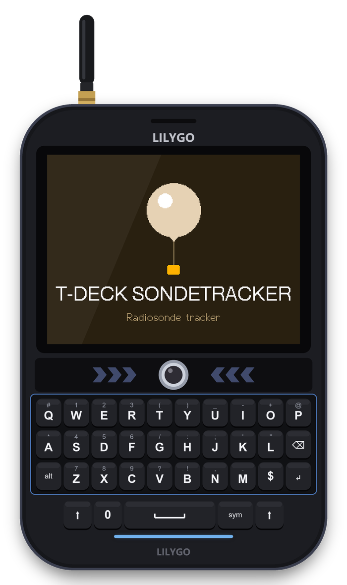
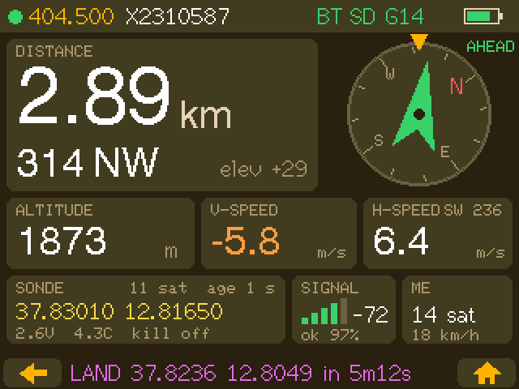
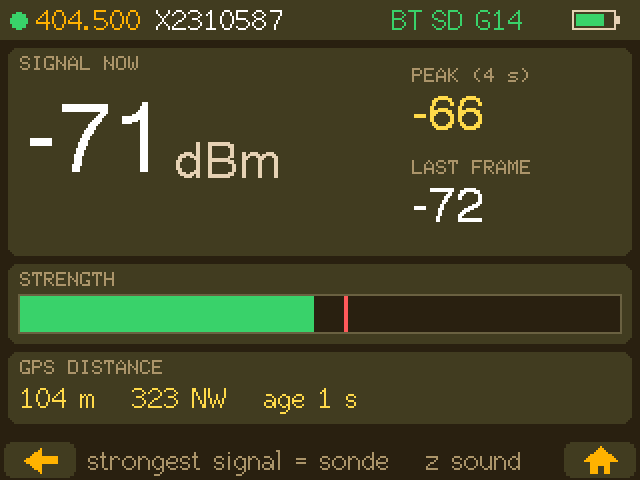
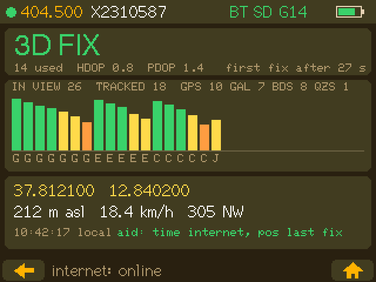
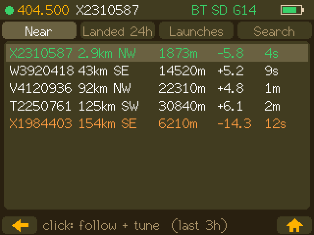
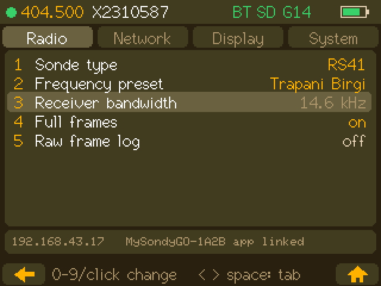
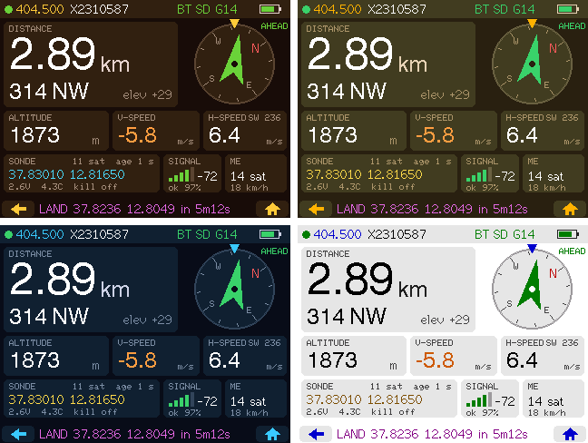
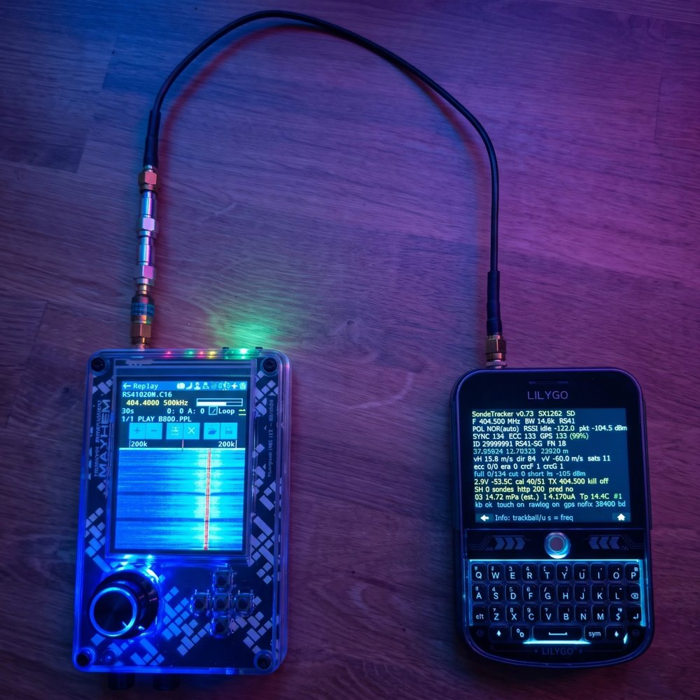

<div align="center">

<a href="README.md"></a>&nbsp;&nbsp;<a href="README.it.md"></a>

[](#)
[](https://github.com/N1k0droid/t-deck-sonde-tracker/releases)
[](LICENSE)
[](https://github.com/Xinyuan-LilyGO/T-Deck)
[](#)
[](https://platformio.org)

<br>



### Segui e recupera le radiosonde con LilyGO T-Deck Plus (433 MHz)

Vaisala RS41 · Graw DFM · Meteomodem M10/M20 · InterMet iMet-54

<table>
  <tr>
    <td align="center"><br><sub>Caccia: distanza e bussola</sub></td>
    <td align="center"><br><sub>Mappa offline e atterraggio previsto</sub></td>
    <td align="center"><br><sub>Avvicinamento: intensità del segnale</sub></td>
  </tr>
</table>

</div>

> [!WARNING]
> **Fase di test**: alcune funzioni già implementate richiedono ancora una verifica sul campo. Vedi ["Funzioni in sviluppo e da verificare"](#funzioni-in-sviluppo-e-da-verificare).

## Indice
- [Cos'è](#cosè)
- [Stato del progetto](#stato-del-progetto)
- [Cosa serve](#cosa-serve)
- [Installazione](#installazione)
- [Primo avvio](#primo-avvio)
- [Wi-Fi e pagina web](#wi-fi-e-pagina-web)
- [Comandi](#comandi)
- [Le pagine](#le-pagine)
- [Impostazioni](#impostazioni)
- [Mappa offline](#mappa-offline)
- [App di caccia sullo smartphone](#app-di-caccia-sullo-smartphone)
- [Internet tramite l'hotspot dello smartphone](#internet-tramite-lhotspot-dello-smartphone)
- [Interfaccia web](#interfaccia-web)
- [Server di debug](#server-di-debug)
- [Frame completi e sensore d'ozono](#frame-completi-e-sensore-dozono)
- [Tipi di sonda e preset](#tipi-di-sonda-e-preset)
- [Invio dei dati: SondeHub, radiosondy.info, aprs.fi](#invio-dei-dati-sondehub-radiosondyinfo-aprsfi)
- [SondeHub: serve aiuto](#sondehub-serve-aiuto)
- [File sulla scheda SD](#file-sulla-scheda-sd)
- [Come è stato provato](#come-è-stato-provato)
- [Funzioni in sviluppo e da verificare](#funzioni-in-sviluppo-e-da-verificare)
- [Limiti noti](#limiti-noti)
- [Compilare dai sorgenti](#compilare-dai-sorgenti)
- [Crediti e licenza](#crediti-e-licenza)

## Cos'è

T-Deck SondeTracker è un firmware per LilyGO T-Deck Plus che permette di ricevere, seguire e recuperare le radiosonde con un unico dispositivo, senza bisogno di uno smartphone o di una connessione internet.

Le radiosonde sono piccoli strumenti meteorologici trasportati da palloni che possono raggiungere i 30–35 km di quota. Quando il pallone scoppia, la sonda scende con un paracadute e continua a trasmettere la propria posizione via radio, generalmente nella banda 400–406 MHz. Queste trasmissioni permettono agli appassionati di seguirne il volo e cercarle una volta a terra.

Di solito, per farlo si usano un ricevitore dedicato e uno smartphone con un'app di tracciamento. T-Deck SondeTracker riunisce ricezione radio, navigazione GPS e mappe offline sul T-Deck Plus, accompagnandoti dall'inseguimento in volo fino agli ultimi metri del recupero.

### Funzioni principali

- Riceve e decodifica le radiosonde Vaisala RS41, Graw DFM-06/09/17, Meteomodem M10/M20 e InterMet iMet-54.
- Mostra posizione, quota e velocità della sonda, insieme alla distanza e alla direzione da seguire per raggiungerla.
- Stima il punto di atterraggio in base ai venti misurati dalla sonda durante il volo.
- Visualizza su mappe offline la tua posizione, quella della sonda, la traccia del volo e il punto di atterraggio previsto.
- Ti aiuta nella ricerca a terra con un indicatore acustico che varia in base all'intensità del segnale ricevuto.
- Cerca automaticamente le sonde di cui non conosci la frequenza, passando prima dai preset e poi all'intera banda 400–406 MHz.
- Registra le tracce sulla scheda SD in formato CSV e permette di esportarle in KML per Google Earth.

Con uno smartphone o una connessione Wi-Fi puoi inoltre:

- Usare il T-Deck come ricevitore per MySondyGO, Hunter Tracker e TrovaLaSonda.
- Consultare SondeHub direttamente dal dispositivo per vedere le sonde vicine, gli atterraggi recenti e i prossimi lanci.
- Condividere la telemetria ricevuta con radiosondy.info e la posizione della tua stazione con radiosondy.info e aprs.fi.

> [!NOTE]
> Le funzioni principali di ricezione e ricerca restano disponibili anche offline. L'invio dei dati ai servizi esterni è facoltativo e disattivato per impostazione predefinita.

<p align="center">
    <br>
  <i>Le schermate di questa pagina usano dati di esempio, tratti da una caccia simulata in Sicilia</i>
</p>

## Stato del progetto

Il firmware è in fase di test. La ricezione delle RS41 è stata provata sia al banco sia durante voli reali. Sono state verificate sul T-Deck Plus anche la schermata di caccia, le mappe, i temi, la consultazione di SondeHub e l'invio dei dati a radiosondy.info e aprs.fi.

La scansione e i decoder degli altri tipi di sonda hanno superato le prove al banco, ma devono ancora essere verificati sul campo. Lo stesso vale per alcune delle altre funzioni già presenti nel firmware.

Trovi i dettagli delle prove nella sezione ["Come è stato provato"](#come-è-stato-provato) e l'elenco delle verifiche ancora da completare in ["Funzioni in sviluppo e da verificare"](#funzioni-in-sviluppo-e-da-verificare).

Se provi il firmware, puoi condividere risultati, segnalare problemi o proporre miglioramenti nelle [Issues](https://github.com/N1k0droid/t-deck-sonde-tracker/issues) di GitHub.

## Cosa serve
- Un LilyGO T-Deck Plus nella versione a 433 MHz, con radio SX1262 e GPS integrato. Fra le varianti a 433, 868 e 915 MHz, solo quella a 433 MHz ha il circuito RF accordato vicino alla banda delle radiosonde, 400–406 MHz.
- Una scheda microSD formattata in FAT32, consigliata per registri, tracce e mappe offline.
- Un'antenna adatta ai 400–406 MHz. Quella a 433 MHz fornita con il dispositivo è un buon punto di partenza.
- Facoltativo: uno smartphone con hotspot Wi-Fi, per le funzioni online e le app di caccia.

> [!NOTE]
> Il T-Deck standard, senza "Plus", non dispone di GPS integrato. Il firmware funziona anche su questo modello, ma la tua posizione non è disponibile.

## Installazione
Scarica il firmware dalla pagina [Releases](https://github.com/N1k0droid/t-deck-sonde-tracker/releases). Le immagini beta hanno il nome `t-deck-sonde-tracker-v-<versione>-beta<n>.bin`, per esempio `t-deck-sonde-tracker-v-0.95-beta4.bin`. Le versioni 0.x sono beta; dalla 1.0.0 il nome diventa `t-deck-sonde-tracker-v-<versione>.bin`.

Il file è un'immagine flash completa, con bootloader, tabella delle partizioni e applicazione. Per l'installazione via USB, scrivila all'offset `0x0`.

### Metodo 1: con il firmware Launcher (consigliato)
[Launcher](https://github.com/bmorcelli/Launcher) è un gestore di firmware open source per dispositivi ESP32, compreso il T-Deck. Permette di installare e alternare le immagini presenti sulla SD senza usare il PC. Puoi quindi usare un altro firmware ogni giorno e passare a SondeTracker quando vuoi seguire un lancio.

Se Launcher non è già presente, installalo una prima volta tramite [Launcher Flasher](https://bmorcelli.github.io/Launcher/) con Chrome o Edge, seguendo le istruzioni della pagina.

1. Copia il file `.bin` nella cartella `downloads` della SD, creandola se necessario. Una volta installato SondeTracker, potrai trasferire le immagini successive dal browser senza estrarre la scheda: vedi la pagina Files in ["Interfaccia web"](#interfaccia-web).
2. Inserisci la SD e avvia Launcher.
3. Seleziona SD, scegli `t-deck-sonde-tracker-v-….bin` e conferma l'installazione.
4. Al termine, il T-Deck si riavvia con SondeTracker.

### Metodo 2: dal browser, via cavo USB
[ESP Web Tool](https://esptool.spacehuhn.com) è uno strumento open source per scrivere il firmware ESP32 dal browser, senza installare programmi sul PC. Usa Chrome o Edge su computer per accedere alla porta USB tramite Web Serial.

Questo metodo scrive l'immagine completa e sostituisce Launcher, se presente.

1. Collega il T-Deck al PC con un cavo USB-C che supporti il trasferimento dati. I cavi per la sola ricarica non funzionano.
2. Apri [ESP Web Tool](https://esptool.spacehuhn.com) con Chrome o Edge.
3. Seleziona Connect e scegli la porta seriale del T-Deck. Se non compare, tieni premuto il trackball (BOOT), premi e rilascia il pulsante laterale di reset, rilascia il trackball e riprova.
4. Seleziona il file `.bin`, imposta l'offset a `0x0` e premi Program.
5. Al termine della scrittura, premi il pulsante di reset.

### Metodo 3: da riga di comando (esptool)
```bash
pip install esptool
esptool --chip esp32s3 write-flash 0x0 t-deck-sonde-tracker-v-0.95-beta4.bin
```
Sostituisci il nome di esempio con quello del file scaricato. Le versioni precedenti di esptool usano `esptool.py` e `write_flash` al posto di `esptool` e `write-flash`.

## Primo avvio
1. Accendi il T-Deck. Dopo il logo iniziale compare la pagina Home.
2. Porta il dispositivo all'aperto, con una buona visuale del cielo. Il primo fix GPS può richiedere alcuni minuti; apri GPS per controllare la ricezione dei satelliti.
3. Imposta la frequenza della sonda: dalla pagina Hunt premi `f`, inserisci il valore in MHz, per esempio `404.5`, e premi Invio. Se non conosci la frequenza, seleziona Scan dalla Home.
4. Alla ricezione dei pacchetti validi sentirai un breve tic per ciascun pacchetto e la pagina Hunt mostrerà i dati della sonda.

> [!TIP]
> Puoi trovare le frequenze dei lanci vicini su [SondeHub](https://tracker.sondehub.org) oppure nella pagina Nearby del T-Deck, con una connessione internet.

## Wi-Fi e pagina web
Il Wi-Fi permette di usare le funzioni online, come le informazioni di SondeHub, la sincronizzazione dell'ora e l'invio dei dati, e permette inoltre di controllare il T-Deck dal browser.

> [!NOTE]
> Sono supportate solo le reti a 2,4 GHz, non quelle a 5 GHz. Sul campo, usare lo smartphone come hotspot Wi-Fi è una soluzione pratica.

1. Attiva l'hotspot sullo smartphone. Su iPhone abilita anche Massimizza compatibilità, così l'hotspot usa la banda a 2,4 GHz.
2. Sul T-Deck apri Settings, scheda Network, e seleziona Scan networks. Dopo qualche secondo compare l'elenco delle reti disponibili.
3. Scegli la rete. Se è protetta, inserisci la password nel riquadro che si apre e premi Invio; la password resta visibile durante la digitazione.
4. Per ritrovare la rete ai prossimi avvii, apri Saved networks (Settings > Network) e seleziona la prima riga, "+ save this network".
5. Per le funzioni online attiva Internet via Wi-Fi (Settings > Network). Per la pagina web attiva Web interface (Settings > System).
6. Dopo qualche secondo, la riga Web interface mostra l'indirizzo IP del T-Deck.
7. Collega lo smartphone o il PC alla stessa rete e apri nel browser `http://<ip>/`, sostituendo `<ip>` con l'indirizzo mostrato.
8. Accedi con utente `tdeck` e password `radiosonde`. Puoi cambiare la password con Web password (Settings > System).

Le funzioni della pagina web sono descritte in ["Interfaccia web"](#interfaccia-web).

## Comandi
Il T-Deck si controlla con tastiera, trackball e schermo touch. Ogni funzione è raggiungibile in tutti e tre i modi.

- Nella Home tocca un pulsante, oppure selezionalo con il trackball e premilo, oppure premi il numero corrispondente.
- In fondo a ogni pagina ci sono ◀ Indietro a sinistra e ⌂ Home a destra. Da tastiera, Indietro corrisponde a Backspace o Esc, Home al tasto `h`.
- Il tasto `v` passa rapidamente tra le tre pagine di caccia, Hunt, Map e Signal. Il tasto `m` apre la mappa.
- Il trackball sposta la selezione negli elenchi e la vista sulla mappa, dove un clic cambia il centro come il tasto `c`. In Hunt, Signal e Info, su e giù cambiano la frequenza di ±1 kHz. Tenuto premuto per 3 secondi, blocca o sblocca lo schermo.
- Preset e reti salvate si eliminano dall'interfaccia web, con il cestino accanto a ogni voce.
- Nelle domande Sì/No, `y` risponde sì, `n` o Indietro risponde no. Invio conferma il pulsante evidenziato, che all'inizio è No.
- Un tocco sulla frequenza in alto a sinistra apre l'inserimento di una nuova frequenza, come il tasto `f`. Non vale nella pagina Map.
- Durante l'inserimento di un testo, Esc, Backspace a campo vuoto o un tocco sullo schermo annullano l'operazione.

### Tasti
| Tasto | Funzione |
|---|---|
| `h` / Backspace | Home / indietro |
| `m` | mappa |
| `v` | pagina di caccia successiva: Hunt, Map, Signal |
| `f` | nuova frequenza: cifre, poi Invio |
| `w` o `+` / `q` o `-` | frequenza +1 / −1 kHz |
| `e` / `d` | frequenza +10 / −10 kHz |
| `p` | preset successivo dello stesso paese |
| `a` | salva frequenza e tipo di sonda attuali come nuovo preset: inserisci il nome e conferma con `y` |
| `j` | cerca nei preset: inserisci un nome, per esempio `trapani`, e premi Invio |
| `y` | tipo di sonda: auto / RS41 / DFM / M10/M20 / iMet54. Nelle domande vale come sì |
| `x` | avvia la scansione; premuto di nuovo la ferma |
| `n` | la bussola punta alla sonda oppure al punto di atterraggio previsto |
| `t` | bersaglio manuale: inserisci latitudine e longitudine, per esempio `38.0176 12.5365` |
| `s` | disattiva tutti i suoni; premuto di nuovo ripristina i volumi precedenti |
| `k` | esporta la traccia della sonda in KML, per Google Earth |
| `i` / `o` | mappa: zoom avanti / indietro |
| `c` | mappa: centra su entrambi, su di te, sulla sonda |
| `g` | mappa: codice QR con la posizione della sonda, da inquadrare con lo smartphone |
| `u` | polarità del segnale: automatica / normale / invertita. Di norma va lasciata automatica |
| `r` | azzera contatori, posizione ricevuta e previsione del T-Deck; il bersaglio inserito con `t` resta |
| `l` | registro dei dati grezzi attivo/disattivo |
| `Alt`+`B` | retroilluminazione della tastiera accesa/spenta |
| trackball premuto 3 s | blocca / sblocca tasti, trackball e touch, con un lucchetto nella barra di stato. Radio, allarmi e invii continuano a funzionare. Dopo il riavvio è sempre sbloccato |

## Le pagine

### Home
La Home ha otto pulsanti: Hunt, Map, Signal, GPS, Nearby, Info, Settings e Scan. Sotto ogni nome, una riga riassume lo stato della pagina, per esempio la distanza dalla sonda, lo zoom della mappa, il segnale in dBm, il fix GPS o il numero di sonde trovate su SondeHub.

### Hunt (caccia)


È la pagina principale durante la caccia. Dall'alto in basso mostra:
- La barra di stato, con spia dei pacchetti, frequenza, seriale della sonda, satelliti del GPS e batteria.
- La distanza dalla sonda, in grande, e la bussola.
- Quota, velocità verticale e velocità orizzontale della sonda.
- In basso, messaggi, punto di atterraggio previsto e suggerimenti.

Nella barra di stato compaiono anche alcuni indicatori:
- `WEB` quando l'interfaccia web è attiva, `DBG` quando lo sono le pagine di debug.
- Un lucchetto quando lo schermo è bloccato.
- `SH`, `RS` e `FI` in rosso quando è attivo l'invio a SondeHub, radiosondy.info o aprs.fi. Se ne sono attivi più di uno, compaiono in piccolo, uno sopra l'altro.
- `BT` per il collegamento con le app di caccia e `SD` per la scheda.

Il T-Deck non ha una bussola magnetica: ricava la direzione dal GPS mentre ti sposti. La bussola ha due modalità:
- AHEAD (verde): sei in movimento, a piedi o in auto. Il triangolo in alto indica la tua direzione, la freccia indica la sonda e le lettere N E S W ruotano per mostrare i punti cardinali reali. Segui la freccia.
- N UP (gialla): sei fermo. La freccia è riferita al nord, quindi orienta il lato superiore dello schermo verso nord.

Durante la discesa, la riga in basso mostra il punto di atterraggio previsto e il tempo mancante: `LAND` indica la previsione del T-Deck, `SH LAND` quella di SondeHub. Questa informazione si alterna con la quota sotto la quale il segnale verrà perso dietro l'orizzonte ("signal lost below ~… m"). Con internet, il T-Deck mostra la previsione di SondeHub finché alla propria mancano i venti sotto la sonda; sotto i 2500 m dal suolo passa alla propria.
<br clear="right">

### Map (mappa)


La mappa mostra la tua posizione in blu, la sonda in rosso, la traccia del volo, la linea che vi unisce e il punto di atterraggio previsto. La croce magenta è la previsione del T-Deck; quella azzurra, con la traiettoria tratteggiata, è la previsione di SondeHub, disponibile solo con internet.
- Lo zoom si regola con `i` e `o`, oppure toccando `+` e `−`.
- Il tasto `c` centra la vista; il trackball la sposta.
- Il pulsante QR in alto a sinistra, o il tasto `g`, mostra un codice QR: inquadralo con lo smartphone per avviare la navigazione verso la sonda o verso il punto di atterraggio.

Le tessere della mappa vanno preparate e copiate sulla SD: vedi ["Mappa offline"](#mappa-offline). Senza la cartella `/maps`, la pagina mostra le istruzioni per prepararla. Dove manca una singola tessera, lo sfondo è grigio.
<br clear="right">

### Signal (avvicinamento)
Serve negli ultimi metri, quando la precisione del GPS non basta più. Una barra mostra l'intensità del segnale in tempo reale, con il picco degli ultimi secondi, e l'indicatore acustico diventa più acuto e più veloce man mano che il segnale cresce. Ruotando su te stesso, il segnale risulta più forte nella direzione della sonda.

### GPS
Mostra lo stato del ricevitore GPS: fix 2D o 3D oppure ricerca in corso, satelliti con l'intensità del segnale di ciascuno, HDOP e PDOP (più sono bassi, più la posizione è precisa) e tempo del primo fix. Riporta inoltre posizione, quota, velocità, ora locale o UTC e stato dell'assistenza al GPS: per accelerare il fix, il T-Deck fornisce al GPS l'ora e una posizione approssimata, ricavate da internet o dalla sonda.

### Nearby (sonde vicine, serve internet)


La pagina ha quattro schede, selezionabili con un tocco o con i tasti 1–4:
- Near: sonde in volo nelle ultime 3 ore entro 300 km. Quelle in discesa sono in arancione, quella seguita in verde. Un tocco su una sonda la imposta come bersaglio e sintonizza la radio sulla sua frequenza; un tocco sulla sonda già seguita interrompe l'inseguimento.
- Landed: voli atterrati entro 400 km nelle ultime 3 ore, 12 ore, 24 ore o 7 giorni, con il punto di atterraggio. Dai dettagli di un volo puoi impostare quel punto come bersaglio.
- Launches: lanci programmati dalle stazioni vicine, con l'atterraggio previsto. L'intervallo di tempo considerato dipende da Launch predictions (Settings > Network), 24 ore di default; i lanci vengono calcolati all'apertura della scheda.
- Search: ricerca di una sonda per numero di serie, per esempio `X1422184`.
<br clear="right">

### Scan (scansione)
La pagina Scan serve a trovare una sonda di cui non conosci la frequenza. Il T-Deck scansiona prima le frequenze dei preset e poi l'intera banda 400–406 MHz, ciclo dopo ciclo, finché non trova una sonda o finché non interrompi la ricerca con `x`, Indietro o un tocco.

Durante la scansione il T-Deck si ferma ad ascoltare i canali con il segnale più forte, per capire se trasmettono una sonda. Un canale già provato senza risultato viene ignorato per 10 minuti e segnato in grigio.

Il grafico mostra la spazzata in corso sopra il livello massimo rilevato finora, in tono attenuato, insieme alla soglia del rumore.

Quando decodifica una sonda, il T-Deck emette un segnale acustico e chiede se tenerla e passare alla pagina Hunt; rispondendo No, la ricerca continua. Quando interrompi la scansione, il T-Deck torna alla frequenza precedente.

### Info
Mostra i dati tecnici della ricezione e della sonda: qualità della decodifica, correzioni, frame ricevuti interi, batteria e temperatura della sonda, kill timer, statistiche e valori del sensore d'ozono.

### Settings (impostazioni)
Le impostazioni sono descritte nella sezione seguente.

## Impostazioni


Le impostazioni sono divise in quattro schede: Radio, Network, Display e System. Per cambiare scheda usa il trackball a sinistra e a destra, la barra spaziatrice o un tocco sul nome della scheda. Seleziona una voce con il trackball o con il touch e premila per modificarla. Nelle schede con al massimo dieci voci puoi usare anche le cifre 1–9 e 0; la scheda Network ne ha di più, quindi lì le cifre non funzionano.

I campi di testo si confermano con Invio:
- Invio senza scrivere nulla mantiene il valore attuale.
- Un singolo `-` cancella il valore.
- Password, passcode e token restano visibili durante la digitazione.

Nella colonna dei valori, "set" indica una voce non ancora impostata, "change" una voce già impostata.
<br clear="right">

| Scheda | N. | Voce | Predefinito | Funzione |
|---|---|---|---|---|
| Radio | 1 | Sonde type | auto | auto prova tutti i tipi; le altre opzioni sono RS41, DFM, M10/M20 e iMet54. Vedi ["Tipi di sonda e preset"](#tipi-di-sonda-e-preset) |
| | 2 | Frequency preset | — | apre l'elenco dei preset di `presets.txt` |
| | 3 | Receiver bandwidth | 14.6 kHz | larghezza del filtro di ricezione, da 9,7 a 39 kHz. È consigliato 14,6: un filtro più largo fa entrare più rumore e a 19,5 kHz le RS41 deboli si perdono. M10/M20 usano sempre almeno 23,4. Il valore è in arancione quando è diverso da 14,6. Le app di caccia non possono modificarlo |
| | 4 | Full frames | on | riceve i frame interi da 320/518 byte (vedi ["Frame completi e sensore d'ozono"](#frame-completi-e-sensore-dozono)). Se disattivato, riceve 255 byte e usa la correzione d'errore |
| | 5 | Raw frame log | on | salva sulla SD i dati grezzi ricevuti |
| Network | 1 | Scan networks | — | cerca le reti Wi-Fi vicine, solo quando viene premuto. La rete scelta sostituisce il nome della rete configurata; se è protetta, un riquadro chiede la password |
| | 2 | Saved networks | — | la prima riga, "+ save this network", salva nome e password della rete configurata, dopo una conferma. Sotto compaiono le reti salvate: quella scelta sostituisce nome e password della rete, anche dopo il riavvio. Le reti sono salvate in `wifi.txt`; per eliminarne una usa il cestino nell'interfaccia web |
| | 3 | Wi-Fi name | — | nome della rete Wi-Fi, per esempio l'hotspot dello smartphone |
| | 4 | Wi-Fi password | set | password della rete, salvata nel dispositivo senza cifratura |
| | 5 | Internet via Wi-Fi | off | usa internet tramite la rete Wi-Fi configurata. Indica "online" solo mentre un server risponde davvero e "no internet" quando non risponde nessuno; dopo 3 minuti in questo stato il T-Deck si ricollega da solo |
| | 6 | Wi-Fi power save | off | mette in pausa il Wi-Fi tra un beacon del router e il successivo. Riduce i consumi, ma con alcuni router il collegamento smette di funzionare |
| | 7 | Launch predictions | 24 h | intervallo in cui la scheda Launches cerca i lanci: 12 h, 24 h, 3, 5 o 7 giorni |
| | 8 | Hunting apps | off | collegamento con le app di caccia: off, Bluetooth, Bluetooth + Wi-Fi |
| | 9 | Callsign | — | il tuo nominativo, unico per tutti gli invii. Viene salvato in maiuscolo, per esempio `IT9ABC-9` |
| | 10 | APRS passcode | set | passcode APRS-IS del tuo nominativo, necessario per radiosondy.info e aprs.fi. È un numero calcolato dal nominativo: puoi ottenerlo con un calcolatore di passcode APRS, ne esistono molti online, o dal tuo servizio APRS. Richiede un nominativo di radioamatore |
| | 11 | SondeHub upload | awaiting approval | sospeso: SondeHub non ha ancora approvato questo firmware, quindi la voce non si può attivare. Premendola compaiono le indicazioni per contribuire: vedi ["SondeHub: serve aiuto"](#sondehub-serve-aiuto) |
| | 12 | SondeHub JSON log | on | salva ogni frame ricevuto, nel formato di SondeHub, in `sondehub/<seriale>.json` sulla SD, circa 2 MB per ora di ricezione. Sono i file da inviarmi per l'approvazione: vedi ["SondeHub: serve aiuto"](#sondehub-serve-aiuto) |
| | 13 | radiosondy.info upload | off | invia a radiosondy.info le sonde ricevute come oggetti APRS, uno per sonda ogni 30 s. L'attivazione chiede conferma |
| | 14 | aprs.fi upload | off | invia ad aprs.fi la posizione della tua stazione, con l'icona scelta più sotto, tramite la rete APRS-IS principale (server europei). L'attivazione chiede conferma. Invia solo la stazione: le sonde vanno a radiosondy.info |
| | 15 | aprs.fi comment | on | aggiunge un commento adatto alla situazione: caccia in corso (stazione mobile), ricezione (stazione fissa) o ricerca di sonde. I testi sono in `aprsfi.txt` |
| | 16 | Only sondes in flight | on | invia solo le sonde viste in volo; se disattivato, invia anche una sonda a terra |
| | 17 | Send my position | off | servizi che ricevono la posizione della tua stazione: off, all (radiosondy.info e aprs.fi), solo radiosondy, solo aprs.fi. L'opzione SondeHub resta grigia finché SondeHub non approva il firmware. aprs.fi riceve solo questa posizione, quindi il suo invio richiede all o aprs.fi. Con all, la posizione viene scritta anche nei file JSON per SondeHub |
| | 18 | Station | mobile | mobile compare come auto inseguitrice, fixed come ricevitore. Su radiosondy.info e aprs.fi la stazione fissa usa sempre l'icona della parabola `` /` ``, perché radiosondy.info elenca così i ricevitori. La stazione mobile invia anche velocità, direzione e quota |
| | 19 | Mobile icon | person | icona della stazione mobile su radiosondy.info e aprs.fi: persona `/[`, auto `/>` oppure `/(`, usata da altri ricevitori di radiosonde |
| | 20 | Mobile update | 60 s | intervallo di invio della posizione della stazione mobile: 30 s, 60 s, 2, 5, 10 o 15 min. Su aprs.fi al massimo una volta al minuto |
| | 21 | Fixed update | 30 min | intervallo di invio della posizione della stazione fissa: 10, 30 o 60 min |
| | 22 | GPS fix wait | 1 min | la posizione viene condivisa solo dopo che il GPS ha mantenuto un fix buono (3D, almeno 5 satelliti, HDOP fino a 3) per questo tempo senza interruzioni: 30 s, 1, 2 o 5 min. I primi fix dopo l'accensione possono essere imprecisi |
| | 23 | Min distance | off | per la stazione mobile: nessuna nuova posizione finché non si è spostata almeno di questa distanza dall'ultima inviata. Opzioni: off, 200 m, 500 m, 1 km. Un nuovo commento o una nuova icona vengono comunque inviati |
| Display | 1 | Screen brightness | 100% | luminosità dello schermo: 100%, 75%, 50%, 25%, 12% per la notte |
| | 2 | Screen timeout | 5 min | tempo senza uso dei comandi dopo il quale lo schermo si spegne o si attenua: sempre acceso, 1, 5 o 10 min |
| | 3 | Screen dimming | screen off | comportamento allo scadere del tempo: screen off spegne lo schermo; light, medium e strong lo lasciano acceso ma attenuato, strong il più scuro |
| | 4 | Theme | Desert | colori dell'interfaccia: Desert, Olive, Navy e Sun, ad alto contrasto per la luce del sole |
| | 5 | Keyboard light | Alt+B | promemoria della combinazione per la retroilluminazione della tastiera |
| | 6 | Touch screen | on | attiva o disattiva il touch |
| | 7 | Auto lock | off | blocca tasti e touch dopo un periodo senza uso: off, 1, 2 o 5 min. Si sblocca tenendo premuto il trackball per 3 s |
| | 8 | Trackball speed | fast | rotazione del trackball necessaria per un passo: fast, medium, slow |
| System | 1 | Volume | 7 | volume di allarmi, indicatore di avvicinamento e conferme, da 0 (muto) a 9 |
| | 2 | Frame volume | 7 | volume del suono di ogni frame ricevuto, in qualsiasi pagina, da 0 (muto) a 9 |
| | 3 | Frame sound | soft tick | suono di ogni frame: un tic leggero, oppure un bip tanto più acuto quanto più il segnale è forte |
| | 4 | Time zone | UTC+1 | fuso orario in ora solare, da UTC-12 a UTC+14, scelto da un elenco con alcune città per ogni fuso |
| | 5 | Daylight saving | auto | ora legale: off, on (+1 ora), auto con le date europee, cioè ultima domenica di marzo e ultima domenica di ottobre |
| | 6 | Web interface | off | controllo del T-Deck dal browser di uno smartphone o di un PC (vedi ["Interfaccia web"](#interfaccia-web)). Quando è attiva, mostra l'indirizzo da aprire |
| | 7 | Debug server | off | pagine di controllo remoto per test e segnalazioni (vedi ["Server di debug"](#server-di-debug)). Quando è attivo, mostra "on, /debug" |
| | 8 | Web password | default | password dell'interfaccia web e delle pagine di debug; la predefinita è `radiosonde`, con utente `tdeck`. Inserisci una nuova password, oppure `-` per tornare a quella predefinita |
| | 9 | About | — | versione, autore e link al progetto |

Timeout dello schermo: con lo schermo spento o attenuato il T-Deck continua a ricevere, registrare ed emettere suoni. Il primo tasto o tocco riporta lo schermo alla luminosità normale senza eseguire altri comandi; gli allarmi lo riaccendono automaticamente. Light, medium e strong riducono la luminosità scelta rispettivamente a metà, a un quarto e a un ottavo.

<p align="center">
  <br>
  <i>I quattro temi: Desert, Olive, Navy, Sun</i>
</p>

## Mappa offline
Il T-Deck legge la mappa dalla SD, suddivisa in tessere PNG da 256 pixel nella cartella `/maps/<zoom>/<x>/<y>.png`. I server pubblici di OpenStreetMap non consentono il download massivo delle tessere, quindi il progetto include uno script che le genera sul tuo PC a partire dai dati OpenStreetMap. Lo script si trova nella cartella `tools/mappack`: puoi scaricare l'intero repository con il pulsante Code in alto in questa pagina, poi Download ZIP.

Dove manca una tessera, il T-Deck ingrandisce quella del livello di zoom inferiore. Conviene quindi preparare una mappa a strati, con poco dettaglio sulle aree ampie e il massimo dettaglio solo nella zona di caccia.

### Requisiti
- Docker in esecuzione (Docker Desktop su Windows o Mac).
- Python 3 e, consigliato, Pillow (`pip install pillow`).
- Circa 10 GB liberi durante la preparazione, per una nazione come l'Italia.

### Procedura
1. Copia `tools/mappack/sicilia.json` con un nuovo nome e adattalo alla tua zona:
   - in `sources` indica il nome dell'estratto [Geofabrik](https://download.geofabrik.de) della tua nazione, per esempio `italy`, `germany` o `france`;
   - in `layers` indica, per ogni strato, il riquadro `[sud, ovest, nord, est]` in gradi e i livelli di zoom. Per esempio: mondo 0–2, continente 3–7, nazione 8–11, regione 12–14.
2. Verifica quante tessere verranno generate:
   ```bash
   python tools/mappack/make_maps.py tools/mappack/mia_zona.json --dry-run
   ```
3. Genera la mappa. La prima esecuzione scarica i dati e può richiedere da pochi minuti a un paio d'ore:
   ```bash
   python tools/mappack/make_maps.py tools/mappack/mia_zona.json
   ```
4. Copia la cartella generata, `mapwork/maps`, nella radice della SD con il nome `maps`: devono essere presenti `/maps/0`, `/maps/1` e così via. Poi riavvia il T-Deck.

Come riferimento, l'esempio della Sicilia (mondo, Europa, Italia e Sicilia fino allo zoom 14) produce circa 30.000 tessere, per un totale di 130 MB.

| Zoom | Larghezza dello schermo | Uso |
|---|---|---|
| 0–2 | mondo | sfondo |
| 3–7 | da 4.000 a 300 km | continente, nazione |
| 8–11 | da 150 a 19 km | regione, viaggio |
| 12–14 | da 10 a 2,4 km | strade, sterrati, ultimo tratto |

I dati della mappa sono © OpenStreetMap contributors (ODbL).

## App di caccia sullo smartphone
Il T-Deck può fare da ricevitore per le app di caccia già in uso, senza modificarle. Il tipo di collegamento si sceglie con Hunting apps (Settings > Network):
- Bluetooth: il T-Deck compare come `MySondyGO-XXXX` e usa il protocollo MySondy GO 4.1. Funziona con MySondyGO, Hunter Tracker (come ricevitore MySondy) e TrovaLaSonda: cercalo tra i dispositivi Bluetooth dell'app. Dall'app si può cambiare la frequenza.
- BT + Wi-Fi: in aggiunta, sulla rete Wi-Fi configurata, il T-Deck si comporta come un ricevitore TTGO rdz, con `http://<ip>/live.json` e la porta TCP 14570, per le app che lo supportano.

Nella barra di stato compare `BT`: grigio in attesa, verde con un'app collegata.

> [!IMPORTANT]
> Il collegamento con le app non invia nulla su internet, ma **le app possono inviare i dati a SondeHub autonomamente**: controlla le loro impostazioni.

## Internet tramite l'hotspot dello smartphone
Con Internet via Wi-Fi attivo (Settings > Network) e il T-Deck collegato all'hotspot dello smartphone sono disponibili:
- L'ora esatta da internet e un fix GPS più rapido.
- La pagina Nearby, con sonde vicine, atterraggi e prossimi lanci.
- La posizione della sonda ricavata da SondeHub quando la radio non la riceve, nel riquadro "SONDE (NET)".
- La previsione di atterraggio di SondeHub sulla mappa, che resta memorizzata anche se la connessione cade.

SondeHub chiede di non interrogare continuamente le sue API, quindi il T-Deck limita le richieste:
- Le sonde vicine vengono aggiornate ogni 5 minuti, oppure ogni minuto quando l'elenco Near è aperto, sul T-Deck o nella pagina web, o quando segui una sonda che la radio non riceve.
- La previsione della sonda seguita viene richiesta ogni 3 minuti.
- Se la sonda seguita resta ferma per 10 minuti, perché è atterrata o nessuno la riceve più, l'aggiornamento torna ogni 5 minuti e la previsione non viene più richiesta.

Queste funzioni scaricano dati da SondeHub e non inviano la tua telemetria. L'unica informazione che il T-Deck comunica è la tua posizione arrotondata a circa 10 km, necessaria per chiedere a SondeHub le sonde della tua zona. L'invio dei dati a SondeHub, radiosondy.info o aprs.fi è una funzione separata, disattivata di default: vedi ["Invio dei dati"](#invio-dei-dati-sondehub-radiosondyinfo-aprsfi).

Senza internet, tutte le altre funzioni restano disponibili.

## Interfaccia web
Web interface (Settings > System, disattivata di default) permette di controllare il T-Deck dal browser di uno smartphone o di un PC collegato alla stessa rete Wi-Fi. È pensata per usare il T-Deck come stazione remota: tutto ciò che si fa con tasti e schermo è disponibile anche dalla pagina.

Apri `http://<ip>/` con l'indirizzo mostrato nelle impostazioni e accedi con utente `tdeck` e password `radiosonde`, se non l'hai cambiata con Web password (Settings > System). La procedura per la prima attivazione è in ["Wi-Fi e pagina web"](#wi-fi-e-pagina-web).

L'interfaccia è divisa in nove pagine:
- Hunt: dati della sonda (seriale, quota, velocità verticale e orizzontale, satelliti, batteria, temperatura, kill timer, ozono), distanza, direzione ed elevazione rispetto a te, e la bussola, orientata secondo la tua direzione di marcia come AHEAD sul T-Deck. Mostra anche segnale, frame decodificati, età dell'ultimo frame, previsione di atterraggio con il pulsante Navigate per Google Maps e quota sotto la quale si perderà il segnale. To sonde e To landing scelgono il riferimento di distanza e freccia, come il tasto `n`; Target inserisce un punto, come il tasto `t`; KML genera e scarica il file della traccia; Reset azzera contatori, posizione ricevuta e previsione, mantenendo il bersaglio inserito; Sound off silenzia il T-Deck. La pagina si aggiorna ogni 2 secondi.
- Map: la tua posizione, la sonda, la sua traccia e le previsioni di atterraggio su una mappa OpenStreetMap, scaricata da internet dallo smartphone o dal PC. Il T-Deck invia solo i punti; le mappe offline della SD restano visibili solo sul suo schermo. Come il tasto `c`, Both mantiene tutto in vista, mentre Me e Sonde centrano il punto scelto; con follow attivo la mappa continua a seguirlo finché non la trascini. Un clic sulla sonda apre i collegamenti a SondeHub e radiosondy.info e il pulsante Navigate. La linea tratteggiata è la traiettoria prevista da SondeHub per la sonda seguita.
- Radio: frequenza, inserita a mano o a passi di 1 e 10 kHz, tipo di sonda, polarità, banda del ricevitore e livello del rumore. Permette di avviare e fermare la scansione, con lo spettro 400–406 MHz in tempo reale e i canali trovati. Include l'elenco dei preset con ricerca e i pulsanti Auto (no preset), Next, Save current, che salva con un nome la frequenza in uso, e Add European sites; il cestino accanto a ogni preset lo elimina.
- SondeHub: i quattro elenchi della pagina Nearby del T-Deck, cioè Near, Landed (ultime 3 h, 12 h, 24 h o 7 giorni), Launches (prossimi lanci dei siti vicini, con atterraggio previsto) e Search per seriale. Un clic su una sonda apre un riquadro con Follow and tune, che la segue e sintonizza la radio, oppure Stop following, insieme al link a SondeHub e a Navigate. Dai dettagli puoi impostare il punto di atterraggio come bersaglio. Richiede Internet via Wi-Fi attivo.
- Signal: intensità del segnale e picco degli ultimi 4 secondi, aggiornati due volte al secondo, con l'ultimo frame e la distanza. È la pagina per gli ultimi metri; Tone riproduce nel browser un tono che segue il segnale.
- GPS: fix, satelliti usati, HDOP e PDOP, segnale di ogni satellite in vista, posizione, quota, velocità e rotta, ora e assistenza al GPS.
- Info: le righe della pagina Info del T-Deck (radio, contatori, ultimo frame, stato della sonda, SondeHub).
- Settings: tutte le voci delle quattro schede, con gli stessi valori e le stesse opzioni del T-Deck. L'attivazione di un invio chiede "Are you sure?" sia sul T-Deck sia nel browser; la voce SondeHub upload spiega come contribuire all'approvazione. Eventuali messaggi del T-Deck, per esempio sul motivo per cui una voce non cambia, compaiono in fondo alla pagina. In Saved networks ogni rete ha un cestino; Scan networks chiede la password della rete scelta.
- Files: file e cartelle della SD, ciascuno con i pulsanti per scaricarlo, rinominarlo ed eliminarlo. L'eliminazione chiede conferma e non si può annullare; una cartella si può eliminare solo se è vuota. Con Upload files, o trascinando i file sulla pagina, li copi dallo smartphone o dal PC nella cartella aperta. Per esempio, se usi Launcher, puoi caricare un nuovo firmware `.bin` in `/downloads` e installarlo senza estrarre la scheda. Durante il trasferimento di un file, in entrambe le direzioni, il T-Deck non riceve: conviene farlo dopo la caccia.

In alto, il lucchetto blocca e sblocca i tasti del T-Deck; la pagina continua a funzionare anche con i tasti bloccati. Il menu contiene About e Restart the T-Deck. Le modifiche fatte dal browser valgono anche sul T-Deck, e viceversa.

La pagina usa i colori del tema scelto con Theme (Settings > Display) e occupa sempre l'intera finestra, dallo smartphone al monitor, senza scorrimento. Scorrono solo gli elenchi lunghi, all'interno del proprio riquadro: preset, file e, sullo smartphone in orizzontale, le impostazioni.

> [!CAUTION]
> La password protegge solo da un accesso occasionale su una rete condivisa e non è una vera misura di sicurezza. Usa l'interfaccia web solo su reti tue, per esempio l'hotspot dello smartphone.

## Server di debug
Debug server (Settings > System, disattivato di default) attiva le pagine per test e segnalazioni all'indirizzo `http://<ip>/debug`, con lo stesso utente, la stessa password e gli stessi colori dell'interfaccia web. Le pagine sono:
- Screen: lo schermo del T-Deck, cliccabile come il touch, con frecce, Invio, Indietro, Home e i tasti più usati.
- Status e Log: lo stato del T-Deck e i suoi ultimi messaggi, utili per segnalare problemi.

La gestione dei file e il riavvio sono nell'interfaccia web.

Le pagine chiedono una password: `radiosonde` finché non la cambi con Web password; il nome utente è sempre `tdeck`. I dati `/live.json` per le app di caccia (Hunting apps: BT + Wi-Fi) non richiedono password.

> [!CAUTION]
> Anche qui la password protegge solo da un accesso occasionale: attiva queste pagine solo quando servono e solo su reti tue.

## Frame completi e sensore d'ozono

### Frame completi
Una RS41 trasmette i suoi dati in pacchetti chiamati frame, uno al secondo. Ogni frame è lungo 320 byte, oppure 518 se la sonda porta sensori aggiuntivi, come quello dell'ozono.

La radio del T-Deck, una SX1262, è progettata per ricevere pacchetti di al massimo 255 byte. Senza accorgimenti, il T-Deck riceverebbe solo i primi 255 byte di ogni frame e dovrebbe completare il resto con la correzione d'errore, a cui resterebbe poco margine per riparare altri errori di ricezione.

La funzione Full frames (Settings > Radio, attiva di default) risolve il problema: quando arriva un frame, il T-Deck mantiene la radio in ricezione oltre i 255 byte, finché il frame non è completo. È una tecnica descritta da Semtech, il produttore della radio, nella nota applicativa AN1200.53.

Ricevere il frame intero rende la decodifica più robusta, soprattutto con segnale debole o disturbato:
- Con il frame intero, la correzione d'errore ripara fino a 12 byte errati per ogni metà del frame; con soli 255 byte ne ripara al massimo 3.
- Nelle prove al banco, con una sonda simulata e molto rumore, il T-Deck ha decodificato il 97% dei frame con Full frames attivo e il 26% senza.
- Con un buon segnale i due metodi danno lo stesso risultato.

Ci sono due effetti secondari:
- Per prolungare la ricezione, il T-Deck deve accorgersi in tempo che sta arrivando un frame. Se se ne accorge tardi, per esempio mentre la mappa carica molte tessere, riceve quel frame con il metodo a 255 byte: si comporta come con Full frames disattivato, senza perdere nulla.
- Mentre riceve un frame, il T-Deck sospende le altre operazioni per non disturbare la radio. Con un frame al secondo, lo schermo può rispondere un po' più lentamente.

### Sensore d'ozono
Le sonde con sensore d'ozono Vaisala OIF411 trasmettono frame estesi da 518 byte, che il T-Deck riceve per intero grazie a Full frames. I dati dell'ozono compaiono in tre punti:
- La pagina Info mostra la pressione parziale dell'ozono in mPa, la corrente della cella e la temperatura della pompa.
- La pagina Hunt mostra "O3" accanto ai dati della sonda.
- Il file CSV della traccia contiene la colonna `o3_mpa`.

Il valore in mPa è una stima: è calcolato con la portata nominale della pompa, non con il foglio di calibrazione del singolo sensore.

## Tipi di sonda e preset

### Tipi di sonda
Il T-Deck decodifica questi tipi di sonda:

| Tipo | Modelli | Dati ricevuti |
|---|---|---|
| RS41 | Vaisala RS41 | posizione, velocità, ora, numero di serie, modello, batteria, satelliti, temperatura, kill timer; ozono con il sensore OIF411 |
| DFM | Graw DFM-06, DFM-09, DFM-17 | posizione, velocità, ora, numero di serie, modello, batteria (DFM-09/17) |
| M10/M20 | Meteomodem M10, M10+, M20 | posizione, velocità, ora, numero di serie, modello, batteria, satelliti (M10) |
| iMet54 | InterMet iMet-54, iMet-50 | posizione, ora del giorno, numero di serie, modello; velocità calcolate dalle posizioni |

Il tipo si sceglie con Sonde type (Settings > Radio) o con il tasto `y`:
- auto (predefinito): il ricevitore prova a turno tutti i tipi, con entrambe le polarità, finché non decodifica un frame, poi resta su quel tipo finché il segnale non si perde. Se il preset in uso indica un tipo, usa direttamente quello.
- RS41, DFM, M10/M20 o iMet54: solo il tipo scelto. È la soluzione più rapida quando sai già quale sonda verrà lanciata.

Quando segui una sonda dalla pagina Nearby, il tipo viene preso da SondeHub. Il numero di serie delle DFM arriva solo ogni alcuni frame, quindi nei primi 20–30 secondi la sonda compare come "DFM".

### Preset
Le frequenze sono salvate nel file `presets.txt` sulla SD. Al primo avvio il T-Deck lo crea con le istruzioni e circa 90 preset di siti di lancio europei, raggruppati per paese. Alcuni siti hanno più frequenze. Frequenze e tipi corrispondono alle sonde rilevate su SondeHub a novembre 2026.

Puoi modificare `presets.txt` liberamente: il T-Deck non lo riscrive mai da solo. Lo cambia soltanto quando sei tu a chiederlo, in tre casi:
- salvi un nuovo preset con il tasto `a`;
- aggiungi i siti europei con "+ add the European launch sites";
- elimini un preset con il cestino nell'interfaccia web.

Le tue modifiche quindi restano. Se un sito cambia frequenza, basta correggere la sua riga.

Ogni riga del file è un preset:

```
[Sicily]
404.500  RS41  Trapani Birgi
[France]
403.000  M10   Trappes
402.000  DFM   Toulon / Levant (DFM-17)
[Saved]
405.100  AUTO
```

- Ogni riga contiene la frequenza in MHz, il tipo (`AUTO`, `RS41`, `DFM`, `M10`, `M20` o `iMet54`) e un nome facoltativo. `[Nome]` apre un gruppo, per esempio un paese o una regione; `#` inizia un commento. Sono ammessi fino a 200 preset, compresi quelli che aggiungi tu.
- Frequency preset (Settings > Radio), o il tasto `j` da qualsiasi pagina, apre l'elenco. Scrivendo parte di un nome, di un paese o una frequenza (`trapani`, `germany`, `404.5`) restano solo le righe corrispondenti. Il trackball a sinistra e a destra salta da un paese all'altro. Seleziona un preset con Invio, con il trackball o con un tocco, e il T-Deck si sintonizza.
- Il preset scelto resta attivo, anche dopo il riavvio, finché non selezioni auto, la prima riga dell'elenco. In quel caso non c'è alcun preset attivo e il ricevitore individua da solo il tipo di sonda.
- Il tasto `p` passa al preset successivo dello stesso paese. Il tasto `a` salva frequenza e tipo attuali sotto `[Saved]` con il nome inserito; un nome già usato diventa "nome 2", "nome 3" e così via, e il preset in uso non viene mai modificato. Per eliminare un preset usa il cestino nella pagina Radio dell'interfaccia web, oppure cancella la sua riga dal file.
- L'ultima riga dell'elenco, "+ add the European launch sites", aggiunge i siti a un file esistente senza duplicati: un sito di cui hai corretto la frequenza non viene aggiunto di nuovo.
- Puoi modificare il file anche dal PC: estrai la SD, modifica il file e reinserisci la scheda.

## Invio dei dati: SondeHub, radiosondy.info, aprs.fi
Tutti gli invii sono disattivati di default; quando ne attivi uno, il T-Deck chiede "Are you sure?" con No già selezionato. Le voci citate in questa sezione si trovano in Settings > Network.

Gli invii richiedono il Wi-Fi e il tuo nominativo, impostato in Callsign; radiosondy.info e aprs.fi richiedono anche APRS passcode.

| Servizio | Dati inviati | Voci |
|---|---|---|
| radiosondy.info | le sonde ricevute, come oggetto APRS ogni 30 s per ciascuna sonda, e la tua stazione | radiosondy.info upload |
| aprs.fi | solo la tua stazione, con un commento adatto alla situazione (`aprsfi.txt`) | aprs.fi upload, aprs.fi comment |
| SondeHub | sospeso: prima di approvare un nuovo software, SondeHub chiede voli completi di ogni tipo di sonda. Nel frattempo i frame restano sulla SD (SondeHub JSON log): vedi ["SondeHub: serve aiuto"](#sondehub-serve-aiuto) | SondeHub JSON log |

- La posizione della tua stazione viene inviata solo ai servizi indicati in Send my position e solo dopo un fix GPS stabile, secondo GPS fix wait. Una stazione mobile invia anche velocità e direzione e, con Min distance, salta gli aggiornamenti finché non si sposta.
- Di default vengono inviate solo le sonde viste in volo (Only sondes in flight).
- L'identificativo APRS del firmware è `APTKRS`.

## SondeHub: serve aiuto
SondeHub abilita un nuovo software solo dopo aver verificato voli completi di ogni tipo di sonda che decodifica. Dalla Sicilia ricevo quasi esclusivamente RS41 e DFM-17: voli di DFM, M10/M20 e iMet-54, e altre RS41, ricevuti in altre zone sarebbero di grande aiuto.

Con SondeHub JSON log (Settings > Network) attivo, come da impostazione predefinita, il T-Deck salva ogni frame ricevuto in `sondehub/<seriale>.json` sulla SD. Le istruzioni per inviarmi i file sono nella pagina ["SondeHub: serve aiuto"](docs/SONDEHUB.md).

## File sulla scheda SD
I file del T-Deck si trovano nella cartella `/t-deck-sonde-tracker/`. Fanno eccezione le tessere della mappa, in `/maps/`.

| File | Contenuto |
|---|---|
| `sonde/<seriale>.csv` | traccia della sonda, una riga per pacchetto. Si apre con un foglio di calcolo; per le sonde con sensore d'ozono contiene la colonna `o3_mpa` |
| `sonde/<seriale>.kml` | traccia per Google Earth, creata con il tasto `k` |
| `log.txt` | registro dei pacchetti ricevuti |
| `raw.txt` | dati grezzi per l'analisi (Raw frame log) |
| `presets.txt` | preset di frequenza (vedi ["Preset"](#preset)) |
| `wifi.txt` | reti Wi-Fi salvate, una per riga nel formato `nome,password` (`nome,` per una rete aperta). Si può scrivere anche a mano. La prima virgola separa nome e password, quindi il nome non può contenere virgole; gli spazi iniziali e finali vengono rimossi. Le password sono in chiaro: tienilo presente se presti la scheda |
| `aprsfi.txt` | commenti per aprs.fi, uno per riga nel formato `chiave = testo`. Le chiavi sono `chase` (stazione mobile che riceve una sonda), `receive` (stazione fissa), `idle` (nessuna sonda ricevuta via radio), più `chase_nosite` e `receive_nosite` quando non c'è un preset in uso. `{serial}` viene sostituito con la sonda, `{site}` con il nome del preset in uso. Il file viene creato al primo avvio con i testi in inglese; modificalo per cambiarli, con al massimo 59 caratteri e senza `\|` o `~` |
| `sondehub/<seriale>.json` | ogni frame ricevuto nel formato di SondeHub, una riga per frame (SondeHub JSON log). Contiene i dati della sonda, il tuo nominativo e, solo se Send my position è "all", la tua posizione. Vedi ["SondeHub: serve aiuto"](#sondehub-serve-aiuto) |
| `gpsdb.ubx` | dati dei satelliti salvati dal GPS, per un fix più rapido |
| `/maps/` | tessere della mappa, fuori dalla cartella del T-Deck |
| `/downloads/` | firmware da installare con Launcher, fuori dalla cartella del T-Deck |

Le quote nel KML sono quelle trasmesse dalla sonda, riferite all'ellissoide: in Google Earth la traccia appare qualche decina di metri più in alto.

## Come è stato provato


Il firmware è stato provato in due fasi: prima al banco, con sonde simulate e con una RS41 recuperata, poi sul campo, seguendo voli reali di RS41 lanciati da Trapani.

### Prove al banco
Per le prove al banco è stata usata una HackRF (PortaPack), collegata al T-Deck con un cavo e degli attenuatori. La HackRF ha trasmesso frame costruiti come quelli reali di RS41, DFM, M10/M20 e iMet-54, con seriali fittizi, polarità normale e invertita e diversi livelli di rumore. Nella foto, la PortaPack trasmette una RS41 simulata con sensore d'ozono e il T-Deck la decodifica.

Ogni versione ha superato una sessione automatica di 20 prove, in cui seriale, modello e posizione dovevano risultare sempre corretti. La RS41 è stata provata anche con una sonda reale recuperata.

### Prove sul campo
Sul campo sono stati verificati:
- La ricezione delle RS41 durante voli reali: i frame interi sono stati decodificati fino a circa −113 dBm, a oltre 45 km di distanza.
- Gli invii a radiosondy.info (sonde e stazione) e ad aprs.fi (stazione), su voli reali di RS41 a novembre 2026: posizioni, quote e orari coincidevano con quelli ricevuti dalle altre stazioni.

DFM, M10/M20 e iMet-54 non sono ancora stati provati su voli reali, che nella mia zona sono rari. Se ne ricevi, le tue prove sono molto utili: puoi segnalarle nelle [Issues](https://github.com/N1k0droid/t-deck-sonde-tracker/issues) di GitHub, indicando tipo di sonda, frequenza, distanza, cosa ha funzionato e cosa no.
<br clear="right">

## Funzioni in sviluppo e da verificare
Queste funzioni sono già implementate, ma non ancora verificate sul campo:
- App di caccia (MySondyGO, Hunter Tracker, TrovaLaSonda): non ancora usate durante un volo reale.
- Decoder DFM, M10/M20 e iMet-54: provati solo al banco.
- Scansione: provata solo al banco.
- Sensore d'ozono e previsione di atterraggio: il primo non è ancora stato osservato su un volo reale, la seconda è stata misurata su pochi voli.

## Limiti noti
- Sono supportate solo le sonde Vaisala RS41, Graw DFM, Meteomodem M10/M20 e InterMet iMet-54: non sono gestite Vaisala RS92, iMet-1/4 e altri tipi rari in Europa.
- Dei sensori aggiuntivi delle RS41 (XDATA) viene decodificato solo il sensore d'ozono OIF411; gli altri compaiono come dati grezzi nella pagina Info.
- La temperatura di DFM, M10/M20 e iMet-54 non è ancora visualizzata.
- Il T-Deck non ha una bussola magnetica: da fermo, la direzione è riferita al nord.
- La tastiera gestisce autonomamente `Alt`+`B` (retroilluminazione).
- La previsione di atterraggio considera il terreno piatto, alla tua quota.

## Compilare dai sorgenti
1. Installa [VS Code](https://code.visualstudio.com/) con l'estensione PlatformIO IDE, oppure `pip install platformio`.
2. Apri la cartella del progetto e compila:
   ```bash
   pio run
   ```
   Alla prima esecuzione PlatformIO scarica la toolchain e le librerie. L'immagine completa da installare viene creata in `release/`.
3. Per scrivere il firmware direttamente sul T-Deck collegato via USB, usa `pio run -t upload`.

## Crediti e licenza
Autore: **N1k0droid (IT9KVB)** — https://github.com/N1k0droid

Il codice è stato scritto con l'aiuto di strumenti di programmazione assistita (coding agent), sotto la mia guida, e provato da me sul dispositivo reale.

Grazie a:
- [TFT_eSPI](https://github.com/Bodmer/TFT_eSPI), [PNGdec](https://github.com/bitbank2/PNGdec), [NimBLE-Arduino](https://github.com/h2zero/NimBLE-Arduino), [QRCode](https://github.com/ricmoo/QRCode);
- il protocollo MySondy GO e il progetto [rdz_ttgo_sonde](https://github.com/dl9rdz/rdz_ttgo_sonde), per la compatibilità con le app;
- [rs1729/RS](https://github.com/rs1729/RS) per la documentazione del formato RS41;
- [SondeHub](https://sondehub.org), [radiosondy.info](https://radiosondy.info) e [aprs.fi](https://aprs.fi) per i dati e le mappe che condividono;
- [Launcher](https://github.com/bmorcelli/Launcher) di bmorcelli ed [ESP Web Tool](https://github.com/spacehuhntech/espwebtool) di Spacehuhn, per gli strumenti che permettono e facilitano l'installazione del firmware;
- dati della mappa © [OpenStreetMap](https://www.openstreetmap.org/copyright) contributors, [OpenMapTiles](https://openmaptiles.org), [Planetiler](https://github.com/onthegomap/planetiler), [TileServer GL](https://github.com/maptiler/tileserver-gl).

Licenza: GNU GPL v3.0 o successiva (vedi [LICENSE](LICENSE)). Puoi usare, modificare e ridistribuire il codice, mantenendo la stessa licenza e citando l'origine.

Ti piace T-Deck SondeTracker? Una ⭐ al repository e un follow aiutano il progetto a crescere.
