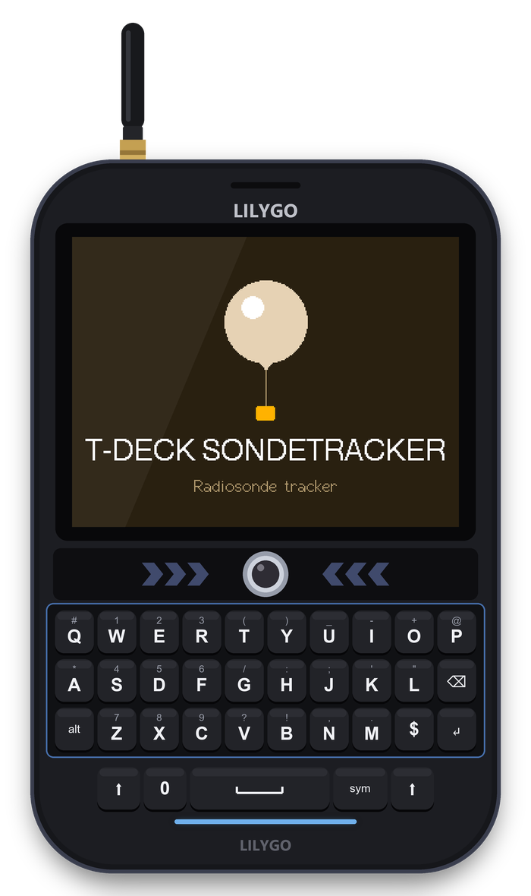
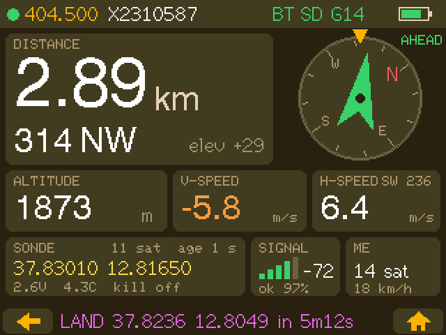
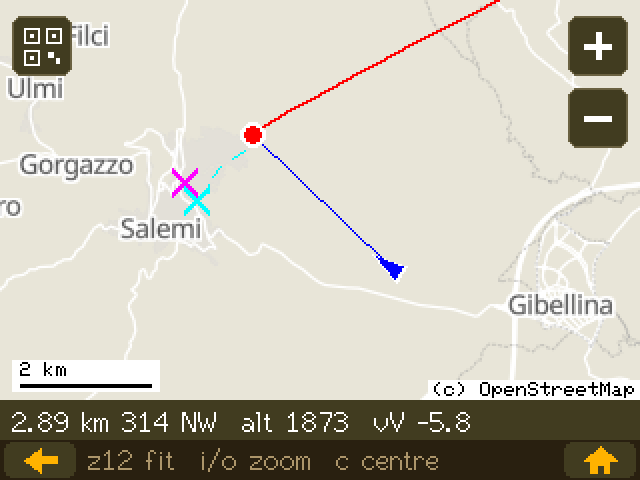
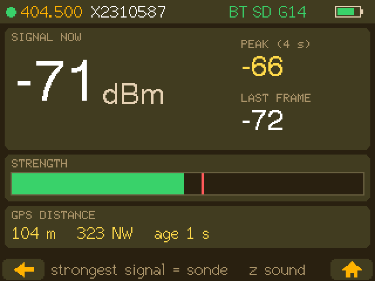
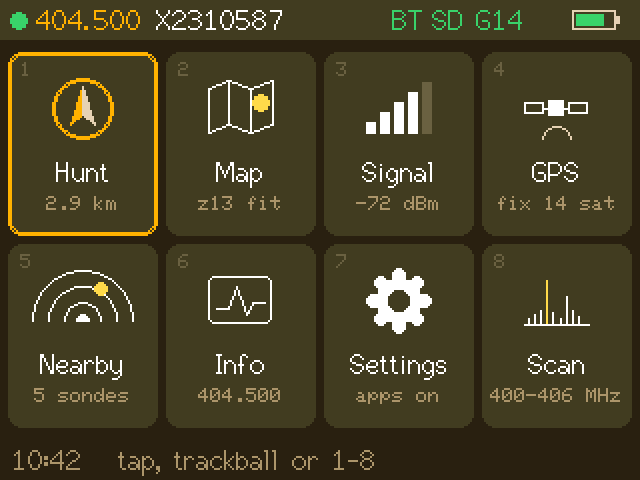
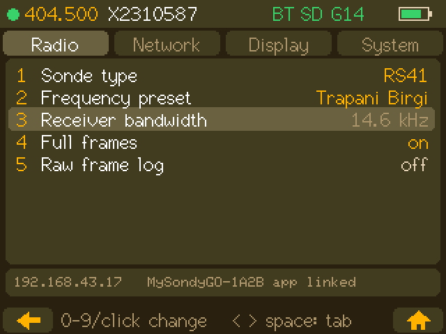
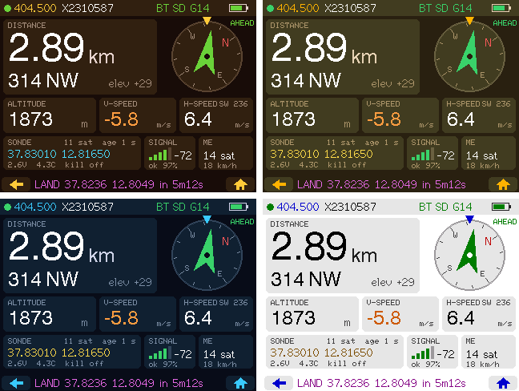
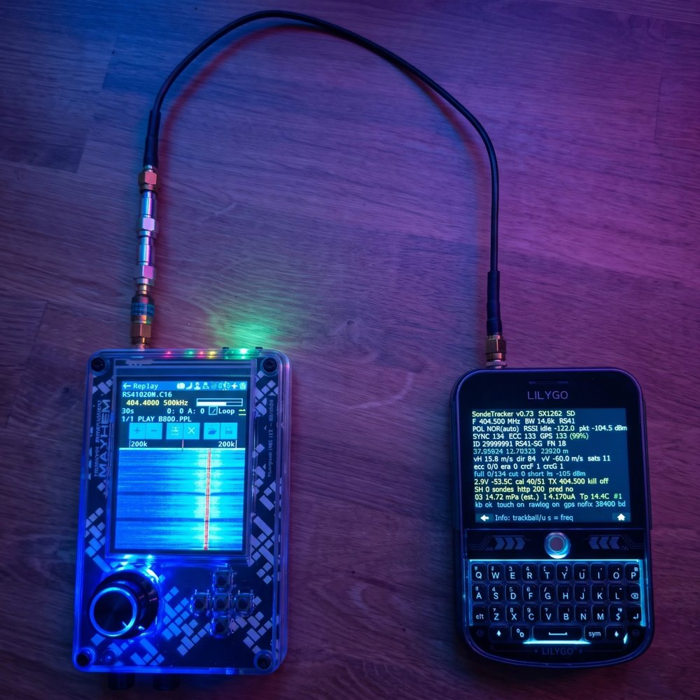

<div align="center">

<a href="README.md"></a>&nbsp;&nbsp;<a href="README.it.md"></a>

[](#)
[](https://github.com/N1k0droid/t-deck-sonde-tracker/releases)
[](LICENSE)
[](https://github.com/Xinyuan-LilyGO/T-Deck)
[](#)
[](https://platformio.org)

<br>



### Hunt radiosondes (Vaisala RS41, Graw DFM, Meteomodem M10/M20, InterMet iMet-54) with nothing but a LilyGO T-Deck Plus (433 MHz)

<table>
  <tr>
    <td align="center"><br><sub>Hunt: distance and compass</sub></td>
    <td align="center"><br><sub>Offline map and landing prediction</sub></td>
    <td align="center"><br><sub>Approach: signal meter</sub></td>
  </tr>
</table>

</div>

> [!WARNING]
> **Firmware in testing phase.** It works, but some parts have not been field-tested yet: see [Features in development and to be verified](#features-in-development-and-to-be-verified).

## Contents
- [What it is](#what-it-is)
- [Project status](#project-status)
- [What you need](#what-you-need)
- [Installation](#installation)
- [First start](#first-start)
- [Wi-Fi and the web page, step by step](#wi-fi-and-the-web-page-step-by-step)
- [Controls](#controls)
- [Pages](#pages)
- [Settings](#settings)
- [Offline map](#offline-map)
- [Hunting apps on the phone](#hunting-apps-on-the-phone)
- [Internet through the phone hotspot](#internet-through-the-phone-hotspot)
- [Web interface](#web-interface)
- [Debug server](#debug-server)
- [Full frames and ozone sensor](#full-frames-and-ozone-sensor)
- [Sonde types and presets](#sonde-types-and-presets)
- [Sending data: SondeHub, radiosondy.info, aprs.fi](#sending-data-sondehub-radiosondyinfo-aprsfi)
- [SondeHub: help wanted](#sondehub-help-wanted)
- [Files on the SD card](#files-on-the-sd-card)
- [How it was tested](#how-it-was-tested)
- [Features in development and to be verified](#features-in-development-and-to-be-verified)
- [Known limits](#known-limits)
- [Glossary](#glossary)
- [Building from source](#building-from-source)
- [Credits and license](#credits-and-license)

## What it is
Radiosondes are small weather instruments carried by a balloon: they climb to 30-35 km, the balloon bursts and they fall back under a parachute. They transmit their position in the 400-406 MHz band, and many radio amateurs go and find them: "sonde hunting".

Usually you need a receiver (for example a TTGO board), a phone with an app and a map. **T-Deck SondeTracker does it all with just the T-Deck Plus**, even with no phone and no internet:

- receives and decodes **Vaisala RS41** sondes with the T-Deck's built-in radio, **whole frames included** (better with weak signals), **Graw DFM-06/09/17**, **Meteomodem M10/M20** and **InterMet iMet-54** sondes;
- reads the **ozone sensor** (OIF411) of ozone sondes;
- shows the sonde's **distance, direction, altitude and speed**, with a compass that points the way;
- predicts **where the sonde will land**, from the wind measured by the sonde itself;
- **offline map** from the SD card, with your position, the sonde, its track and the landing point;
- **approach page** with an audible signal meter for the last metres;
- **continuous scan** (preset frequencies first, then the whole band) to find a sonde whose frequency you do not know;
- saves **each sonde's track** to the SD card (CSV, and KML export for Google Earth);
- when you want, it works as a **receiver for the hunting apps** (MySondyGO, Hunter Tracker, TrovaLaSonda) and **reads SondeHub** through the phone hotspot;
- if you turn it on, it **sends the sondes** to radiosondy.info and **your station position** to radiosondy.info and aprs.fi; it keeps every frame in the SondeHub format on the SD card, to get the firmware approved by SondeHub ([help wanted](docs/SONDEHUB.md)).

<p align="center">
    
</p>

## Project status
The firmware is in its **testing phase**. RS41 reception (also on real flights), the hunting screen, the map, the themes, SondeHub reading and the uploads to radiosondy.info and aprs.fi work and have been tested on the T-Deck Plus; the scan and the other sonde types on the bench. How the tests were done: [How it was tested](#how-it-was-tested). Other features are complete but still need field testing: see [Features in development and to be verified](#features-in-development-and-to-be-verified).

The screenshots on this page reproduce the T-Deck screens with sample data (a simulated hunt in Sicily).

Reports, tests and suggestions are welcome in the GitHub **Issues**.

## What you need
- **LilyGO T-Deck Plus, 433 MHz version** (SX1262 LoRa radio and built-in GPS). The T-Deck Plus is sold in 433, 868 and 915 MHz versions: only the **433 MHz** one has the radio circuit tuned close to the 400-406 MHz sonde band. The 868/915 MHz versions receive the sondes much worse, or not at all.
- The plain T-Deck (without "Plus") has no GPS: the firmware runs, but without your own position.
- A **microSD card** (FAT32), recommended: it holds logs, tracks and the map.
- An **antenna** suited to 400-406 MHz: the 433 MHz antenna supplied with the T-Deck is fine to start with.
- Optional: a phone with a hotspot, for internet and the hunting apps.

## Installation
Download the file from the **[Releases](https://github.com/N1k0droid/t-deck-sonde-tracker/releases)** page: `t-deck-sonde-tracker-v-<version>-beta<n>.bin`, for example `t-deck-sonde-tracker-v-0.95-beta4.bin` (the 0.x versions are betas; from 1.0.0 on `t-deck-sonde-tracker-v-<version>.bin`). It is a full image (bootloader, partitions and program), to be written at address 0.

### Method 1: with the Launcher firmware (recommended)
The [Launcher](https://github.com/bmorcelli/Launcher) is an open-source firmware for ESP32 devices, T-Deck included, that acts as a boot manager: it stays on the device and lets you install and switch between firmwares kept on the SD card, without a PC. Radiosonde hunting is not an everyday activity: with the Launcher the T-Deck can run another firmware day to day and switch to T-Deck SondeTracker when there is a launch to chase.

If the Launcher is not on your T-Deck yet, install it once from the [Launcher Flasher](https://bmorcelli.github.io/Launcher/) page (Chrome or Edge), following the instructions there.

1. Copy the `.bin` file to the `downloads` folder of the SD card (create it if missing), where the Launcher looks for firmwares. Once T-Deck SondeTracker is installed, the next versions can also be copied from the browser, without taking the card out: see [Web interface](#web-interface), **Files** page.
2. Put the SD card in the T-Deck and start the Launcher.
3. Choose **SD**, then the file `t-deck-sonde-tracker-v-….bin`, and confirm.
4. When done, the T-Deck restarts into T-Deck SondeTracker.

### Method 2: from the browser, over USB
[ESP Web Tool](https://esptool.spacehuhn.com) is an open-source web page that writes firmware to ESP32 boards: there is nothing to install. The browser talks to the T-Deck over USB through the Web Serial API, which only Chrome and Edge on desktop support.

This method writes the whole flash memory: **it replaces the Launcher**, if you have it.

1. Connect the T-Deck to the PC with a USB-C cable **that carries data** (some cables only charge).
2. Open [esptool.spacehuhn.com](https://esptool.spacehuhn.com) in Chrome or Edge.
3. Press **Connect** and pick the T-Deck's port. If it does not show up: hold the trackball down (BOOT button), press and release the reset button on the side, release the trackball, and try again.
4. Choose the `.bin` file, check that its offset is `0x0` and press **Program**.
5. When done, press the reset button.

### Method 3: command line (esptool)
```bash
pip install esptool
esptool --chip esp32s3 write-flash 0x0 t-deck-sonde-tracker-v-0.95-beta4.bin
```
With older versions of esptool the command is `esptool.py ... write_flash ...`.

## First start
1. At power-on the logo shows for a moment, then the **Home** page.
2. Go outdoors: the GPS needs to see the sky. The first fix can take a few minutes; the **GPS** page shows the satellites coming in.
3. Set the sonde frequency: on the **Hunt** page press `f`, type the frequency in MHz (for example `404.5`) and press Enter. If you do not know it, use **Scan** from the Home page.
4. When the sonde is received you hear a short "tick" at each packet and the Hunt page fills with data.

> The frequencies of sondes launched near you are on [SondeHub](https://tracker.sondehub.org), or on the T-Deck itself in the **Nearby** page (internet needed).

## Wi-Fi and the web page, step by step
Wi-Fi is for the internet (nearby sondes, exact time, uploads) and for using the T-Deck from a browser. The T-Deck only sees **2.4 GHz** networks, not 5 GHz ones. The handiest network is the phone hotspot.

1. Turn on the hotspot on the phone. On an iPhone also turn on **Maximize Compatibility**: then the hotspot uses 2.4 GHz.
2. On the T-Deck go to **Settings**, **Network** tab, and press **Scan networks**. After a few seconds the list of networks appears.
3. Pick your network. If it is protected a box opens: type the password (you see it while typing) and press Enter.
4. To find it again next time: **Saved networks**, then the first row **+ save this network**.
5. For the internet turn on **Internet via Wi-Fi** (same tab). For the web page go to the **System** tab and turn on **Web interface**.
6. After a few seconds the **Web interface** row shows the T-Deck's address: four numbers separated by dots.
7. On the phone or PC, on the same network, open the browser and type `http://` followed by that address (`http://<ip>/`).
8. The browser asks for a user and a password: user `tdeck`, password `radiosonde`. Change the password with the **Web password** row.

What the page does: [Web interface](#web-interface).

## Controls
The T-Deck is used with the **keyboard**, the **trackball** and the **touch screen**: every function can be reached in all three ways.

- **Home:** tap a button, or move the trackball and press it, or press the button's number.
- **At the bottom of every page:** ◀ **Back** on the left and ⌂ **Home** on the right. Keyboard: Back = Backspace (or Esc); Home = `h`.
- **`v`** quickly switches between the three hunting pages: Hunt, Map and Signal; **`m`** opens the map.
- **Trackball:** moves the selection in lists; pans the map (a click changes the centre, like `c`); in Hunt, Signal and Info up/down changes the frequency by ±1 kHz; **held for 3 seconds** it locks or unlocks the screen.
- **`Alt`+`D`** deletes the item in focus in the preset and saved-network lists (after a confirmation).
- **Yes/No questions:** `y` answers yes, `n` or Back answers no. Enter takes the button in focus, which is No at first.
- **Frequency at the top left:** a tap starts typing a new frequency, like `f` (not on the Map page).
- **While typing a text:** Esc, Backspace on an empty field, or a tap on the screen cancels.

### Keys
| Key | Function |
|---|---|
| `h` / Backspace | Home / back |
| `m` | map |
| `v` | switch between the hunting pages: Hunt, Map, Signal |
| `f` | type a new frequency (digits, then Enter) |
| `w` or `+` / `q` or `-` | frequency +1 / −1 kHz |
| `e` / `d` | frequency +10 / −10 kHz |
| `p` | next preset of the same country |
| `a` | save the current frequency and sonde type as a new preset: type a name, then confirm with `y` |
| `j` | search the presets: type a name, e.g. `trapani`, then Enter |
| `y` | sonde type: auto / RS41 / DFM / M10/M20 / iMet54 (in questions it means yes) |
| `x` | start the scan (`x` again stops it) |
| `n` | the compass points to the sonde or to the predicted landing point |
| `t` | manual target: type latitude and longitude, for example `38.0176 12.5365` |
| `s` | mutes every sound; pressed again, back to the previous volumes |
| `k` | export the sonde track as KML (for Google Earth) |
| `i` / `o` | map: zoom in / out |
| `c` | map: centre on both, on you, on the sonde |
| `g` | map: QR code with the sonde position, to scan with the phone |
| `u` | signal polarity: automatic / normal / inverted (normally leave it on automatic) |
| `r` | resets the counters, the received position and the T-Deck's prediction; a target typed with `t` stays |
| `l` | raw data log on/off |
| `Alt`+`B` | keyboard backlight on/off |
| trackball held 3 s | lock / unlock keys, trackball and touch (a padlock in the status bar); radio, alarms and uploads keep working. Always unlocked after a restart |

## Pages

### Home
Eight buttons: **Hunt**, **Map**, **Signal**, **GPS**, **Nearby**, **Info**, **Settings**, **Scan**. Under each name a short line tells how that page stands: for example the distance to the sonde, the map zoom, the signal in dBm, the GPS fix, how many sondes SondeHub found.

### Hunt


The main page while hunting:
- at the top the status bar: packet light, frequency, sonde serial, `WEB` with the web interface on (`DBG` with the debug pages on; a padlock when the screen is locked), `SH` / `RS` / `FI` in red while an upload is on (SondeHub, radiosondy.info, aprs.fi; with more than one on, small and stacked), `BT` for the apps, `SD`, your GPS satellites, battery;
- the **distance** to the sonde in large digits and the **compass**;
- the sonde's altitude, vertical and horizontal speed;
- at the bottom messages, predicted landing point and hints.

**Reading the compass.** The T-Deck has no magnetic compass: it gets the direction from the GPS while you move.
- **AHEAD** (green): you are walking or driving. The triangle at the top is your direction, the arrow is the sonde, the letters N E S W rotate to show the real cardinal points. Follow the arrow.
- **N UP** (yellow): you are standing still. The arrow is referred to north: hold the top of the screen towards north.

While descending, the bottom line shows the predicted landing point and the time to landing (`LAND`, or `SH LAND` when it is SondeHub's prediction), alternating with the altitude below which the signal will be lost behind the horizon ("signal lost below ~… m").
<br clear="right">

### Map


Shows you (blue), the sonde (red), its track, the line between you and the sonde, and the predicted landing point: the magenta cross is the T-Deck's prediction, the light blue one, with its dashed path, SondeHub's (with internet).
- Zoom with `i`/`o` or by tapping `+` and `−`.
- `c` centres the view; the trackball pans it.
- The **QR** button at the top left (or `g`) shows a QR code: scan it with the phone to open navigation to the sonde or to the landing point.

The map tiles must be prepared and copied to the SD card: see [Offline map](#offline-map). Without the `/maps` folder the page only shows how to prepare it. Where a single tile is missing the background is grey.
<br clear="right">

### Signal (approach)
For the last metres, when the GPS is not enough: a bar shows the live signal with the recent peak, and the audible **signal meter** gets higher and faster as the signal grows. Turning around on the spot, the signal is strongest towards the sonde.

### GPS
GPS status: 2D/3D fix or searching, satellites with the signal strength of each, HDOP and PDOP (the lower, the more precise the position), time to the first fix, position, altitude, speed, local time (or UTC) and the state of the GPS aid. The T-Deck helps the GPS get its fix sooner by telling it the time and a rough position (from the internet or from the sonde).

### Nearby (internet needed)


Four tabs, chosen by tapping them or with keys 1-4:
- **Near:** sondes in flight in the last 3 hours within 300 km. Orange ones are descending, the green one is the sonde you follow. A tap follows one: it becomes the target and the radio tunes to it. A tap on the followed one stops following it.
- **Landed:** flights landed within 400 km, in the last 3 hours, 12 hours, 24 hours or 7 days, with the landing point. The details of a flight can make that point your target.
- **Launches:** scheduled launches from nearby stations within the **Launch predictions** setting (24 hours by default), with the predicted landing; they are computed when you open the tab.
- **Search:** look up a sonde by serial (for example `X1422184`).
<br clear="right">

### Scan
Searches until it finds a sonde or you stop it (`x`, Back, or a tap): first the frequencies of the presets, then the whole band 400-406 MHz, round after round, listening to the strongest channels in between. The graph keeps the highest level seen (dim) under the current sweep, with the noise threshold; a channel already tried without a sonde is left alone for 10 minutes (grey mark). When a sonde is decoded the T-Deck beeps and asks whether to keep it and go to the Hunt page; with No the search goes on. Stopping it goes back to the previous frequency.

### Info
Technical reception and sonde data: decoding quality, corrections, whole frames received, sonde battery and temperature, kill timer, statistics, ozone sensor values.

### Settings
See the next section.

## Settings


Four tabs: **Radio**, **Network**, **Display**, **System**. Move between tabs with the trackball left/right, the space bar or by tapping the tab name. In each tab pick a row with the trackball or by touch (or, in tabs of up to ten rows, with digits 1-9 and 0) and press it to change it. Text fields are confirmed with Enter:
- Enter with nothing typed keeps the value there was;
- a single `-` clears it;
- passwords, passcodes and tokens are shown while you type them.

The Network tab has more than ten rows, so digits do not work there: use the trackball or touch. In the value column "set" means "not set yet", "change" that there is one.
<br clear="right">

| Tab | No. | Row | Default | What it does |
|---|---|---|---|---|
| Radio | 1 | Sonde type | auto | auto (tries every type), RS41, DFM, M10/M20, iMet54: see below |
| | 2 | Frequency preset | — | opens the list of presets from `presets.txt` |
| | 3 | Receiver bandwidth | 14.6 kHz | width of the receive filter: 9.7 to 39 kHz. Keep 14.6: wider lets in more noise (at 19.5 kHz weak RS41 sondes are lost); M10/M20 always use at least 23.4. Shown in orange when not 14.6. Hunting apps cannot change it |
| | 4 | Full frames | on | receive whole 320/518-byte frames (see below); off = 255 bytes + error correction |
| | 5 | Raw frame log | on | saves the raw received data to the SD card |
| Network | 1 | Scan networks | — | lists the Wi-Fi networks around (only when pressed); the one you pick replaces the Wi-Fi name, and for a protected one a box asks its password |
| | 2 | Saved networks | — | first row "+ save this network" keeps the Wi-Fi name and password now set (asks Yes/No); below, the saved networks: the one you pick replaces the Wi-Fi name and password (kept after a restart); Alt+D deletes one from the list. They are in `wifi.txt` (see below) |
| | 3 | Wi-Fi name | — | Wi-Fi network name (for example the phone hotspot) |
| | 4 | Wi-Fi password | set | network password (stored on the device, not encrypted); "change" once it is set |
| | 5 | Internet via Wi-Fi | off | use the internet through the Wi-Fi network above; it says "online" only while a server really answers, "no internet" when none does (after 3 minutes like that the T-Deck joins the network again by itself) |
| | 6 | Wi-Fi power save | off | lets the Wi-Fi sleep between the router's beacons: less current, but with some routers the link stops working |
| | 7 | Launch predictions | 24 h | how far ahead the Launches tab looks for launches: 12 h, 24 h, 3, 5, 7 days |
| | 8 | Hunting apps | off | link to the apps: off, Bluetooth, Bluetooth + Wi-Fi |
| | 9 | Callsign | — | your callsign, one for every upload (saved in capitals, e.g. `IT9ABC-9`) |
| | 10 | APRS passcode | set | the APRS-IS passcode of your callsign, needed for radiosondy.info and aprs.fi; "change" once it is set. It is a number computed from the callsign: get it from an APRS passcode calculator (there are many online) or from your APRS service. It needs an amateur radio callsign |
| | 11 | SondeHub upload | awaiting approval | **suspended**: SondeHub has not approved this firmware yet, so the row cannot be turned on; pressing it explains how to help ([SondeHub](docs/SONDEHUB.md)) |
| | 12 | SondeHub JSON log | on | keeps every received frame in the SondeHub format in `sondehub/<serial>.json` on the SD card (about 2 MB per hour of reception), to send to me for the approval ([how](docs/SONDEHUB.md)) |
| | 13 | radiosondy.info upload | off | sends the received sondes to radiosondy.info as APRS objects (one per sonde every 30 s); same question |
| | 14 | aprs.fi upload | off | sends your station position to aprs.fi (main APRS-IS network, European servers), with the icon chosen below; same question. Only the station: the sondes go to radiosondy.info |
| | 15 | aprs.fi comment | on | adds a comment for the situation: chasing a sonde (mobile), receiving one (fixed), or looking for sondes. Texts in `aprsfi.txt`, see below |
| | 16 | Only sondes in flight | on | sends only sondes seen flying; off, also a sonde on the ground |
| | 17 | Send my position | off | where your station position is shared: off, all (radiosondy.info and aprs.fi), only radiosondy, only aprs.fi. The SondeHub choice is shown greyed out until SondeHub approves the firmware. aprs.fi gets nothing else, so its upload needs all or aprs.fi here. With all, your position is also written in the SondeHub JSON files |
| | 18 | Station | mobile | mobile: shown as a chase car; fixed: a receiver (on radiosondy.info and aprs.fi always the dish icon `` /` ``: that is how radiosondy.info lists receivers). A mobile station also sends speed, course and altitude |
| | 19 | Mobile icon | person | icon of the mobile station on radiosondy.info and aprs.fi: person `/[`, car `/>`, or `/(` (used by other sonde receivers) |
| | 20 | Mobile update | 60 s | how often the position of a mobile station is sent: 30 s, 60 s, 2, 5, 10, 15 min (on aprs.fi at most once a minute) |
| | 21 | Fixed update | 30 min | how often the position of a fixed station is sent: 10, 30, 60 min |
| | 22 | GPS fix wait | 1 min | your position is shared only after the GPS has had a good fix (3D, 5 or more satellites, HDOP up to 3) for this long without a break: 30 s, 1, 2, 5 min. The first fixes after switching on can be far off |
| | 23 | Min distance | off | mobile station: no new position until it has moved this far from the last one sent: off, 200 m, 500 m, 1 km (a new comment or icon is still sent) |
| Display | 1 | Screen brightness | 100% | display brightness: 100%, 75%, 50%, 25%, 12% (at night) |
| | 2 | Screen timeout | 5 min | time without input before the screen goes off or is dimmed: always on, 1, 5, 10 min |
| | 3 | Screen dimming | screen off | what happens at the timeout: screen off switches it off; light, medium, strong keep it on, dimmed (strong darkest) |
| | 4 | Theme | Desert | colours: Desert, Olive, Navy, Sun (high contrast for sunlight) |
| | 5 | Keyboard light | Alt+B | reminder of the keyboard backlight key combination |
| | 6 | Touch screen | on | touch input on or off |
| | 7 | Auto lock | off | locks keys and touch after a time without input: off, 1, 2, 5 min (hold the trackball 3 s to unlock) |
| | 8 | Trackball speed | fast | how far the ball turns for one step: fast, medium, slow |
| System | 1 | Volume | 7 | volume of alarms, approach meter and confirmations: 0 mute, 9 loudest |
| | 2 | Frame volume | 7 | volume of the sound of each received frame, on every page: 0 mute, 9 loudest |
| | 3 | Frame sound | soft tick | sound of each frame: a soft tick, or a beep that gets higher as the signal gets stronger |
| | 4 | Time zone | UTC+1 | time zone (winter time), picked from a list with a few cities for each, UTC-12 to UTC+14 |
| | 5 | Daylight saving | auto | summer time: off, on (+1 hour), auto (European dates: last Sunday of March and of October) |
| | 6 | Web interface | off | use the T-Deck from the browser of a phone or PC (see below); when on, it shows the address to open |
| | 7 | Debug server | off | remote control pages for tests and problem reports (see below); when on, it shows "on, /debug" |
| | 8 | Web password | default | password of the web interface and of the debug pages (default `radiosonde`, user name `tdeck`): type a new one, `-` goes back to the default |
| | 9 | About | — | version, author and project link |

**Screen timeout:** with the screen off or dimmed the T-Deck keeps receiving, logging and **playing sounds**. The first key or touch only brings the screen back to full brightness and does nothing else; alarms wake it on their own. Light, medium and strong cut the chosen brightness to a half, a quarter and an eighth.

<p align="center">
  <br>
  <i>The four themes: Desert, Olive, Navy, Sun</i>
</p>

## Offline map
The T-Deck reads the map from the SD card, as 256-pixel PNG tiles in `/maps/<zoom>/<x>/<y>.png`. The public OpenStreetMap servers do not allow bulk tile downloads, so the project includes a script that **renders the tiles on your PC** from OpenStreetMap data. The script is in the `tools/mappack` folder of this repository: download everything with the **Code** button, then **Download ZIP**, at the top of this page.

Where a tile is missing, the T-Deck shows the one from the lower level enlarged: a "layered" map works best, with little detail everywhere and much detail only where you hunt.

### What you need
- **Docker** (Docker Desktop on Windows or Mac), running;
- **Python 3** and, recommended, Pillow (`pip install pillow`);
- about 10 GB free during the preparation (for a country like Italy).

### Steps
1. Copy `tools/mappack/sicilia.json` under a new name and edit it for your area:
   - in `sources` put the name of your country's [Geofabrik](https://download.geofabrik.de) extract (for example `italy`, `germany`, `france`);
   - in `layers` put, for each layer, the box `[south, west, north, east]` in degrees and the zoom levels. Example: world 0-2, continent 3-7, country 8-11, your region 12-14.
2. Check how many tiles will be made:
   ```bash
   python tools/mappack/make_maps.py tools/mappack/my_area.json --dry-run
   ```
3. Build the map (the first time it downloads the data and can take from minutes to a couple of hours):
   ```bash
   python tools/mappack/make_maps.py tools/mappack/my_area.json
   ```
4. Copy the generated folder (`mapwork/maps`) to the root of the SD card, named `maps`: you must have `/maps/0`, `/maps/1`, … Restart the T-Deck.

For reference: the Sicily example (world, Europe, Italy, Sicily up to zoom 14) gives about 30,000 tiles and 130 MB.

| Zoom | Screen width | Use |
|---|---|---|
| 0-2 | world | background |
| 3-7 | 4,000 to 300 km | continent, country |
| 8-11 | 150 to 19 km | region, travel |
| 12-14 | 10 to 2.4 km | roads, tracks, last stretch |

Map data © OpenStreetMap contributors (ODbL).

## Hunting apps on the phone
The T-Deck can act as the receiver for the apps you already use, without changing them. **Hunting apps** row (Network tab):
- **Bluetooth:** the T-Deck shows up as `MySondyGO-XXXX` and speaks the MySondy GO 4.1 protocol. It works with **MySondyGO**, **Hunter Tracker** (MySondy receiver) and **TrovaLaSonda**: look for it among the Bluetooth devices in the app. The frequency can be changed from the app.
- **BT + Wi-Fi:** in addition, on the Wi-Fi network that is set (Network tab), the T-Deck behaves like a **TTGO rdz** receiver (`http://<ip>/live.json` and TCP port 14570), for the apps that support it.

`BT` appears at the top: grey while waiting, green with an app connected.

> The link to the apps sends nothing to the internet, but **the apps may upload data to SondeHub on their own**: check the app's settings.

## Internet through the phone hotspot
With **Internet via Wi-Fi** on (Network tab) and the T-Deck connected to the phone hotspot:
- exact time from the internet and a faster GPS fix;
- **Nearby** page with nearby sondes, landings and upcoming launches;
- sonde position from SondeHub while the radio cannot hear it ("SONDE (NET)" card). SondeHub asks not to poll its API: the nearby sondes are read every 5 minutes, every minute only with the Near list open (on the T-Deck or in the web page) or while following a sonde the radio does not hear; the prediction of the followed sonde is asked every 3 minutes; a followed sonde that stands still for 10 minutes (landed, or nobody hears it) goes back to every 5 minutes and its prediction is no longer asked;
- SondeHub's landing prediction on the map, kept even if the internet drops.

The T-Deck **only reads** here: it sends data to SondeHub, radiosondy.info or aprs.fi only if you turn on their upload (see [Sending data](#sending-data-sondehub-radiosondyinfo-aprsfi)). To ask for nearby sondes it shares your position rounded to about 10 km. Without internet everything else works as usual.

## Web interface
The **Web interface** row (System tab, off by default) lets you use the T-Deck from the browser of a phone or PC on the same Wi-Fi network: open `http://<ip>/` (the address is shown in the settings, user `tdeck`, password `radiosonde` unless you changed it, **Web password** row). It is made to run the T-Deck as a remote station: everything the keys and the screen do, the page does too. How to turn it on the first time: [Wi-Fi and the web page, step by step](#wi-fi-and-the-web-page-step-by-step). It has nine pages:
- **Hunt:** the sonde (serial, altitude, vertical and horizontal speed, satellites, battery, temperature, kill timer, ozone), distance, direction and elevation from you, the compass (turned with your direction while you move, as **AHEAD** on the T-Deck), signal, decoded frames and age of the last frame, the landing prediction with a **Navigate** button (Google Maps), and the height below which the signal will be lost. The buttons: **To sonde** / **To landing** choose where distance and arrow point (the `n` key); **Target** types a point (the `t` key); **KML** makes the track file and downloads it; **Reset** clears the counters, the received position and the prediction (a typed target stays); **Sound off** silences the T-Deck. It updates every 2 seconds;
- **Map:** you, the sonde, its path and the landing predictions on an OpenStreetMap map, taken from internet by the phone or PC (the offline maps of the SD card are only on the T-Deck screen); the T-Deck only sends the points. Like the `c` key on the T-Deck, **Both** keeps everything in view (you, the sonde, its path and the predictions), **Me** and **Sonde** keep that point in the middle; with **follow** ticked the map keeps doing it (dragging the map stops it). A click on the sonde opens its links on **SondeHub** and **radiosondy.info** and the **Navigate** button. The path SondeHub predicts for the followed sonde is a dashed line;
- **Radio:** frequency (typed or in 1 and 10 kHz steps), sonde type, polarity, receiver bandwidth and noise level, scan start and stop with the live spectrum of 400-406 MHz and the channels found, the presets list with a search box, **Auto (no preset)**, **Next**, **Save current** (the frequency in use, with a name), **Add European sites** and a bin on each preset to delete it;
- **SondeHub:** the four lists of the T-Deck's **Nearby** page: **Near**, **Landed** (last 3 h, 12 h, 24 h or 7 days), **Launches** (next launches of the sites around, with the predicted landing) and **Search** by serial. A click on a sonde opens a box with **Follow and tune** (follows it and tunes to it) or **Stop following**, the SondeHub link and **Navigate**; in the details the landing point can become your target. It needs **Internet via Wi-Fi** on;
- **Signal:** the signal level now and its peak of the last 4 seconds, twice a second, the last frame and the distance: the page to walk the last metres. **Tone** plays a pitch that follows the signal in the browser;
- **GPS:** fix, satellites used, HDOP and PDOP, the signal of each satellite in view, position, height, speed and course, clock and GPS aid;
- **Info:** the lines of the T-Deck's Info page (radio, counters, last frame, sonde status, SondeHub);
- **Settings:** all the rows of the four tabs, with the same values and choices as on the T-Deck. Turning an upload on asks "Are you sure?" both on the T-Deck and in the browser; the **SondeHub upload** row explains how to help get the approval. A message of the T-Deck (for example why a row cannot change) shows at the bottom of the page. **Saved networks** has a bin on each network, **Scan networks** asks the password of the network you pick;
- **Files:** the SD card files and folders, each with buttons to **download**, **rename** and **delete** it (deleting asks first and cannot be undone; a folder only when empty), and **Upload files** (or drag them onto the page) to copy files from the phone or PC onto the card, in the folder that is open. For example, if you use the Launcher, a new firmware `.bin` in `/downloads`: then install it from the Launcher, without taking the card out. While a file is copied, in either direction, the T-Deck does not receive: better after the hunt.

At the top, the padlock locks and unlocks the T-Deck keys (the page keeps working with them locked) and the menu has **About** and **Restart the T-Deck**. Whatever you change from the browser changes on the T-Deck too, and the other way round. The page uses the colours of the theme chosen on the T-Deck (Display tab, Theme row) and always fills the window, from a phone to a large monitor, without scrolling: only long lists (presets, files, and the settings on a phone held sideways) scroll inside their box.

The password is only a lock against a quick look on a shared network, not real security: use the web interface only on your own networks (for example the phone hotspot).

## Debug server
The **Debug server** row (System tab, off by default) turns on the pages for tests and problem reports at `http://<ip>/debug` (same user and password as the web interface, same theme colours), with buttons for:
- **Screen:** the T-Deck screen, which you can click like the touch screen, with the arrows, Enter, Back, Home and the most used keys;
- **Status** and **Log:** the T-Deck state and its latest messages, useful to report problems.

Files and restart are in the web interface.

The pages ask for a **password**: `radiosonde` until you change it (**Web password** row). The user name is always `tdeck`. It is only a lock against a quick look on a shared network, not real security: turn the pages on only when you need them, and only on your own networks (for example the phone hotspot). The `/live.json` data for the hunting apps (Hunting apps: BT + Wi-Fi) needs no password.

## Full frames and ozone sensor
The SX1262 radio of the T-Deck normally stops a packet at 255 bytes, while an RS41 frame is 320 bytes long (518 with extra sensor data). With **Full frames** (Radio tab) (on by default) the T-Deck uses the long-packet method described by Semtech (application note AN1200.53): while the frame arrives, the end of the packet is moved forward, so **the whole frame is received**.

- **Better reception with weak, noisy signals.** With the whole frame the error correction can fix up to 12 wrong bytes per half frame, against 3 when only 255 bytes arrive. In bench tests with a simulated sonde and strong noise, the T-Deck decoded **97% of the frames with Full frames, against 26%** without. With good signals the two methods are equal.
- **Sondes with an ozone sensor** (Vaisala OIF411, extended 518-byte frames) are decoded: the **Info** page shows the ozone partial pressure in mPa, the cell current and the pump temperature; the hunting page shows "O3" next to the sonde data; the CSV file gets the `o3_mpa` column. The mPa value is an **estimate**: it uses the nominal pump flow, not the calibration sheet of the single sensor.
- If a frame is noticed too late to be extended (for example while the map loads many tiles), the T-Deck falls back to the 255-byte method for that frame: nothing is lost compared with before.
- While a frame is being received the T-Deck does nothing else, so the radio is not disturbed: with frames arriving every second the screen may react a little slower.

## Sonde types and presets
**Sonde types.** Besides the Vaisala RS41 the T-Deck decodes:

| Type | Models | What is read |
|---|---|---|
| DFM | Graw DFM-06, DFM-09, DFM-17 | position, speeds, time, serial number, model, battery (DFM-09/17) |
| M10/M20 | Meteomodem M10, M10+, M20 | position, speeds, time, serial number, model, battery, satellites (M10) |
| iMet54 | InterMet iMet-54, iMet-50 | position, time of day, serial number, model; speeds computed from the positions |

**Sonde type** row (Radio tab) (or key `y`):
- **auto** (default): the receiver tries every type in turn, with both polarities, until a frame is decoded; then it stays on that type until the signal is lost. If the preset in use names a type, that type is used straight away;
- **RS41**, **DFM**, **M10/M20** or **iMet54**: only that type, the fastest when you already know what will fly.

When you follow a sonde from the Nearby page, the type is taken from SondeHub. The DFM serial number arrives every few frames: for the first 20-30 seconds the sonde is shown as "DFM".

**Presets.** The frequencies are kept in the file **`presets.txt`** on the SD card, which the T-Deck creates the first time with the instructions inside and about **90 presets of European launch sites** ready to use (some sites have more than one frequency, and Tunis is there too), grouped by country (frequency and type of the sondes heard from them on SondeHub, November 2026). The T-Deck always reads the presets from this file and changes it only when you ask (key `a`, Alt+D, "+ add the European launch sites"), keeping your edits: if a site changes frequency, correct its line. One line per preset:

```
[Sicily]
404.500  RS41  Trapani Birgi
402.000  DFM   Tunis (DFM-17)
[France]
403.000  M10   Trappes
[Saved]
405.100  AUTO
```

- frequency in MHz, type (`AUTO`, `RS41`, `DFM`, `M10`, `M20` or `iMet54`), name (optional); `[Name]` starts a group (country, region); `#` starts a comment; up to 200 presets (you can add your own);
- the **Frequency preset** row (Radio tab) (or key `j` from any page) opens the list: type part of a name, a country or a frequency (`trapani`, `germany`, `404.5`) and the list shows only what matches; trackball left/right jumps between countries; pick one with Enter, the trackball or a tap and the T-Deck tunes to it;
- the preset you pick stays in use, also after a restart, until you choose **auto** (first row of the list): then there is no preset and the receiver finds the sonde type by itself;
- key `p` goes to the next preset of the same country, key `a` saves the current frequency and type under `[Saved]` with the name you type (an existing name gets " 2", " 3"…; the preset in use is never changed); in the list, with an empty search, Alt+D deletes the preset in focus after a confirmation;
- the last row of the list, **"+ add the European launch sites"**, adds the sites to an existing file, without duplicates: a site whose frequency you corrected is not added again;
- you can also edit the file on the PC: take the SD card out, change it, put it back.

## Sending data: SondeHub, radiosondy.info, aprs.fi
Every upload is **off by default**, and turning one on asks "Are you sure?" with **No** already chosen. They need the Wi-Fi (Network tab) and your **Callsign**; radiosondy.info and aprs.fi also the **APRS passcode** of the callsign.

| Service | What it gets | Rows (Network tab) |
|---|---|---|
| radiosondy.info | the received sondes (one APRS object per sonde every 30 s) and your station | radiosondy.info upload |
| aprs.fi | only your station, with a comment for the situation (`aprsfi.txt`) | aprs.fi upload, aprs.fi comment |
| SondeHub | **suspended**: SondeHub asks for whole flights of every sonde type before approving a new software. Meanwhile the frames are kept on the SD card (**SondeHub JSON log**): see [SondeHub: help wanted](docs/SONDEHUB.md) | SondeHub JSON log |

- **Your station position** goes only where **Send my position** says (off, all, or one service), only after a stable GPS fix (**GPS fix wait**), with speed and course when mobile; **Min distance** skips the updates while a mobile station does not move.
- By default only sondes seen flying are sent (**Only sondes in flight**); the serial numbers of the bench simulators never are.
- The APRS device id of the firmware is `APTKRS`.

## SondeHub: help wanted
SondeHub enables a new software only after checking **whole flights of every sonde type** it decodes. From Sicily I receive almost only RS41 and DFM-17: flights of **DFM, M10/M20 and iMet-54** (and more RS41) from other places would help a lot.

With **SondeHub JSON log** on (it is by default) the T-Deck keeps every received frame in `sondehub/<serial>.json` on the SD card. How to send the files: **[docs/SONDEHUB.md](docs/SONDEHUB.md)**.

## Files on the SD card
All the files of the T-Deck are in the folder **`/t-deck-sonde-tracker/`**; only the map tiles stay in `/maps/` and the firmware files in `/downloads/`, shared with other programs.

| File | Content |
|---|---|
| `sonde/<serial>.csv` | sonde track, one line per packet (opens in a spreadsheet; `o3_mpa` for ozone sondes) |
| `sonde/<serial>.kml` | track for Google Earth, made with the `k` key |
| `log.txt` | log of the received packets |
| `raw.txt` | raw data (Raw frame log), for analysis |
| `presets.txt` | frequency presets (see above) |
| `wifi.txt` | saved Wi-Fi networks, one per line `name,password` (`name,` for an open network); it can also be written by hand. The first comma splits name and password, so the name cannot contain one; spaces at the ends are dropped. The passwords are in plain text: keep the card in mind if you lend it |
| `aprsfi.txt` | comments sent to aprs.fi, one `key = text` per line: `chase` (mobile station hearing a sonde), `receive` (fixed station), `idle` (no sonde heard by radio), and `chase_nosite` / `receive_nosite` without a preset in use. `{serial}` is the sonde, `{site}` the name of the frequency preset in use. Written with the default English texts at the first start; edit it to change them (up to 59 characters, no `|` or `~`) |
| `sondehub/<serial>.json` | every received frame in the SondeHub format, one line per frame (SondeHub JSON log): the sonde data, your callsign, and your position only if Send my position is "all". See [docs/SONDEHUB.md](docs/SONDEHUB.md) |
| `gpsdb.ubx` | satellite data saved from the GPS, for a faster fix |
| `/maps/` | map tiles (outside the T-Deck's folder) |
| `/downloads/` | firmware to install with the Launcher (outside the T-Deck's folder) |

Altitudes in the KML are those sent by the sonde (ellipsoidal): in Google Earth the track appears a few tens of metres higher.

## How it was tested


Every version was tested **on the bench** first and then, for the RS41, **with real sondes**:
- **RS41:** on the bench with a recovered RS41, then in the field following real flights launched from Trapani (whole frames decoded down to about -113 dBm, more than 45 km away).
- **DFM, M10/M20, iMet-54** (and the RS41 too): **simulated sondes**. A HackRF (PortaPack), joined to the T-Deck by a cable and attenuators, transmits frames built like the real ones, with fake serials, normal and inverted polarity and several noise levels. Every version goes through an automatic session of 20 tests: serial, model and position must always be right. In the photo the PortaPack transmits a simulated RS41 with an ozone sensor and the T-Deck decodes it.
- **Compass letters N E S W** while moving and the **memory** of the manual target and of SondeHub's prediction after a power-off: checked in the field.
- **Uploads:** radiosondy.info (sondes and station) and aprs.fi (station) on real RS41 flights in November 2026, with the same positions, altitudes and times as the other stations; SondeHub with test data that it checks but does not store.
- **Quick GPS fix** with the satellite data saved to the SD card: checked by switching the T-Deck off and on, also after a trip of about a hundred kilometres.

These sonde types still need real flights, which are rare where I live. **Field tests and feedback from users are very welcome:** please leave them in the GitHub **Issues** (sonde type, frequency, distance, what worked and what did not).
<br clear="right">

## Features in development and to be verified
Complete in the firmware, but **not yet field-tested**:
- link with **MySondyGO, Hunter Tracker and TrovaLaSonda** (Bluetooth and Wi-Fi);
- **scan** (continuous search): it works on the bench (23 November 2026, simulated RS41), still to be tried with a real sonde;
- accuracy of the **landing prediction** over more flights. On 21 November 2026 (an RS41 heard only from 25 km up, so without the low winds) the T-Deck's own prediction was 6-17 km off above 5 km, 2 km off at 3.8 km, under 1 km below 2.5 km and **48 m** off at 570 m; SondeHub's was 1-6 km off up high and 500 m off at the end. The T-Deck shows SondeHub's prediction (with internet) while its own lacks the winds below the sonde, and its own below 2500 m above the ground;
- **ozone sensor**: the decoding follows the OIF411 sensor format and was tested with simulated sondes, but ozone flights are rare and a real one is still missing;
- **DFM, M10/M20 and iMet-54 decoders** with real sondes (tested on the bench with simulated sondes, see above);
- **SondeHub upload**: suspended until SondeHub approves the firmware, which needs whole flights of every sonde type: [help wanted](docs/SONDEHUB.md).

## Known limits
- **Vaisala RS41**, **Graw DFM**, **Meteomodem M10/M20** and **InterMet iMet-54** sondes only: no Vaisala RS92, iMet-1/4 or other types rare in Europe. Of the RS41 extra sensors (XDATA) only the OIF411 ozone sensor is decoded; the others are shown as raw data in the Info page. DFM, M10/M20 and iMet-54 temperature is not shown yet.
- No magnetic compass: when standing still the direction is referred to north.
- The keyboard handles `Alt`+`B` (its backlight) by itself and reports no key release: that is why the screen lock is on the trackball.
- The landing prediction assumes flat ground at your altitude.

## Glossary
- **Fix:** the GPS has computed the position. 2D without the altitude, 3D with it.
- **HDOP / PDOP:** how well the satellites are spread over the sky. The lower the number, the more precise the position (below 2 is good).
- **dBm:** the strength of the radio signal. It is a negative number: -80 is strong, -115 is at the limit.
- **Polarity:** some sondes arrive with their bits inverted. In automatic the T-Deck tries both ways.
- **APRS-IS:** the internet network of the radio amateurs using APRS. radiosondy.info and aprs.fi get their data from it.
- **APRS passcode:** the number that opens APRS-IS to your callsign.
- **Kill timer:** the time after which the sonde stops transmitting by itself.
- **XDATA:** the data of the extra sensors attached to an RS41, for example the ozone one.
- **Frame:** one data packet of the sonde. About one arrives every second.

## Building from source
1. Install [VS Code](https://code.visualstudio.com/) with the **PlatformIO IDE** extension, or `pip install platformio`.
2. Open the project folder and build:
   ```bash
   pio run
   ```
   On the first run PlatformIO downloads the toolchain and libraries. The full image to install is created in `release/`.
3. To write it straight to a T-Deck connected over USB: `pio run -t upload`.

## Credits and license
Author: **N1k0droid (IT9KVB)** — https://github.com/N1k0droid

The code was written with the help of AI-assisted programming tools (coding agents), under my direction, and tested by me on the real device.

Thanks to:
- [TFT_eSPI](https://github.com/Bodmer/TFT_eSPI), [PNGdec](https://github.com/bitbank2/PNGdec), [NimBLE-Arduino](https://github.com/h2zero/NimBLE-Arduino), [QRCode](https://github.com/ricmoo/QRCode);
- the MySondy GO protocol and the [rdz_ttgo_sonde](https://github.com/dl9rdz/rdz_ttgo_sonde) project, for app compatibility;
- [rs1729/RS](https://github.com/rs1729/RS) for the RS41 format documentation;
- [SondeHub](https://sondehub.org), [radiosondy.info](https://radiosondy.info) and [aprs.fi](https://aprs.fi) for the data and the maps they share;
- [Launcher](https://github.com/bmorcelli/Launcher) by bmorcelli and [ESP Web Tool](https://github.com/spacehuhntech/espwebtool) by Spacehuhn, for their tools that make installing the firmware possible and easy;
- map data © [OpenStreetMap](https://www.openstreetmap.org/copyright) contributors, [OpenMapTiles](https://openmaptiles.org), [Planetiler](https://github.com/onthegomap/planetiler), [TileServer GL](https://github.com/maptiler/tileserver-gl).


License: **GNU GPL v3.0 or later** (see [LICENSE](LICENSE)). You may use, modify and redistribute the code, keeping the same license and crediting the origin.

Like T-Deck SondeTracker? A ⭐ on the repository and a follow help the project grow.
