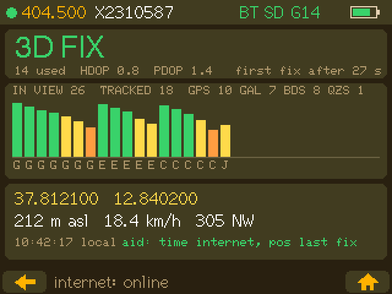
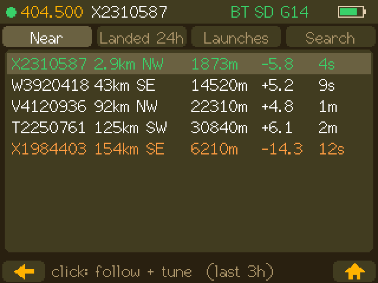

<div align="center">

<a href="README.md"></a>&nbsp;&nbsp;<a href="README.it.md"></a>

[](#)
[](https://github.com/N1k0droid/t-deck-sonde-tracker/releases)
[](LICENSE)
[](https://github.com/Xinyuan-LilyGO/T-Deck)
[](#)
[](https://platformio.org)

<br>


### Track and recover radiosondes with the LilyGO T-Deck Plus (433 MHz)

Vaisala RS41 · Graw DFM · Meteomodem M10/M20 · InterMet iMet-54

<table>
  <tr>
    <td align="center"><br><sub>Hunt: distance and compass</sub></td>
    <td align="center"><br><sub>Offline map and predicted landing</sub></td>
    <td align="center"><br><sub>Approach: signal strength</sub></td>
  </tr>
</table>

</div>

> [!WARNING]
> **Testing phase**: some features already implemented still need to be verified in the field. See ["Features in development and to be verified"](#features-in-development-and-to-be-verified).

## Contents
- [What it is](#what-it-is)
- [Project status](#project-status)
- [What you need](#what-you-need)
- [Installation](#installation)
- [First start](#first-start)
- [Wi-Fi and the web page](#wi-fi-and-the-web-page)
- [Controls](#controls)
- [Pages](#pages)
- [Settings](#settings)
- [Offline map](#offline-map)
- [Hunting apps on the smartphone](#hunting-apps-on-the-smartphone)
- [Internet through the smartphone hotspot](#internet-through-the-smartphone-hotspot)
- [Web interface](#web-interface)
- [Debug server](#debug-server)
- [Full frames and ozone sensor](#full-frames-and-ozone-sensor)
- [Sonde types and presets](#sonde-types-and-presets)
- [Sending data: SondeHub, radiosondy.info, aprs.fi](#sending-data-sondehub-radiosondyinfo-aprsfi)
- [SondeHub: help wanted](#sondehub-help-wanted)
- [Files on the SD card](#files-on-the-sd-card)
- [How it was tested](#how-it-was-tested)
- [Features in development and to be verified](#features-in-development-and-to-be-verified)
- [Known limits](#known-limits)
- [Building from source](#building-from-source)
- [Credits and license](#credits-and-license)

## What it is

T-Deck SondeTracker is a firmware for the LilyGO T-Deck Plus that lets you receive, track and recover radiosondes with a single device, with no need for a smartphone or an internet connection.

Radiosondes are small weather instruments carried by balloons that can reach an altitude of 30–35 km. When the balloon bursts, the sonde comes down under a parachute and keeps transmitting its position by radio, usually in the 400–406 MHz band. These transmissions let enthusiasts follow the flight and search for the sonde once it is on the ground.

This is usually done with a dedicated receiver and a smartphone running a tracking app. T-Deck SondeTracker brings radio reception, GPS navigation and offline maps together on the T-Deck Plus, guiding you from the chase during the flight to the last metres of the recovery.

### Main features

- Receives and decodes Vaisala RS41, Graw DFM-06/09/17, Meteomodem M10/M20 and InterMet iMet-54 radiosondes.
- Shows the sonde's position, altitude and speed, together with the distance and the direction to follow to reach it.
- Estimates the landing point from the winds measured by the sonde during the flight.
- Displays on offline maps your position, the sonde's position, the flight track and the predicted landing point.
- Helps you search on the ground with an audible indicator that changes with the strength of the received signal.
- Automatically looks for sondes whose frequency you do not know, trying the presets first and then the whole 400–406 MHz band.
- Logs the tracks to the SD card in CSV format and can export them as KML for Google Earth.

With a smartphone or a Wi-Fi connection you can also:

- Use the T-Deck as the receiver for MySondyGO, Hunter Tracker and TrovaLaSonda.
- Check SondeHub directly from the device to see nearby sondes, recent landings and upcoming launches.
- Share the received telemetry with radiosondy.info and your station position with radiosondy.info and aprs.fi.

> [!NOTE]
> The main reception and search features remain available offline. Sending data to external services is optional and off by default.

<p align="center">
    <br>
  <i>The screenshots on this page use sample data, taken from a simulated hunt in Sicily</i>
</p>

## Project status

The firmware is in its testing phase. RS41 reception has been tested both on the bench and during real flights. The hunting screen, the maps, the themes, SondeHub browsing and sending data to radiosondy.info and aprs.fi have also been verified on the T-Deck Plus.

The scan and the decoders for the other sonde types have passed the bench tests, but still need to be verified in the field. The same applies to some of the other features already in the firmware.

You can find the details of the tests in the ["How it was tested"](#how-it-was-tested) section and the list of checks still to be done in ["Features in development and to be verified"](#features-in-development-and-to-be-verified).

If you try the firmware, you can share results, report problems or suggest improvements in the GitHub [Issues](https://github.com/N1k0droid/t-deck-sonde-tracker/issues).

## What you need
- A LilyGO T-Deck Plus in the 433 MHz version, with SX1262 radio and built-in GPS. Of the 433, 868 and 915 MHz variants, only the 433 MHz one has its RF circuit tuned close to the radiosonde band, 400–406 MHz.
- A microSD card formatted as FAT32, recommended for logs, tracks and offline maps.
- An antenna suited to 400–406 MHz. The 433 MHz antenna supplied with the device is a good starting point.
- Optional: a smartphone with a Wi-Fi hotspot, for the online features and the hunting apps.

> [!NOTE]
> The standard T-Deck, without "Plus", has no built-in GPS. The firmware also runs on this model, but your position is not available.

## Installation
Download the firmware from the [Releases](https://github.com/N1k0droid/t-deck-sonde-tracker/releases) page. Beta images are named `t-deck-sonde-tracker-v-<version>-beta<n>.bin`, for example `t-deck-sonde-tracker-v-0.95-beta4.bin`. The 0.x versions are betas; from 1.0.0 on the name becomes `t-deck-sonde-tracker-v-<version>.bin`.

The file is a complete flash image, with bootloader, partition table and application. For installation over USB, write it at offset `0x0`.

### Method 1: with the Launcher firmware (recommended)
[Launcher](https://github.com/bmorcelli/Launcher) is an open-source firmware manager for ESP32 devices, the T-Deck included. It lets you install and switch between the images on the SD card without a PC. You can therefore use another firmware every day and switch to SondeTracker when you want to follow a launch.

If Launcher is not installed yet, install it once through [Launcher Flasher](https://bmorcelli.github.io/Launcher/) with Chrome or Edge, following the instructions on that page.

1. Copy the `.bin` file to the `downloads` folder of the SD card, creating it if needed. Once SondeTracker is installed, you can transfer the next images from the browser without taking the card out: see the Files page in ["Web interface"](#web-interface).
2. Insert the SD card and start Launcher.
3. Select SD, choose `t-deck-sonde-tracker-v-….bin` and confirm the installation.
4. When it is done, the T-Deck restarts into SondeTracker.

### Method 2: from the browser, over USB
[ESP Web Tool](https://esptool.spacehuhn.com) is an open-source tool for writing ESP32 firmware from the browser, without installing any program on the PC. Use Chrome or Edge on a computer to access the USB port through Web Serial.

This method writes the complete image and replaces Launcher, if present.

1. Connect the T-Deck to the PC with a USB-C cable that supports data transfer. Charge-only cables do not work.
2. Open [ESP Web Tool](https://esptool.spacehuhn.com) with Chrome or Edge.
3. Select Connect and choose the T-Deck's serial port. If it does not appear, hold the trackball down (BOOT), press and release the reset button on the side, release the trackball and try again.
4. Select the `.bin` file, set the offset to `0x0` and press Program.
5. When writing is complete, press the reset button.

### Method 3: from the command line (esptool)
```bash
pip install esptool
esptool --chip esp32s3 write-flash 0x0 t-deck-sonde-tracker-v-0.95-beta4.bin
```
Replace the example name with the name of the file you downloaded. Older versions of esptool use `esptool.py` and `write_flash` instead of `esptool` and `write-flash`.

## First start
1. Switch on the T-Deck. After the start-up logo the Home page appears.
2. Take the device outdoors, with a clear view of the sky. The first GPS fix can take a few minutes; open GPS to check satellite reception.
3. Set the sonde frequency: on the Hunt page press `f`, enter the value in MHz, for example `404.5`, and press Enter. If you do not know the frequency, select Scan from the Home page.
4. When valid packets are received you will hear a short tick for each packet, and the Hunt page will show the sonde data.

> [!TIP]
> You can find the frequencies of nearby launches on [SondeHub](https://tracker.sondehub.org), or on the T-Deck's Nearby page when you have an internet connection.

## Wi-Fi and the web page
Wi-Fi lets you use the online features, such as SondeHub information, time synchronisation and data uploads, and also lets you control the T-Deck from a browser.

> [!NOTE]
> Only 2.4 GHz networks are supported, not 5 GHz ones. In the field, using the smartphone as a Wi-Fi hotspot is a practical solution.

1. Turn on the hotspot on the smartphone. On an iPhone also enable Maximize Compatibility, so that the hotspot uses the 2.4 GHz band.
2. On the T-Deck open Settings, Network tab, and select Scan networks. After a few seconds the list of available networks appears.
3. Choose the network. If it is protected, enter the password in the box that opens and press Enter; the password stays visible while you type.
4. To find the network again at the next starts, open Saved networks (Settings > Network) and select the first row, "+ save this network".
5. For the online features turn on Internet via Wi-Fi (Settings > Network). For the web page turn on Web interface (Settings > System).
6. After a few seconds, the Web interface row shows the T-Deck's IP address.
7. Connect the smartphone or PC to the same network and open `http://<ip>/` in the browser, replacing `<ip>` with the address shown.
8. Log in with user `tdeck` and password `radiosonde`. You can change the password with Web password (Settings > System).

The features of the web page are described in ["Web interface"](#web-interface).

## Controls
The T-Deck is controlled with the keyboard, the trackball and the touch screen. Every function can be reached in all three ways.

- On the Home page, tap a button, or select it with the trackball and press it, or press its number.
- At the bottom of every page there are ◀ Back on the left and ⌂ Home on the right. On the keyboard, Back is Backspace or Esc, Home is the `h` key.
- The `v` key quickly switches between the three hunting pages, Hunt, Map and Signal. The `m` key opens the map.
- The trackball moves the selection in lists and the view on the map, where a click changes the centre like the `c` key. In Hunt, Signal and Info, up and down change the frequency by ±1 kHz. Held down for 3 seconds, it locks or unlocks the screen.
- Presets and saved networks are deleted from the web interface, with the bin next to each item.
- In Yes/No questions, `y` answers yes, `n` or Back answers no. Enter confirms the highlighted button, which is No at first.
- A tap on the frequency at the top left starts entering a new frequency, like the `f` key. This does not apply on the Map page.
- While entering text, Esc, Backspace on an empty field or a tap on the screen cancels.

### Keys
| Key | Function |
|---|---|
| `h` / Backspace | Home / back |
| `m` | map |
| `v` | next hunting page: Hunt, Map, Signal |
| `f` | new frequency: digits, then Enter |
| `w` or `+` / `q` or `-` | frequency +1 / −1 kHz |
| `e` / `d` | frequency +10 / −10 kHz |
| `p` | next preset of the same country |
| `a` | save the current frequency and sonde type as a new preset: enter the name and confirm with `y` |
| `j` | search the presets: enter a name, for example `trapani`, and press Enter |
| `y` | sonde type: auto / RS41 / DFM / M10/M20 / iMet54. In questions it means yes |
| `x` | start the scan; pressed again, it stops it |
| `n` | the compass points to the sonde or to the predicted landing point |
| `t` | manual target: enter latitude and longitude, for example `38.0176 12.5365` |
| `s` | mutes all sounds; pressed again, restores the previous volumes |
| `k` | export the sonde track as KML, for Google Earth |
| `i` / `o` | map: zoom in / out |
| `c` | map: centre on both, on you, on the sonde |
| `g` | map: QR code with the sonde position, to scan with the smartphone |
| `u` | signal polarity: automatic / normal / inverted. Normally leave it on automatic |
| `r` | resets the counters, the received position and the T-Deck's prediction; a target entered with `t` stays |
| `l` | raw data log on/off |
| `Alt`+`B` | keyboard backlight on/off |
| trackball held 3 s | lock / unlock keys, trackball and touch, with a padlock in the status bar. Radio, alarms and uploads keep working. Always unlocked after a restart |

## Pages

### Home
The Home page has eight buttons: Hunt, Map, Signal, GPS, Nearby, Info, Settings and Scan. Under each name, a line sums up the state of that page, for example the distance to the sonde, the map zoom, the signal in dBm, the GPS fix or the number of sondes found on SondeHub.

### Hunt


This is the main page while hunting. From top to bottom it shows:
- The status bar, with packet light, frequency, sonde serial, GPS satellites and battery.
- The distance to the sonde, in large digits, and the compass.
- The sonde's altitude, vertical speed and horizontal speed.
- At the bottom, messages, the predicted landing point and hints.

Some indicators also appear in the status bar:
- `WEB` when the web interface is on, `DBG` when the debug pages are on.
- A padlock when the screen is locked.
- `SH`, `RS` and `FI` in red when the upload to SondeHub, radiosondy.info or aprs.fi is on. With more than one on, they are shown small, one above the other.
- `BT` for the link with the hunting apps and `SD` for the card.

The T-Deck has no magnetic compass: it works out the direction from the GPS while you move. The compass has two modes:
- AHEAD (green): you are moving, on foot or by car. The triangle at the top shows your direction, the arrow shows the sonde, and the letters N E S W rotate to show the real cardinal points. Follow the arrow.
- N UP (yellow): you are standing still. The arrow is referred to north, so point the top of the screen north.

While the sonde descends, the bottom line shows the predicted landing point and the remaining time: `LAND` is the T-Deck's prediction, `SH LAND` is SondeHub's. This alternates with the altitude below which the signal will be lost behind the horizon ("signal lost below ~… m"). With internet, the T-Deck shows SondeHub's prediction while its own lacks the winds below the sonde; below 2500 m above the ground it switches to its own.
<br clear="right">

### Map


The map shows your position in blue, the sonde in red, the flight track, the line joining you and the predicted landing point. The magenta cross is the T-Deck's prediction; the light blue one, with its dashed path, is SondeHub's prediction, available only with internet.
- Zoom with `i` and `o`, or by tapping `+` and `−`.
- The `c` key centres the view; the trackball moves it.
- The QR button at the top left, or the `g` key, shows a QR code: scan it with the smartphone to start navigation to the sonde or to the landing point.

The map tiles must be prepared and copied to the SD card: see ["Offline map"](#offline-map). Without the `/maps` folder, the page shows the instructions to prepare it. Where a single tile is missing, the background is grey.
<br clear="right">

### Signal (approach)
It is for the last metres, when the GPS is no longer precise enough. A bar shows the signal strength in real time, with the peak of the last few seconds, and the audible indicator gets higher and faster as the signal grows. If you turn around on the spot, the signal is strongest in the direction of the sonde.

### GPS
It shows the state of the GPS receiver: 2D or 3D fix or search in progress, satellites with the signal strength of each, HDOP and PDOP (the lower they are, the more precise the position) and time to first fix. It also shows position, altitude, speed, local time or UTC, and the state of the GPS assistance: to speed up the fix, the T-Deck gives the GPS the time and a rough position, taken from the internet or from the sonde.

### Nearby (nearby sondes, internet needed)


The page has four tabs, selected with a tap or with keys 1–4:
- Near: sondes in flight in the last 3 hours within 300 km. Descending ones are orange, the followed one is green. A tap on a sonde makes it the target and tunes the radio to its frequency; a tap on the sonde already followed stops following it.
- Landed: flights landed within 400 km in the last 3 hours, 12 hours, 24 hours or 7 days, with the landing point. From the details of a flight you can make that point your target.
- Launches: scheduled launches from nearby stations, with the predicted landing. The time span depends on Launch predictions (Settings > Network), 24 hours by default; the launches are computed when the tab is opened.
- Search: look up a sonde by serial number, for example `X1422184`.
<br clear="right">

### Scan
The Scan page is for finding a sonde whose frequency you do not know. The T-Deck scans the preset frequencies first and then the whole 400–406 MHz band, cycle after cycle, until it finds a sonde or until you stop the search with `x`, Back or a tap.

During the scan the T-Deck stops to listen to the channels with the strongest signal, to find out whether they carry a sonde. A channel already tried without result is skipped for 10 minutes and marked in grey.

The graph shows the current sweep over the highest level detected so far, drawn dim, together with the noise threshold.

When it decodes a sonde, the T-Deck beeps and asks whether to keep it and go to the Hunt page; if you answer No, the search goes on. When you stop the scan, the T-Deck goes back to the previous frequency.

### Info
It shows the technical data of the reception and of the sonde: decoding quality, corrections, whole frames received, sonde battery and temperature, kill timer, statistics and ozone sensor values.

### Settings page
The settings are described in the next section.

## Settings


The settings are split into four tabs: Radio, Network, Display and System. To change tab use the trackball left and right, the space bar or a tap on the tab name. Select a row with the trackball or by touch and press it to change it. In tabs with up to ten rows you can also use the digits 1–9 and 0; the Network tab has more, so digits do not work there.

Text fields are confirmed with Enter:
- Enter with nothing typed keeps the current value.
- A single `-` clears the value.
- Passwords, passcodes and tokens stay visible while you type.

In the value column, "set" marks a row not set yet, "change" a row already set.
<br clear="right">

| Tab | No. | Row | Default | Function |
|---|---|---|---|---|
| Radio | 1 | Sonde type | auto | auto tries every type; the other options are RS41, DFM, M10/M20 and iMet54. See ["Sonde types and presets"](#sonde-types-and-presets) |
| | 2 | Frequency preset | — | opens the list of presets from `presets.txt` |
| | 3 | Receiver bandwidth | 14.6 kHz | width of the receive filter, 9.7 to 39 kHz. 14.6 is recommended: a wider filter lets in more noise, and at 19.5 kHz weak RS41 sondes are lost. M10/M20 always use at least 23.4. The value is orange when it differs from 14.6. Hunting apps cannot change it |
| | 4 | Full frames | on | receives whole 320/518-byte frames (see ["Full frames and ozone sensor"](#full-frames-and-ozone-sensor)). When off, it receives 255 bytes and uses error correction |
| | 5 | Raw frame log | on | saves the raw received data to the SD card |
| Network | 1 | Scan networks | — | searches for nearby Wi-Fi networks, only when pressed. The chosen network replaces the configured network name; if it is protected, a box asks for the password |
| | 2 | Saved networks | — | the first row, "+ save this network", saves the name and password of the configured network, after a confirmation. The saved networks are listed below: the one you choose replaces the network name and password, also after a restart. The networks are stored in `wifi.txt`; to delete one, use the bin in the web interface |
| | 3 | Wi-Fi name | — | Wi-Fi network name, for example the smartphone hotspot |
| | 4 | Wi-Fi password | set | network password, stored on the device without encryption |
| | 5 | Internet via Wi-Fi | off | uses the internet through the configured Wi-Fi network. It shows "online" only while a server really answers and "no internet" when none does; after 3 minutes in that state the T-Deck reconnects by itself |
| | 6 | Wi-Fi power save | off | pauses the Wi-Fi between one router beacon and the next. It lowers consumption, but with some routers the link stops working |
| | 7 | Launch predictions | 24 h | time span in which the Launches tab looks for launches: 12 h, 24 h, 3, 5 or 7 days |
| | 8 | Hunting apps | off | link with the hunting apps: off, Bluetooth, Bluetooth + Wi-Fi |
| | 9 | Callsign | — | your callsign, one for all uploads. It is saved in capitals, for example `IT9ABC-9` |
| | 10 | APRS passcode | set | APRS-IS passcode of your callsign, needed for radiosondy.info and aprs.fi. It is a number computed from the callsign: you can get it from an APRS passcode calculator, there are many online, or from your APRS service. It requires an amateur radio callsign |
| | 11 | SondeHub upload | awaiting approval | suspended: SondeHub has not approved this firmware yet, so the row cannot be turned on. Pressing it shows how to help: see ["SondeHub: help wanted"](#sondehub-help-wanted) |
| | 12 | SondeHub JSON log | on | saves every received frame, in the SondeHub format, in `sondehub/<serial>.json` on the SD card, about 2 MB per hour of reception. These are the files to send me for the approval: see ["SondeHub: help wanted"](#sondehub-help-wanted) |
| | 13 | radiosondy.info upload | off | sends the received sondes to radiosondy.info as APRS objects, one per sonde every 30 s. Turning it on asks for confirmation |
| | 14 | aprs.fi upload | off | sends your station position to aprs.fi, with the icon chosen further down, through the main APRS-IS network (European servers). Turning it on asks for confirmation. It sends only the station: the sondes go to radiosondy.info |
| | 15 | aprs.fi comment | on | adds a comment that fits the situation: hunt in progress (mobile station), reception (fixed station) or looking for sondes. The texts are in `aprsfi.txt` |
| | 16 | Only sondes in flight | on | sends only sondes seen in flight; when off, it also sends a sonde on the ground |
| | 17 | Send my position | off | services that receive your station position: off, all (radiosondy.info and aprs.fi), only radiosondy, only aprs.fi. The SondeHub option stays grey until SondeHub approves the firmware. aprs.fi receives only this position, so its upload needs all or aprs.fi. With all, the position is also written to the SondeHub JSON files |
| | 18 | Station | mobile | mobile is shown as a chase car, fixed as a receiver. On radiosondy.info and aprs.fi a fixed station always uses the dish icon `` /` ``, because that is how radiosondy.info lists receivers. A mobile station also sends speed, course and altitude |
| | 19 | Mobile icon | person | icon of the mobile station on radiosondy.info and aprs.fi: person `/[`, car `/>` or `/(`, used by other radiosonde receivers |
| | 20 | Mobile update | 60 s | interval for sending the mobile station position: 30 s, 60 s, 2, 5, 10 or 15 min. On aprs.fi at most once a minute |
| | 21 | Fixed update | 30 min | interval for sending the fixed station position: 10, 30 or 60 min |
| | 22 | GPS fix wait | 1 min | the position is shared only after the GPS has held a good fix (3D, at least 5 satellites, HDOP up to 3) for this long without a break: 30 s, 1, 2 or 5 min. The first fixes after switching on can be inaccurate |
| | 23 | Min distance | off | for a mobile station: no new position until it has moved at least this far from the last one sent. Options: off, 200 m, 500 m, 1 km. A new comment or a new icon is still sent |
| Display | 1 | Screen brightness | 100% | screen brightness: 100%, 75%, 50%, 25%, 12% for the night |
| | 2 | Screen timeout | 5 min | time without input after which the screen switches off or dims: always on, 1, 5 or 10 min |
| | 3 | Screen dimming | screen off | what happens at the timeout: screen off switches the screen off; light, medium and strong keep it on but dimmed, strong the darkest |
| | 4 | Theme | Desert | interface colours: Desert, Olive, Navy and Sun, high contrast for sunlight |
| | 5 | Keyboard light | Alt+B | reminder of the key combination for the keyboard backlight |
| | 6 | Touch screen | on | turns touch input on or off |
| | 7 | Auto lock | off | locks keys and touch after a period without use: off, 1, 2 or 5 min. Unlock by holding the trackball down for 3 s |
| | 8 | Trackball speed | fast | trackball rotation needed for one step: fast, medium, slow |
| System | 1 | Volume | 7 | volume of alarms, approach indicator and confirmations, from 0 (mute) to 9 |
| | 2 | Frame volume | 7 | volume of the sound of each received frame, on any page, from 0 (mute) to 9 |
| | 3 | Frame sound | soft tick | sound of each frame: a soft tick, or a beep that gets higher as the signal gets stronger |
| | 4 | Time zone | UTC+1 | time zone in winter time, UTC-12 to UTC+14, chosen from a list with a few cities for each zone |
| | 5 | Daylight saving | auto | summer time: off, on (+1 hour), auto with the European dates, that is the last Sunday of March and the last Sunday of October |
| | 6 | Web interface | off | control of the T-Deck from the browser of a smartphone or PC (see ["Web interface"](#web-interface)). When on, it shows the address to open |
| | 7 | Debug server | off | remote control pages for tests and problem reports (see ["Debug server"](#debug-server)). When on, it shows "on, /debug" |
| | 8 | Web password | default | password of the web interface and of the debug pages; the default is `radiosonde`, with user `tdeck`. Enter a new password, or `-` to go back to the default one |
| | 9 | About | — | version, author and project link |

Screen timeout: with the screen off or dimmed, the T-Deck keeps receiving, logging and playing sounds. The first key or touch brings the screen back to normal brightness without running any other command; alarms switch it back on automatically. Light, medium and strong reduce the chosen brightness to a half, a quarter and an eighth respectively.

<p align="center">
  <br>
  <i>The four themes: Desert, Olive, Navy, Sun</i>
</p>

## Offline map
The T-Deck reads the map from the SD card, split into 256-pixel PNG tiles in the folder `/maps/<zoom>/<x>/<y>.png`. The public OpenStreetMap servers do not allow bulk tile downloads, so the project includes a script that generates them on your PC from OpenStreetMap data. The script is in the `tools/mappack` folder: you can download the whole repository with the Code button at the top of this page, then Download ZIP.

Where a tile is missing, the T-Deck enlarges the one from the lower zoom level. It is therefore best to prepare a layered map, with little detail over large areas and full detail only in your hunting area.

### Requirements
- Docker running (Docker Desktop on Windows or Mac).
- Python 3 and, recommended, Pillow (`pip install pillow`).
- About 10 GB free during the preparation, for a country like Italy.

### Steps
1. Copy `tools/mappack/sicilia.json` under a new name and adapt it to your area:
   - in `sources` give the name of your country's [Geofabrik](https://download.geofabrik.de) extract, for example `italy`, `germany` or `france`;
   - in `layers` give, for each layer, the box `[south, west, north, east]` in degrees and the zoom levels. For example: world 0–2, continent 3–7, country 8–11, region 12–14.
2. Check how many tiles will be generated:
   ```bash
   python tools/mappack/make_maps.py tools/mappack/my_area.json --dry-run
   ```
3. Generate the map. The first run downloads the data and can take from a few minutes to a couple of hours:
   ```bash
   python tools/mappack/make_maps.py tools/mappack/my_area.json
   ```
4. Copy the generated folder, `mapwork/maps`, to the root of the SD card with the name `maps`: `/maps/0`, `/maps/1` and so on must be present. Then restart the T-Deck.

For reference, the Sicily example (world, Europe, Italy and Sicily up to zoom 14) produces about 30,000 tiles, 130 MB in total.

| Zoom | Screen width | Use |
|---|---|---|
| 0–2 | world | background |
| 3–7 | 4,000 to 300 km | continent, country |
| 8–11 | 150 to 19 km | region, travel |
| 12–14 | 10 to 2.4 km | roads, dirt tracks, last stretch |

Map data © OpenStreetMap contributors (ODbL).

## Hunting apps on the smartphone
The T-Deck can act as the receiver for the hunting apps you already use, without changing them. The type of link is chosen with Hunting apps (Settings > Network):
- Bluetooth: the T-Deck shows up as `MySondyGO-XXXX` and uses the MySondy GO 4.1 protocol. It works with MySondyGO, Hunter Tracker (as a MySondy receiver) and TrovaLaSonda: look for it among the app's Bluetooth devices. The frequency can be changed from the app.
- BT + Wi-Fi: in addition, on the configured Wi-Fi network, the T-Deck behaves like a TTGO rdz receiver, with `http://<ip>/live.json` and TCP port 14570, for the apps that support it.

`BT` appears in the status bar: grey while waiting, green with an app connected.

> [!IMPORTANT]
> The link with the apps sends nothing to the internet, but **the apps may upload data to SondeHub on their own**: check their settings.

## Internet through the smartphone hotspot
With Internet via Wi-Fi on (Settings > Network) and the T-Deck connected to the smartphone hotspot, you get:
- The exact time from the internet and a faster GPS fix.
- The Nearby page, with nearby sondes, landings and upcoming launches.
- The sonde position taken from SondeHub while the radio cannot receive it, in the "SONDE (NET)" box.
- SondeHub's landing prediction on the map, which stays stored even if the connection drops.

SondeHub asks not to poll its API continuously, so the T-Deck limits its requests:
- Nearby sondes are updated every 5 minutes, or every minute while the Near list is open, on the T-Deck or in the web page, or while you follow a sonde the radio does not receive.
- The prediction of the followed sonde is requested every 3 minutes.
- If the followed sonde stands still for 10 minutes, because it has landed or nobody receives it any more, updates go back to every 5 minutes and the prediction is no longer requested.

These features download data from SondeHub and do not send your telemetry. The only information the T-Deck shares is your position rounded to about 10 km, needed to ask SondeHub for the sondes in your area. Sending data to SondeHub, radiosondy.info or aprs.fi is a separate feature, off by default: see ["Sending data"](#sending-data-sondehub-radiosondyinfo-aprsfi).

Without internet, all the other features remain available.

## Web interface
Web interface (Settings > System, off by default) lets you control the T-Deck from the browser of a smartphone or PC on the same Wi-Fi network. It is designed to use the T-Deck as a remote station: everything you can do with the keys and the screen is also available from the page.

Open `http://<ip>/` with the address shown in the settings and log in with user `tdeck` and password `radiosonde`, unless you changed it with Web password (Settings > System). The procedure for turning it on the first time is in ["Wi-Fi and the web page"](#wi-fi-and-the-web-page).

The interface is split into nine pages:
- Hunt: sonde data (serial, altitude, vertical and horizontal speed, satellites, battery, temperature, kill timer, ozone), distance, direction and elevation from you, and the compass, oriented along your direction of travel like AHEAD on the T-Deck. It also shows signal, decoded frames, age of the last frame, landing prediction with the Navigate button for Google Maps, and the altitude below which the signal will be lost. To sonde and To landing choose the reference for distance and arrow, like the `n` key; Target enters a point, like the `t` key; KML generates and downloads the track file; Reset clears counters, received position and prediction, keeping the target you entered; Sound off silences the T-Deck. The page updates every 2 seconds.
- Map: your position, the sonde, its track and the landing predictions on an OpenStreetMap map, downloaded from the internet by the smartphone or PC. The T-Deck sends only the points; the offline maps on the SD card are visible only on its own screen. Like the `c` key, Both keeps everything in view, while Me and Sonde centre the chosen point; with follow on, the map keeps following it until you drag it. A click on the sonde opens the links to SondeHub and radiosondy.info and the Navigate button. The dashed line is the path SondeHub predicts for the followed sonde.
- Radio: frequency, typed in or in 1 and 10 kHz steps, sonde type, polarity, receiver bandwidth and noise level. It lets you start and stop the scan, with the live 400–406 MHz spectrum and the channels found. It includes the preset list with search and the buttons Auto (no preset), Next, Save current, which saves the frequency in use under a name, and Add European sites; the bin next to each preset deletes it.
- SondeHub: the four lists of the T-Deck's Nearby page, that is Near, Landed (last 3 h, 12 h, 24 h or 7 days), Launches (next launches from nearby sites, with the predicted landing) and Search by serial. A click on a sonde opens a box with Follow and tune, which follows it and tunes the radio, or Stop following, together with the SondeHub link and Navigate. From the details you can make the landing point your target. It needs Internet via Wi-Fi on.
- Signal: signal strength and the peak of the last 4 seconds, updated twice a second, with the last frame and the distance. It is the page for the last metres; Tone plays in the browser a tone that follows the signal.
- GPS: fix, satellites used, HDOP and PDOP, signal of each satellite in view, position, altitude, speed and course, time and GPS assistance.
- Info: the lines of the T-Deck's Info page (radio, counters, last frame, sonde status, SondeHub).
- Settings: all the rows of the four tabs, with the same values and options as on the T-Deck. Turning an upload on asks "Are you sure?" both on the T-Deck and in the browser; the SondeHub upload row explains how to help with the approval. Any message from the T-Deck, for example about why a row does not change, appears at the bottom of the page. In Saved networks each network has a bin; Scan networks asks for the password of the chosen network.
- Files: files and folders on the SD card, each with buttons to download, rename and delete it. Deleting asks for confirmation and cannot be undone; a folder can only be deleted when empty. With Upload files, or by dragging files onto the page, you copy them from the smartphone or PC into the open folder. For example, if you use Launcher, you can upload a new firmware `.bin` to `/downloads` and install it without taking the card out. While a file is being transferred, in either direction, the T-Deck does not receive: it is best done after the hunt.

At the top, the padlock locks and unlocks the T-Deck's keys; the page keeps working with the keys locked. The menu contains About and Restart the T-Deck. Changes made from the browser also apply on the T-Deck, and vice versa.

The page uses the colours of the theme chosen with Theme (Settings > Display) and always fills the whole window, from a smartphone to a monitor, without scrolling. Only long lists scroll, inside their own box: presets, files and, on a smartphone held sideways, the settings.

> [!CAUTION]
> The password only protects against casual access on a shared network and is not a real security measure. Use the web interface only on your own networks, for example the smartphone hotspot.

## Debug server
Debug server (Settings > System, off by default) turns on the pages for tests and problem reports at `http://<ip>/debug`, with the same user, password and colours as the web interface. The pages are:
- Screen: the T-Deck screen, clickable like the touch screen, with arrows, Enter, Back, Home and the most used keys.
- Status and Log: the T-Deck's state and its latest messages, useful for reporting problems.

File management and restart are in the web interface.

The pages ask for a password: `radiosonde` until you change it with Web password; the user name is always `tdeck`. The `/live.json` data for the hunting apps (Hunting apps: BT + Wi-Fi) needs no password.

> [!CAUTION]
> Here too the password only protects against casual access: turn these pages on only when you need them and only on your own networks.

## Full frames and ozone sensor

### Full frames
An RS41 transmits its data in packets called frames, one per second. Each frame is 320 bytes long, or 518 if the sonde carries extra sensors, such as the ozone one.

The T-Deck's radio, an SX1262, is designed to receive packets of at most 255 bytes. Without special handling, the T-Deck would receive only the first 255 bytes of each frame and would have to complete the rest with error correction, which would then have little margin left to repair other reception errors.

The Full frames feature (Settings > Radio, on by default) solves the problem: when a frame arrives, the T-Deck keeps the radio receiving beyond 255 bytes until the frame is complete. It is a technique described by Semtech, the maker of the radio, in application note AN1200.53.

Receiving the whole frame makes decoding more robust, especially with a weak or noisy signal:
- With the whole frame, error correction repairs up to 12 wrong bytes in each half of the frame; with only 255 bytes it repairs at most 3.
- In bench tests, with a simulated sonde and strong noise, the T-Deck decoded 97% of the frames with Full frames on and 26% without.
- With a good signal both methods give the same result.

There are two side effects:
- To extend reception, the T-Deck must notice in time that a frame is arriving. If it notices late, for example while the map is loading many tiles, it receives that frame with the 255-byte method: it behaves as with Full frames off, without losing anything.
- While receiving a frame, the T-Deck pauses other operations so as not to disturb the radio. With one frame per second, the screen may respond a little more slowly.

### Ozone sensor
Sondes with a Vaisala OIF411 ozone sensor transmit extended 518-byte frames, which the T-Deck receives in full thanks to Full frames. The ozone data appears in three places:
- The Info page shows the ozone partial pressure in mPa, the cell current and the pump temperature.
- The Hunt page shows "O3" next to the sonde data.
- The track's CSV file contains the `o3_mpa` column.

The mPa value is an estimate: it is computed with the nominal pump flow, not with the calibration sheet of the individual sensor.

## Sonde types and presets

### Sonde types
The T-Deck decodes these sonde types:

| Type | Models | Data received |
|---|---|---|
| RS41 | Vaisala RS41 | position, speeds, time, serial number, model, battery, satellites, temperature, kill timer; ozone with the OIF411 sensor |
| DFM | Graw DFM-06, DFM-09, DFM-17 | position, speeds, time, serial number, model, battery (DFM-09/17) |
| M10/M20 | Meteomodem M10, M10+, M20 | position, speeds, time, serial number, model, battery, satellites (M10) |
| iMet54 | InterMet iMet-54, iMet-50 | position, time of day, serial number, model; speeds computed from the positions |

The type is chosen with Sonde type (Settings > Radio) or with the `y` key:
- auto (default): the receiver tries every type in turn, with both polarities, until it decodes a frame, then stays on that type until the signal is lost. If the preset in use names a type, it uses that type straight away.
- RS41, DFM, M10/M20 or iMet54: only the chosen type. It is the fastest option when you already know which sonde will be launched.

When you follow a sonde from the Nearby page, the type is taken from SondeHub. The DFM serial number arrives only every few frames, so for the first 20–30 seconds the sonde is shown as "DFM".

### Presets
The frequencies are stored in the `presets.txt` file on the SD card. At the first start the T-Deck creates it with the instructions and about 90 presets of European launch sites, grouped by country. Some sites have more than one frequency. Frequencies and types match the sondes seen on SondeHub in November 2026.

You can edit `presets.txt` freely: the T-Deck never rewrites it on its own. It changes it only when you ask, in three cases:
- you save a new preset with the `a` key;
- you add the European sites with "+ add the European launch sites";
- you delete a preset with the bin in the web interface.

So your edits are kept. If a site changes frequency, just correct its line.

Each line of the file is a preset:

```
[Sicily]
404.500  RS41  Trapani Birgi
[France]
403.000  M10   Trappes
402.000  DFM   Toulon / Levant (DFM-17)
[Saved]
405.100  AUTO
```

- Each line holds the frequency in MHz, the type (`AUTO`, `RS41`, `DFM`, `M10`, `M20` or `iMet54`) and an optional name. `[Name]` starts a group, for example a country or a region; `#` starts a comment. Up to 200 presets are allowed, including the ones you add.
- Frequency preset (Settings > Radio), or the `j` key from any page, opens the list. Typing part of a name, a country or a frequency (`trapani`, `germany`, `404.5`) leaves only the matching lines. Trackball left and right jumps from one country to the next. Select a preset with Enter, with the trackball or with a tap, and the T-Deck tunes to it.
- The chosen preset stays active, also after a restart, until you select auto, the first row of the list. Then no preset is active and the receiver finds the sonde type by itself.
- The `p` key goes to the next preset of the same country. The `a` key saves the current frequency and type under `[Saved]` with the name you enter; a name already in use becomes "name 2", "name 3" and so on, and the preset in use is never changed. To delete a preset use the bin on the Radio page of the web interface, or delete its line from the file.
- The last row of the list, "+ add the European launch sites", adds the sites to an existing file without duplicates: a site whose frequency you corrected is not added again.
- You can also edit the file from the PC: take out the SD card, edit the file and put the card back.

## Sending data: SondeHub, radiosondy.info, aprs.fi
All uploads are off by default; when you turn one on, the T-Deck asks "Are you sure?" with No already selected. The rows mentioned in this section are in Settings > Network.

Uploads need the Wi-Fi and your callsign, set in Callsign; radiosondy.info and aprs.fi also need the APRS passcode.

| Service | Data sent | Rows |
|---|---|---|
| radiosondy.info | the received sondes, as an APRS object every 30 s for each sonde, and your station | radiosondy.info upload |
| aprs.fi | only your station, with a comment that fits the situation (`aprsfi.txt`) | aprs.fi upload, aprs.fi comment |
| SondeHub | suspended: before approving a new software, SondeHub asks for complete flights of every sonde type. Meanwhile the frames are kept on the SD card (SondeHub JSON log): see ["SondeHub: help wanted"](#sondehub-help-wanted) | SondeHub JSON log |

- Your station position is sent only to the services chosen in Send my position, and only after a stable GPS fix, according to GPS fix wait. A mobile station also sends speed and course and, with Min distance, skips updates until it moves.
- By default only sondes seen in flight are sent (Only sondes in flight).
- The APRS identifier of the firmware is `APTKRS`.

## SondeHub: help wanted
SondeHub enables a new software only after checking complete flights of every sonde type it decodes. From Sicily I receive almost only RS41 and DFM-17: flights of DFM, M10/M20 and iMet-54, and more RS41, received in other areas would be a great help.

With SondeHub JSON log (Settings > Network) on, as it is by default, the T-Deck saves every received frame in `sondehub/<serial>.json` on the SD card. The instructions for sending me the files are on the ["SondeHub: help wanted"](docs/SONDEHUB.md) page.

## Files on the SD card
The T-Deck's files are in the `/t-deck-sonde-tracker/` folder. The exception is the map tiles, in `/maps/`.

| File | Content |
|---|---|
| `sonde/<serial>.csv` | sonde track, one line per packet. It opens in a spreadsheet; for sondes with an ozone sensor it contains the `o3_mpa` column |
| `sonde/<serial>.kml` | track for Google Earth, made with the `k` key |
| `log.txt` | log of the received packets |
| `raw.txt` | raw data for analysis (Raw frame log) |
| `presets.txt` | frequency presets (see ["Presets"](#presets)) |
| `wifi.txt` | saved Wi-Fi networks, one per line in the format `name,password` (`name,` for an open network). It can also be written by hand. The first comma separates name and password, so the name cannot contain commas; leading and trailing spaces are removed. The passwords are in plain text: keep this in mind if you lend the card |
| `aprsfi.txt` | comments for aprs.fi, one per line in the format `key = text`. The keys are `chase` (mobile station receiving a sonde), `receive` (fixed station), `idle` (no sonde received by radio), plus `chase_nosite` and `receive_nosite` for when no preset is in use. `{serial}` is replaced with the sonde, `{site}` with the name of the preset in use. The file is created at the first start with English texts; edit it to change them, with at most 59 characters and no `\|` or `~` |
| `sondehub/<serial>.json` | every received frame in the SondeHub format, one line per frame (SondeHub JSON log). It holds the sonde data, your callsign and, only if Send my position is "all", your position. See ["SondeHub: help wanted"](#sondehub-help-wanted) |
| `gpsdb.ubx` | satellite data saved by the GPS, for a faster fix |
| `/maps/` | map tiles, outside the T-Deck's folder |
| `/downloads/` | firmware to install with Launcher, outside the T-Deck's folder |

The altitudes in the KML are those transmitted by the sonde, referred to the ellipsoid: in Google Earth the track appears a few tens of metres higher.

## How it was tested


The firmware was tested in two stages: first on the bench, with simulated sondes and a recovered RS41, then in the field, following real RS41 flights launched from Trapani.

### Bench tests
The bench tests used a HackRF (PortaPack), connected to the T-Deck with a cable and attenuators. The HackRF transmitted frames built like the real ones of RS41, DFM, M10/M20 and iMet-54, with fake serial numbers, normal and inverted polarity and different noise levels. In the photo, the PortaPack transmits a simulated RS41 with an ozone sensor and the T-Deck decodes it.

Every version passed an automatic session of 20 tests, in which serial, model and position always had to be correct. The RS41 was also tested with a real recovered sonde.

### Field tests
In the field, these were verified:
- RS41 reception during real flights: whole frames were decoded down to about −113 dBm, more than 45 km away.
- The uploads to radiosondy.info (sondes and station) and aprs.fi (station), on real RS41 flights in November 2026: positions, altitudes and times matched those received by the other stations.

DFM, M10/M20 and iMet-54 have not yet been tested on real flights, which are rare in my area. If you receive them, your tests are very useful: you can report them in the GitHub [Issues](https://github.com/N1k0droid/t-deck-sonde-tracker/issues), with sonde type, frequency, distance, what worked and what did not.
<br clear="right">

## Features in development and to be verified
These features are already implemented, but not yet verified in the field:
- Hunting apps (MySondyGO, Hunter Tracker, TrovaLaSonda): not yet used during a real flight.
- DFM, M10/M20 and iMet-54 decoders: tested only on the bench.
- Scan: tested only on the bench.
- Ozone sensor and landing prediction: the first has not yet been seen on a real flight, the second has been measured on only a few flights.

## Known limits
- Only Vaisala RS41, Graw DFM, Meteomodem M10/M20 and InterMet iMet-54 sondes are supported: Vaisala RS92, iMet-1/4 and other types rare in Europe are not handled.
- Of the RS41 extra sensors (XDATA), only the OIF411 ozone sensor is decoded; the others appear as raw data on the Info page.
- DFM, M10/M20 and iMet-54 temperature is not shown yet.
- The T-Deck has no magnetic compass: when standing still, the direction is referred to north.
- The keyboard handles `Alt`+`B` (backlight) by itself.
- The landing prediction assumes flat ground, at your altitude.

## Building from source
1. Install [VS Code](https://code.visualstudio.com/) with the PlatformIO IDE extension, or `pip install platformio`.
2. Open the project folder and build:
   ```bash
   pio run
   ```
   On the first run PlatformIO downloads the toolchain and the libraries. The complete image to install is created in `release/`.
3. To write the firmware straight to a T-Deck connected over USB, use `pio run -t upload`.

## Credits and license
Author: **N1k0droid (IT9KVB)** — https://github.com/N1k0droid

The code was written with the help of AI-assisted programming tools (coding agents), under my direction, and tested by me on the real device.

Thanks to:
- [TFT_eSPI](https://github.com/Bodmer/TFT_eSPI), [PNGdec](https://github.com/bitbank2/PNGdec), [NimBLE-Arduino](https://github.com/h2zero/NimBLE-Arduino), [QRCode](https://github.com/ricmoo/QRCode);
- the MySondy GO protocol and the [rdz_ttgo_sonde](https://github.com/dl9rdz/rdz_ttgo_sonde) project, for app compatibility;
- [rs1729/RS](https://github.com/rs1729/RS) for the RS41 format documentation;
- [SondeHub](https://sondehub.org), [radiosondy.info](https://radiosondy.info) and [aprs.fi](https://aprs.fi) for the data and the maps they share;
- [Launcher](https://github.com/bmorcelli/Launcher) by bmorcelli and [ESP Web Tool](https://github.com/spacehuhntech/espwebtool) by Spacehuhn, for the tools that make installing the firmware possible and easy;
- map data © [OpenStreetMap](https://www.openstreetmap.org/copyright) contributors, [OpenMapTiles](https://openmaptiles.org), [Planetiler](https://github.com/onthegomap/planetiler), [TileServer GL](https://github.com/maptiler/tileserver-gl).

License: GNU GPL v3.0 or later (see [LICENSE](LICENSE)). You may use, modify and redistribute the code, keeping the same license and crediting the origin.

Like T-Deck SondeTracker? A ⭐ on the repository and a follow help the project grow.
